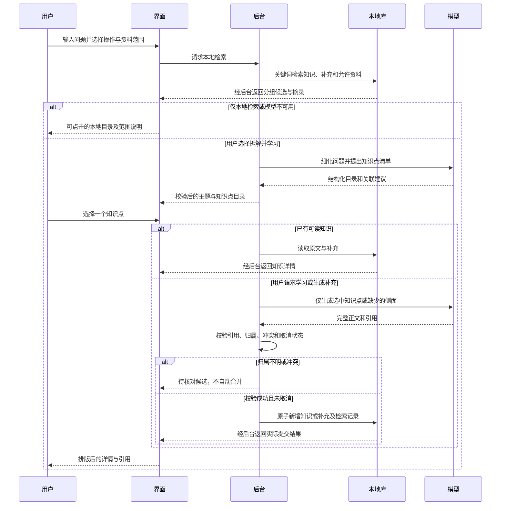
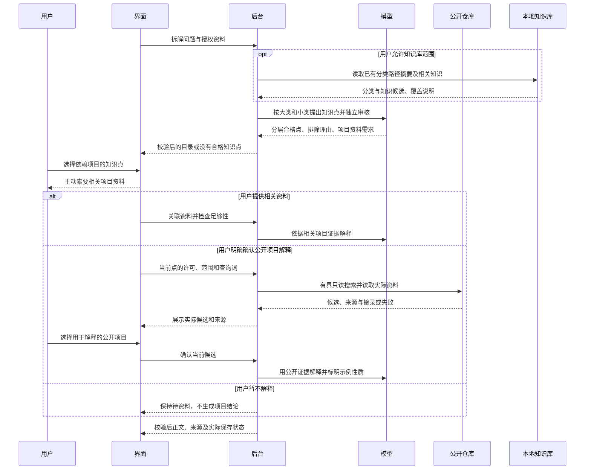
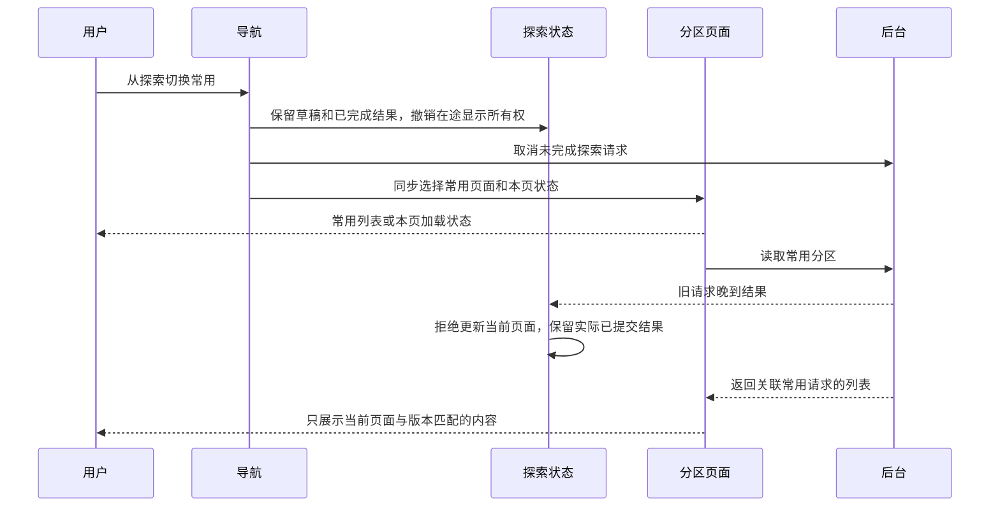
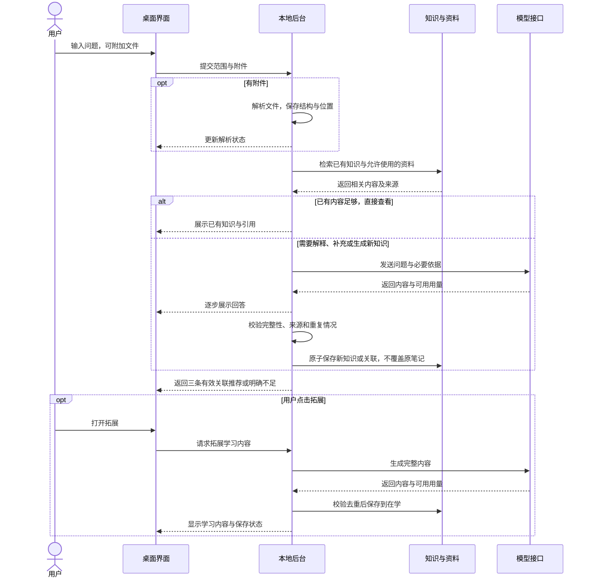

# 个人知识库 Agent：产品方案

> 当前代码为 `test0.03`，修订 4 与修订 6 已实现并通过隔离模拟验证：独立页面、知识分层分类、知识点资格审核、项目资料与联网解释确认、畸形 Markdown 排版修正，产品代码已完成修改和本地验证。修订 6 整合并替代未执行的修订 5。
>
> 简单说：现在先查本地、看目录，再选择知识点学习；新内容核对后追加，原笔记保留。


| 项目 | 当前状态 |
|---|---|
| 方案修订 | 6，已实施并完成本地验证；修订 4 为已实施基线，修订 3 的 API／模型交互继续有效 |
| 更新日期 | 2026-10-20 |
| 内容性质 | v1 产品目标、test0.01 历史支持范围与修订 4 实际支持内容分别标明 |
| 已确认范围 | 桌面应用、本地知识库、API 与用量、A 平衡频率方案、文档提问、本地路径、按需保留资料、所选技术栈、主流模型方向、Windows 11 x64／16GB／无独显验收基准 |
| 开发授权 | 修订 4 历史授权保留；修订 6 已获本轮“进行开发”授权；不自动提交、上传或发布 |
| 实施／验证状态 | 修订 6 已完成实现、Python／协议／桌面隔离验证；真实模型与网络质量不在本地验证范围 |

## 当前可用与限制（保留 test0.01 兼容入口）

已实现桌面窗口、后台自动启动与关闭、SQLite 知识编辑和中文关键词检索、A 频率分区、临时附件、资料保留与删除、引用摘录、可配置生成协议和调用统计。生成完成后检查结构与引用 ID，再事务保存；同标题、相同正文和已完成的同问题复用已有知识。上述复用规则保留在旧 `question` 兼容入口；主提问入口已改为知识点目录，后续新内容经核对以独立补充保存，不被旧问题缓存阻止。

简单说：这次交付可以实际操作的第一版，能写、查、读文件，配置接口后可生成并积累；不会把还没做的功能写成已完成。

| 当前支持 | 实际边界 |
|---|---|
| MD／TXT／DOCX／文字版 PDF | 按文本、正文块或页定位；图片、复杂分栏、页眉页脚可能遗漏，解析说明会显示 |
| 三种本地文件入口 | 路径入口已做桌面流程测试；文件选择和拖放已接入，仍需人工等价性验收 |
| 本地知识与来源 | 正文、使用记录、必要引用摘录存 SQLite；会话副本退出清理；保留资料使用快照，不修改用户原件 |
| 回答与收录 | 已接 Responses、Chat Completions、Anthropic Messages 流式适配并用模拟响应验证；真实服务及内容质量未实测 |
| 三条关联 | 2＋1／1＋2／0＋3 组合通过合成库存测试；不足明确显示，实际推荐质量待真实模型验收；重开旧条目仅恢复已有知识关联 |
| 取消与退出 | 取消生成不收录残缺结果；桌面正常退出和后台挂起后的超时进程树清理已验证 |
| API Key 与用量 | Windows 凭据存储往返已验证；用量缺失显示未知，价格由用户填写并按请求快照估算 |
| 尚未完成 | 语义索引、同义概念去重、OCR、旧 DOC、分层长文总结、独立安装包及完整 v1 验收 |

单文件最多 50MB，PDF 最多 200 页，一次最多 20 个附件。单次证据约 28000 字，全文超限会要求拆分；知识卡片列表最多 200 条，独立搜索覆盖全库，每页 30 条。阅读器安全渲染 Markdown，不执行来源 HTML。内容完整性和依据正确性仍需人工核对，引用 ID 检查不等于结论已获证明。

启动与使用：在项目根目录双击 `启动知序.cmd`，或构建后运行 `npm start`；先新建知识或加入文档，需要生成时再在“API 配置”填写自己的真实接口。连接测试会产生接口调用。详见 [使用说明](../../../README.md)。

简单说：无需先填 Key 就能写笔记、查知识、读本地片段；真实 AI 功能用你配置的接口，产生的费用会留记录。

下文保留完整 v1 产品目标；未在上表声明完成的部分仍为后续目标。

## 1. 目的

面向个人学习建立可检索、可复习、可逐步扩充的知识库，将已有知识检索、文档问答和关联学习连接成一个流程，减少重复查找和笔记分散。

简单说：先找自己已经存过的知识，缺少时帮助学习并留下知识条目，读完再引导你理解相关内容。

目前已有 test0.01 桌面开发测试版，完整 v1 功能仍按下文目标逐步完善。若只做普通聊天，旧知识、文件来源和学习关联很难持续积累，因此第一版重点建设上述闭环。

## 2. 第一版范围

第一版围绕 Windows 11 x64 桌面使用，知识与资料元数据存本地，通过用户配置的模型 API 提供解释、总结、内容生成和可用时的语义检索。验收以 16GB 内存、无需独立显卡的电脑为基准；最低配置、速度和安装体积待实测，不承诺 Windows 10 或其他架构兼容。

简单说：安装后在自己的电脑里管理知识，需要 AI 帮助时才调用配置的接口；本地存储不等于发给外部 API 的内容不会离开电脑。

| 能力 | 第一版计划 |
|---|---|
| 搜索已有知识 | 关键词检索，具备可用向量模型时结合语义检索；展示原有条目与来源 |
| 未知知识学习 | 检索不足时生成学习内容；成功形成的新知识自动收录到“在学” |
| 关联学习 | 正常提供三条有理由的推荐，优先已有知识，至少留一条拓展 |
| 文档提问 | 拖入、粘贴本地路径或点击“＋”加入一个或多个文件后提问 |
| 文档格式 | 核心目标为 MD、TXT、DOCX、文字版 PDF；扫描 PDF／OCR 和旧 DOC 为待确认兼容范围 |
| 知识组织 | 常用／在学／归档，支持自动变化与手动固定 |
| 编辑维护 | 查看、编辑和删除知识；管理主动保存的资料；删除操作明确告知影响 |
| API 与统计 | 多配置、连接测试、模型选择、请求用量与费用估算、失败记录 |
| 本地使用 | 无 API 时仍可浏览和进行关键词检索；生成、外部向量化等功能说明不可用原因 |

跨设备同步、多人协作、浏览器采集、在线 Google Docs／通用网页解析、无人确认的自动联网研究、考试与掌握程度评估、复杂知识图谱展示，以及修改其他应用的 API 配置，不纳入当前第一版基线。修订 6 增加经单次明确确认的公开项目示例检索，具体边界见第 3.6 节。

通俗地说，先把“查、读、存、联想”做完整；频率表示常不常用，不代表已经掌握。

## 3. 搜索、知识点目录和增量积累（修订 4，已实施）

### 3.1 目的、诊断与本轮范围

将一次提问转换为可选择的知识点目录，让同一主题的知识能跨多次提问持续积累。避免整段问题成为条目名称、回答难以阅读，以及补充内容因同标题去重而未保存。

简单说：问题可以很长，留下来的应该是一个个有名称、能找到、能补充的知识点。

实施前代码核查确认（历史诊断，以下缺口已在主入口修复）：`AnswerPanel` 将正文直接作为文本显示，模型提示允许 Markdown，因此会露出 `###`、`**` 和证据 ID；当前本地关键词搜索已经存在，但主要是列表筛选和生成前召回。问答只校验并保存单个标题／正文，没有多知识点结构；程序未强制直接用问题当标题，但也没有阻止这种结果。同问题缓存直接返回旧笔记，同标题不同正文不覆盖也不追加，导致缺少更新通路。截图中的具体标题来源未经真实请求重放，不能断言由程序硬编码生成。

简单说：显示问题来自缺少排版；积累问题来自目前“一问一篇、同名只复用”的流程。

| 方案 | 范围与效果 | 主要代价和风险 | 选择 |
|---|---|---|---|
| 推荐：本地关键词检索＋知识点目录＋增量补充 | 独立本地搜索；模型细化问题；按主题列出知识点；按需学习并追加 | 关键词可能漏同义词，模型可能分错主题，需校验及待核对入口 | 用户已选择 |
| 可选：同期加入本地语义检索 | 在上述流程中额外加入嵌入模型和向量召回 | 增加模型、资源、索引版本与迁移维护，不能消除误归类 | 本轮不采用 |

本轮涉及探索与知识阅读界面、Python 问答与检索用例、跨进程增量契约及 SQLite 增量迁移。主题分类与“常用／在学／归档”相互独立。保留现有接口配置、附件范围、引用、手工笔记及频率规则，不扩展 OCR、联网研究、语义索引、安装包或发布。

简单说：这次集中完成“查、拆、选、读、补”，不把使用频率误当作知识类别。

### 3.2 如何处理提问与本地检索

提供明确的“本地检索”操作：程序在本地检索主题、标题、正文、补充内容及已保留资料的文字块，展示分组结果、相关摘录和来源。搜索不请求模型，不要求 API 或网络；支持中文及多个关键词，结果分页，不能继续静默只扫描最近 5000 条。切换频率分区时显示搜索范围，主界面的“本地检索”固定搜索全部频率分区；目录的附件／混合范围结果则按该次范围分页。临时附件只在本次授权范围使用。

简单说：只想找旧知识时直接在电脑上查；旧笔记里的补充内容也能找到，不必先问大模型。

“拆解并学习”先清理空白、拆出显式分点并取得本地候选；有可用接口时，由模型结合本次问题、允许的资料和候选主题生成结构化知识点清单，再由程序校验。清单使用“主题 → 具体知识点”，一个问题可以对应多个点；标题表达细化后的概念，不把整段原问题原样当标题，也不为简单问题硬拆多个空洞类别。原问题只作为本次查询上下文。

简单说：例如“Qt 怎么接相机、怎么避免界面卡顿、掉线怎么处理”，拆成“相机接入”“采集线程与界面更新”“掉线重连”，分别放到合适主题下。

目录标明“已有知识／待补充／待学习／待核对”。目录最多 16 点，当前会话保留最近 24 份，重启后重新拆解；正式保存的知识和补充不受目录会话过期影响。本地命中不等于内容已完整回答，关键词没命中也不等于不存在同义内容。无接口、接口失败或取消拆解时，保留可点击的本地结果；本地只能做确定性的分点和匹配，不宣称具备完整语义理解。模型只能建议分类与已有条目关联，不能自己执行保存或覆盖。

简单说：大模型负责理解，程序负责查找、检查和组织；大模型不可用时仍能查阅本地内容。

### 3.3 目录选择、正文排版与引用

问题处理完成先展示目录，默认不铺开一篇长回答。点击已有知识直接打开本地详情，不调用模型；点击待学习项后按“学习这个知识点”才生成该知识点，点击待补充项后明确选择“生成补充”。目录占位项尚不是已收录知识，只有详情完整生成、通过校验并保存后才显示已收录。新生成内容自动进入“在学”，背景召回和目录展示不计有效使用，主动阅读仍按原规则计数。

简单说：先看有哪些内容，再点你要看的；没打开、没生成的选项不会被假装存成知识。

正文按 Markdown 语义显示标题、加粗、列表、表格、引用和代码块，代码保留缩进并可横向滚动。有效证据标记显示为可点击的引用序号，可查看来源、位置和摘录；不把长证据 ID 作为主要阅读内容。原始 HTML 和脚本不执行，危险链接被阻止；代码块中的 `**`、`#` 和类似引用的文本保持原样。编辑器保留 Markdown 原文，老笔记无需重写即可改善阅读。

简单说：阅读时看排版后的正文和引用，编辑时仍能修改原文；不能简单删除所有符号，以免破坏代码。

```text
┌ 探索 ───────────────────────────────────────────────┐
│ 问题…… [添加文档] [范围 ▾]                          │
│ [本地检索] [拆解并学习]   接口／模型／强度            │
├ 知识目录 ────────────────┬ 知识详情 ─────────────────┤
│ Qt／设备接入            │ 选择左侧知识点查看内容      │
│  · 相机接入 [已有知识]  │                            │
│ Qt／线程与交互          │ 标题、列表、表格、代码      │
│  · 采集线程 [待补充]    │ 原有内容                    │
│ Qt／可靠性              │ 新增补充 · 日期 · 来源      │
│  · 掉线重连 [待学习]    │ [引用 1] [引用 2]           │
│                         │ [生成补充] [编辑原笔记]     │
└─────────────────────────┴────────────────────────────┘
```

窄窗口中目录与详情改为上下排列；返回目录保留本次结果和已完成状态。原有三条关联推荐保留在知识详情中，不用推荐卡片替代本次问题拆出的知识目录。

### 3.4 同主题的后续补充

主题及知识点采用稳定标识；后续提问按细化点查找已有条目。新侧面形成同一知识点下的独立补充，保留时间、生成模型、来源和引用；不同侧面过大时形成同主题下的独立知识点。新内容不能因问题相同或标题相同而直接丢弃，也不将整个旧正文替换成新回答。

简单说：后面又问到了相机断线的退避策略，就补在“掉线重连”下，原来的内容还在。

完全重复的补充只复用，不重复写入；可确认归属的新内容追加保存。仅名称相似、跨上下文同名或与旧结论冲突时，显示待核对候选，让用户选择关联目标或保留为独立知识；不自动把相反结论合成一个事实。手工编辑的原正文不被模型覆盖；补充也能单独编辑和删除，删除知识点时说明会同时移除所属补充与索引，不删除用户原文件。

简单说：同一知识越积越丰富，但不能“名字差不多就合并”，更不能把你改过的笔记改回去。

同一详情的并发点击、重试和重复终态必须幂等；不同问题同时补充同一知识点也要在提交时重新检查目标和重复内容。每个知识点或补充独立原子提交：取消只丢弃未提交结果，已经保存的其他知识点保留并如实显示。模型或保存失败不能显示收录成功，不自动重试增加费用。

### 3.5 预期效果、用法及迁移风险



使用时，“本地检索”只查本地，“拆解并学习”可能调用所选模型；已有目录项直接打开，缺少的内容按需生成。详情同时显示原有内容、历次补充、来源及生成性质。没有外部证据时，不编造参考链接、核实标记或“文档已证明”的结论。

简单说：找旧知识免费离线可用；让模型拆解、学习和补充会产生调用记录，只生成你要看的内容。

预期验收包括：离线能查到旧条目与补充；一个含多个问题的输入变成多个具体知识点；阅读中不裸露 Markdown 标记；后续新信息能追加、重启仍在；重复点击不重复保存；取消和失败不污染知识。

简单说：最终要实际验证“看得懂、找得到、能选择、补得进去”，不能只把目录画出来。

分类、补充和检索数据需要 SQLite 从版本 2 增量到 3。迁移前创建一致性恢复点，失败回滚并阻止继续写入；重复启动不重复迁移。旧条目保留 ID、标题、正文、引用、手工编辑、频率和凭据位置，初始可列为未分类，不批量调用模型改写或重新归类。只有用户后续使用并确认关联时才逐步组织。

简单说：升级不重写旧知识；先留好恢复点，旧内容照常可查，再在使用中整理。

主要风险是模型拆错知识点、同义内容漏检、同名内容误归并、迁移失败和多阶段调用增加费用。控制措施是本地结果保底、显式范围、校验后提交、模糊归属待核对、恢复点及逐次调用记账；不能承诺自动分类或知识事实完全正确。必要配套仅限本轮契约、迁移、依赖与验证，不包含其他模块清理。本轮行为已通过隔离数据与模拟接口验证；真实模型质量、正式数据迁移及性能尚未验证。

### 3.6 知识点审核、项目说明与阅读修正（修订 6，已实施）

目的：在目录展示前判断候选是否为可独立学习、解释和复用的概念、原理、方法或实践；项目相关结论先取得必要资料；阅读器兼容明确的模型排版错误。

简单说：先判断“这算不算知识”，涉及你的项目先问你要依据，正文应当像文章一样阅读。

#### 修改前原因与证据边界

- `PLAN_SYSTEM` 只要求拆成 1–16 项，`validate_plan` 仅检查结构、标题、重复、候选和引用。没有知识资格判断，且强制至少一项，容易把工作经历、操作要求或文档整理任务硬拆成知识点。
- `TopicWorkflow.learn/generate` 从目录直接进入模型生成，契约没有项目缺口、资料确认或联网许可状态；已有附件也未被判断是否足以支持项目结论。当前供应商请求没有联网工具，不能声称已在网上找过项目。
- 截图中的星号原因用当前 `react-markdown` 依赖合成复现：`**整体开发与设备接入： **独立负责` 显示字面星号，`**整体开发与设备接入：** 独立负责` 正常加粗。此前桌面测试只有合法加粗，本轮已补入该类输入及原文不变验证。截图对应的实际数据库正文未读取，具体原文仍未核实。

简单说：以前检查了格式是否合法，却没判断内容适不适合收录；排版组件已经有了，但不能自动理解写错的 Markdown。

#### 完整处理方案

1. **候选先审核。** 拆分后增加独立的语义审核阶段，返回保留／排除／待澄清及理由。可复用的“有限状态机”“线程间结果传递”可保留；“简历整理稿”、公司名称、任职日期、项目名称、纯职责描述、重复项和空泛标题不单独作为知识点。工作经历中真实体现的方法可抽为知识，不因来自简历而全部排除。允许零个合格点，并说明原因；被排除项可展开查看，用户可补充问题后重新拆解。待澄清项不进入自动学习或收录，审核失败保留本地结果，不直接放行未经审核的候选。
2. **项目依据先补齐。** 针对“这个项目为何采用某方案、代码如何实现”等依赖具体项目的点，展示项目点标题、需要的资料与缺少的内容，先邀请用户提供相关说明、支持格式的文件或代码片段。复用现有附件入口，不读取整个项目目录、不扫描仓库或导入压缩包。资料需要关联到当前点并核对相关性；无关文件不能解锁项目解释。能独立解释的通用概念可以正常学习，不能冒充用户项目事实。
3. **公开示例需单独确认。** 未提供足够项目资料时，默认停留在“待项目资料”。用户可从探索入口加入相关附件并检查资料；也可以暂不解释，或确认本点公开示例范围和查询词后进行检索。学习按钮、文档中的指令、模型建议和旧目录许可都不构成联网授权。“仅本次文件”仍可在当前知识点上明确勾选“本点公开示例”并再次同意；范围、查询词或附件变化会撤销旧许可。
4. **确认后真实检索。** 使用有界的 GitHub 公开仓库搜索与 README 读取，依据已展示的通用技术关键词检索，最多选择三个候选供用户确认，再解释选中的公开项目。查询词允许用户编辑，不自动发送用户项目名、私有代码或附件正文给搜索接口。只读公开资料，不克隆、下载运行项目，也不访问任意模型提供的链接。结果记录仓库 URL、实际读取位置、摘录与检索时间；没有实际读取证据不得标成“已检索”。网络失败、限流或没有合适项目时明确停止，不能用模型记忆伪装搜索结果。
5. **确认与结果绑定。** 许可仅用于当前目录项、资料范围和展示的查询词；变更目录项、问题或范围后重新确认。取消、切页、目录过期、移除关联资料后，旧授权和晚到结果不得解锁新解释；已提交内容按实际保存结果显示。解释与入库区分用户项目证据和公开示例，公开项目不能被写成用户实际完成的工作。
6. **按语法修排版。** 生成提示要求合法的标题、加粗和列表；展示前仅对以冒号结尾的成对加粗标签修正结束边界空格，不全局删 `*`、`#`。跳过代码块、行内代码、转义文本、链接目标及无法判定的星号表达式，保留编辑原文、合法列表和引用。旧笔记不批量重写；非知识类回答仍可展示，但不自动成为知识点或正式知识。

简单说：先筛一次，再按需要向你要项目；你同意后才找公开示例，并清楚区分“你的项目”和“参考项目”。星号修正在阅读时生效，代码和原笔记不会被乱删。

```text
┌ 知识目录 ─────────────────┬ 选中知识点 ──────────────────────┐
│ 状态机 [待项目资料]       │ 状态机如何应用于工件流转          │
│ 线程间结果传递 [待学习]   │ 需要：流程说明、相关代码片段      │
│ [查看排除项及原因]        │ [检查本次附件] [撤销许可]         │
│                          │ [勾选本点公开示例] [同意并检索]      │
│                          │ 查询词：Qt 状态机 工件流转 [编辑] │
│                          │ 检索后：候选项目、来源、选择解释   │
└──────────────────────────┴──────────────────────────────────┘
```



#### 效果、代价与验收

验收时，同一份含公司、日期、职责和技术方法的合成简历，只将可复用方法纳入目录；全是整理任务时返回零个知识点。项目资料不足时，后台拒绝绕过界面的生成或搜索；无关附件、过期许可和取消后的结果不能放行。确认后能看到真实公开来源，失败不得生成“已查证”的结论。截图同类文本正常加粗，代码、列表和引用保持语义。

简单说：不仅看按钮有没有出现，还要验证模型没有越过你的选择、没把任务当知识，也没破坏代码排版。

独立审核比现状通常多一次模型调用，资料足够性分析也可能产生调用，均逐次记账、没有自动重试。语义判断仍会误判；排除理由和待澄清状态用于恢复。GitHub 公开项目覆盖不全且可能限流，失败时回到提供资料或暂不解释。受限排版兼容不能保证修好任意损坏 Markdown。错误修复须重点防止将乘法、指针、转义星号或用户手工内容误作格式标记。

简单说：更严格的判断会增加时间和用量；联网找不到时如实停下，不保证任何一句模型输出都能自动排好版。

本轮已修改目录规划、单点学习与相关生成入口、附件关联、受限跨进程契约、公开项目只读适配、安全阅读组件及对应测试；修订 6 另增加第 3.7 节独立页面及第 3.8 节分层分类。第 3.6–3.8 节合为本轮完整已实施范围。不改数据库结构，不批量清理旧知识，不自动获取正式凭据、不做付费接口验证、不递增版本、不提交或发布。

### 3.7 探索与知识分区为独立页面（修订 6，已实施）

目的：探索、常用、在学、归档分别呈现自己的内容和交互状态，进入知识分区的第一屏即为该分区列表或加载／空状态。探索中搜过什么、看过什么，不应占据另一个页面。

简单说：点“常用”就先看常用知识，不再先看到探索的输入框、结果和回答。

修改前原因：`useNavigation.bodySection` 将四个入口视为同组；`AppContent` 对它们统一挂载 `ExplorationPage`，该组件始终包含输入、目录、回答、推荐与列表。`useAppModel` 组合的阅读、探索目录和回答未按页面隔离。`useLibrary` 切换后等待 160 毫秒才刷新，原列表在新响应前继续保留，因此还存在首屏短暂显示上一分区条目的风险。切页 effect 目前只撤销异步选择并取消任务，没有隔离已经显示的内容。以上是修改前的源码诊断；修改后的首帧、迟到响应和滚动恢复已通过隔离桌面回归。

简单说：现在主要换了标题和列表条件，页面主体及内容状态没有真正分开；只清空一次回答也修不完整。

现将探索单独路由到探索页面，常用／在学／归档各自路由到知识分区页面，可复用相同的分区组件实现。分区首页只显示本区列表、筛选、新建入口及本区主动打开的详情，不挂载探索输入、目录或探索推荐。探索保留自己的问题、附件、检索结果、目录与已完成回答，返回时可以继续；四个入口的筛选、选中项和阅读上下文按页持有，切换不能相互覆盖。首次进入分区不自动打开探索选择的知识。

简单说：组件可以复用，页面的内容和选择必须各管各的；回来探索时也不用重新输入问题。

导航提交时同步切换页面显示归属，列表结果须与当前页面、筛选词和请求版本匹配后才显示；无匹配结果先显示本页加载状态，不能拿旧列表填空。请求尚未完成时也能切页；晚到的成功、错误、进度或清理回调不能写入当前其他页面，不能把用户拉回探索。继续执行既有切页取消策略，已提交知识保留并如实报告；新请求不被旧请求的 `finally` 清除。探索中的附件仍由会话持有，切页不删除用户原件；未保存编辑草稿不因页面隔离静默丢失。页面首屏与滚动位置按页管理，首次进入分区从列表顶部开始。

简单说：切页立即生效，等接口返回时也不闪回旧内容；取消未完成任务，不把已经保存的知识说成撤销。

```text
[探索] → 问题／附件 → 分层目录 → 本次结果与解释
[常用] → 常用列表／本页筛选 → 本页主动打开的详情
[在学] → 在学列表／本页筛选 → 本页主动打开的详情
[归档] → 归档列表／本页筛选 → 本页主动打开的详情
```



风险是状态隔离时漏接打开、编辑、推荐、提示或取消回调，导致原来可用的保存流程失去刷新；必须覆盖四页互切、慢列表、后台失败、已提交竞态及未保存草稿。此修改不改变常用／在学／归档的频率规则，存储仍为同一知识库。

简单说：分开的是页面操作，不是复制四份知识，也不改变知识什么时候进入常用或归档。

### 3.8 参考已有知识的大类、小类与知识点（修订 6，已实施）

目的：结合用户问题、允许访问的已有知识分类和模型推断，以“大类 → 小类 → 知识点”组织目录。项目中的具体实现与 C++ 等语言知识、框架知识、通用设计方法分别归类；不把全部内容混进一个项目标题下。

简单说：先看属于哪一大类，再看小类，最后才是能独立学习的一条知识。

历史诊断：旧目录只有自由字符串 `theme`，无法表达层级；现已增加兼容的 `category`／`subcategory` 字段和全库分类摘要，旧主题仍原样保留。

先读取已授权知识库的分类路径摘要和相关知识候选，优先沿用含义匹配的现有大类／小类；模型再依据问题推断必要的新类，独立审核检查分类是否合理。已有分类不匹配时不强行套入，来源不足或歧义大的点待澄清。分类摘要来自全库路径汇总能力，不从最近列表或六个候选冒充全库；送入模型的上下文仍有上限，选取和遗漏范围须说明。“仅本次文件”继续禁止读取或发送库内分类与知识，改为根据本次文件和问题推断。

简单说：先参考你已经整理过的分类，确实没有合适的再新建；你选择只用文件时，就只分析文件。

例如以下为可能的目录，实际分类随问题与已有库确定，不硬编码成唯一类别：

```text
项目实践
  工业视觉压字码上位机
    工件流转的具体实现 [待项目资料]
编程语言
  C++
    RAII 与资源释放
    值语义与对象生命周期
框架与工具
  Qt
    信号槽与跨线程调用
软件设计
  并发与通信
    有界队列与背压
```

项目名称可以是分类上下文，但名称、公司、日期本身仍不能作为合格知识点。项目中的“队列如何与设备应答衔接”归项目实践；可跨项目复用的“有界队列与背压”归通用设计。允许通过说明或关联表达两者的关系，不为每个项目复制一份相同通识，也不把不同项目的实现当成同一事实自动合并。

简单说：同样提到队列，通用原理和你项目中的用法可以相关，但应分清内容归属与证据。

目录按大类和小类分组显示，叶子是具体知识点及学习状态；常用／在学／归档是使用分区，与知识分类独立。新增知识保存规范分类路径，并在后续提问、阅读、搜索和补充中继续沿用。保持现有数据库结构，以兼容的主题路径保存新分类；旧笔记不自动搬动、改名或合并，旧平面主题未能可靠拆分时继续原样显示并标为旧分类，不猜测层级。只有用户已授权的目录生成才调用模型，不批量对旧库重新分类。

简单说：新知识按层级积累，旧知识先保住；“C++”不会因为你经常看就变成“常用”这个类别。

验收覆盖混合项目／C++／Qt 问题、已有分类复用、新类推断、无合适类、同名不同义、严格文件范围、旧主题兼容、分类保存后重启及再次规划。主要风险是模型误分类、同义分类漂移和旧主题误解析，须保留可见分类依据与待核对状态，禁止自动覆盖已有身份。

简单说：不只看树形目录画出来，还要验证分类能保存、后面能复用、不同含义不会被乱合并。

## 4. 文档提问

### 4.1 输入与解析

文档入口统一放在搜索框：拖入文件、点击“＋”选文件、或粘贴本地文件路径。附件显示名称、移除按钮及待解析／解析中／可提问／失败状态。仅有路径而无法访问文件时，提示具体问题，不假装已经读到内容。

简单说：文件先成为本次提问的附件，再由搜索框里的问题决定回答什么。

本地路径是用户已确认的第一版边界。HTTP 文件链接、网页链接与在线文档不属于第一版支持范围。空问题不自动触发付费总结，可提示用户输入问题或主动选择总结。

解析保存标题、正文、代码块、表格及可获得的来源位置。短文档可整体处理，长文档按结构拆分并检索；全文总结应覆盖全文，可分段汇总，不能只用几个相似片段冒充全文阅读。多文件问题需要明确引用各文件。

### 4.2 回答依据与范围

带附件时，默认采用“本次文件＋知识库”，以本次文件为主要依据，已有知识为明确标注的补充；提供“仅本次文件”和“仅知识库”切换。没有附件时默认检索知识库。

简单说：你能看到答案来自刚加入的文件、旧笔记，还是模型额外补充的解释。

“仅本次文件”范围找不到依据时，回答“文档中未找到足够依据”，不自动补入未标明的通识结论；混合范围可以提供标注后的补充。冲突资料并列说明，不静默选成同一个事实。

回答引用跳到 PDF 页码、DOCX 标题／段落、MD 标题／行或段落等实际可获得的位置。DOCX 不承诺固定页码。解析不到可靠位置时降低定位精度并说明，不伪造页码。

### 4.3 资料按需入库，知识自动积累

本次附件默认用于会话，不自动成为长期资料。“加入资料库”才保存受管理的原文件和索引；问答中成功形成的可复用新知识自动进入“在学”，保留相关引用摘录和来源位置。

简单说：问过的新知识留下来，整本书是否长期保存由你决定。

| 对象 | 保存与清理 |
|---|---|
| 临时附件 | 会话期间可连续追问；会话结束后清理应用临时副本，不删除用户原文件 |
| 新知识 | 保存概念内容、引用摘录、文件名／版本指纹和位置；去重后新增或关联 |
| 主动入库的资料 | 保存应用管理的原文件副本与索引，供以后无附件检索；用户修改原路径文件不会自动改变已保存副本 |
| 原文件未长期保存时的引用 | 仍显示保留的摘录与位置；明确提示完整原文未保留，可重新选择匹配文件 |

并非每一句闲聊、错误提示或重复回答都新建条目；自动收录针对完整、可复用的新知识。具体知识提取与去重效果需要样例验收。用户删除资料时说明引用和索引的处理；已有知识可保留摘录并标记来源原文已移除。

## 5. 固定三条关联推荐

推荐必须与当前知识有关、互不重复，并附一句关联理由。已有知识优先，但不为了数量混入无关条目。

简单说：既告诉你“接下来可以看什么”，也告诉你“为什么值得接着看”。

| 足够相关且不重复的已有知识数 | 正常推荐组合 |
|---|---|
| 至少 2 条 | 2 条已有＋1 条拓展 |
| 1 条 | 1 条已有＋2 条拓展 |
| 0 条 | 3 条拓展 |

关联包括前置基础、原理相似、容易混淆和应用场景，不仅是同义词。附件里出现但尚未形成知识条目的概念，可作为“文档内待学习”的拓展，不计为已有知识。

拓展卡片先给标题、理由和简述，点击后才生成完整学习内容，生成成功自动收录到“在学”。重复点击或同一概念已收录时打开已有内容，不重复新建。失败时显示重试入口；若无法形成三条有效推荐，明确显示不足或失败，不能编造条目凑数。

## 6. 常用／在学／归档

分区按近期使用频率变化，支持手动固定和恢复自动管理；自动归档不会删除内容。新知识默认进入“在学”，已归档知识仍可被检索、打开和重新激活。

简单说：常用内容更容易找到，暂时不用的收起来；经常查询不等于已经学会。

用户已选择 A 平衡方案，以下为第一版频率规则。日内重复打开只计一个使用日，后台行为不增加热度。

| 规则 | 已确定的 A 平衡方案 |
|---|---|
| 有效使用 | 用户主动打开知识详情；后台召回、自动生成和只展示推荐不计入 |
| 防重复计数 | 同一知识在同一用户本地自然日内，多次打开只算一个有效使用日 |
| 常用 | 最近 14 天至少有 3 个有效使用日 |
| 归档 | 已收录至少 30 天，且最近 30 天没有有效使用 |
| 在学 | 其余自动管理知识；新收录不因零点击立即归档 |
| 手动固定 | 覆盖自动分区，直到用户恢复自动管理 |

常用知识不再满足频率条件时回到“在学”；归档知识重新主动打开后回到“在学”，满足常用条件后可再次进入“常用”。手动固定优先。

统计以记录时的本地日期和时区为依据，不因切换显示时区悄悄重写历史。阈值允许调整；改变阈值只重新计算自动分区，不丢弃使用记录。14／30 天是产品分区规则，不代表科学记忆规律或掌握程度。

## 7. API 配置与用量

应用管理自身使用的供应商、接口地址、凭据和模型，为内容生成与语义检索分别配置。不同供应商通过适配层接入，不把“兼容接口”理解为所有协议完全一致。

简单说：在应用里管理自己的接口，按接口真实支持的方式调用模型。

### 7.1 已实现：接口编辑和模型选择（修订 3）

本次沿用现有 API 配置与提问功能，补齐配置维护及每次生成的模型选择。此前后台已有按原配置 ID 更新、Key 留空复用原凭据的逻辑，但界面只有添加入口；前后端都把单个必填模型当作默认模型，尚无模型列表和推理强度参数。

简单说：此前缺少编辑入口和临时换模型能力，本轮已把界面和实际请求一起补齐。

| 功能 | 当前行为 |
|---|---|
| 编辑已有 API | 卡片增加“编辑”，复用表单并显示“保存修改／取消”；保存沿用原 ID 和当前接口状态，不新增重复配置；取消不保存 |
| 编辑 Key | 不读取或显示旧 Key；编辑时留空保留，填写新值替换；新增接口仍须填写 Key |
| 获取模型 | 使用当前表单的协议、地址和新 Key；编辑且 Key 留空时由后台使用该配置的旧凭据。请求模型列表，不发送问题、文档或生成测试 |
| 模型列表 | 获取后在表单合并、去重；允许手动添加／移除模型 ID。获取失败保留已有列表，允许继续手动配置；点击保存才持久化 |
| 可空默认模型 | 下拉第一项为“不设置默认模型”；模型列表和默认值都可留空并保存；有默认值时必须属于列表 |
| 主界面模型 | 输入框下方显示当前接口和模型菜单。可选“使用接口默认模型”或列表里的具体模型；显式选择优先，不改配置默认值；切换接口不串用另一接口的选择 |
| 未选择模型 | 有接口默认值则使用；没有则显示“请选择模型”。本地检索照常可用，确需生成或测试连接时先提示选择，不发送空模型、不猜第一个模型 |
| 推理强度 | 主界面提供独立菜单，默认“由模型决定”（不发送强度参数）。按实际协议提供可用档位，详见技术设计；切换模型重置为默认，避免沿用不兼容值 |
| 请求状态 | 提交时固定接口、模型和强度；生成中锁定这些控件。列表获取有独立加载／失败状态，表单切换或地址、协议、Key 变化后忽略旧响应 |

使用时，在 API 页面编辑或新增接口，获取或手动添加模型，按需选择默认模型并保存；回到主界面可临时改选模型和强度，再提问或点击关联拓展。临时选择仅在本次应用会话内按接口保留，重启重新使用接口默认值；列表修改在保存后生效，无需重启。隔离桌面测试已验证编辑、获取、空默认、问题选择及请求负载。

简单说：常用模型可以预设，也可以每次在主界面选；强度跟着这次问题走，不会改掉接口设置。

```text
┌ API 配置 ─────────────────────────────────────────────┐
│ 已保存接口：我的接口  [使用中]  [编辑] [测试连接] [删除] │
│ 编辑接口：名称／协议／地址／Key（留空保留）             │
│ 模型列表                 [获取模型列表] [手动添加]      │
│ model-a [移除]     model-b [移除]                      │
│ 默认模型 [不设置默认模型 ▾]                            │
│ 价格／币种                    [取消] [保存修改]         │
└───────────────────────────────────────────────────────┘
┌ 主界面 ───────────────────────────────────────────────┐
│ 输入问题……                                             │
│ [添加文档] [回答范围 ▾]                 [检索并提问]     │
│ 我的接口 · [模型：使用接口默认模型 ▾] [强度：默认 ▾]    │
└───────────────────────────────────────────────────────┘
```

预期结果是已有 API 可直接维护，同一接口可管理多个模型，默认值可省略，普通提问与关联拓展都使用发送时选定的参数。模型列表不保证每个模型都支持文本生成或全部强度；不支持的参数应明确报错，不自动换模型或重试。原有知识复用规则保留，复用结果会明确显示“未调用模型”，切换模型不强制重新生成已有知识。

简单说：选中的模型会用于新调用；如果只是打开已有知识，就如实说明这次没有请求模型。

多模型下价格仍由用户填写，配置价格只对应填写时的默认模型；临时切换其他模型时费用显示未知，改变默认模型时清空旧单价并允许重填，防止套错价格。旧配置的单模型自动作为列表首项及默认值保留，凭据标识与知识数据位置不变。获取模型不等于测试生成，生成连接测试仍可能产生费用，未选模型时必须先选择。

简单说：升级后原来的接口仍能用；不同模型不乱套同一个价格，也不会在获取列表时顺带生成回答。

截图只作为布局和交互参考；不引入截图中的子代理配置、Codex 重启要求或固定型号。本次不增加自动重试、强制重新生成、向量检索或安装包交付，也不调用真实凭据验证。

### 7.2 继续有效的接入与记账规则

首批接入方向已确定：GPT 优先，同时支持 DeepSeek、Claude、Grok 等主流模型。具体型号可配置，不写死“最新型号”；通过供应商适配层区分协议，实际使用官方接口还是中转接口、可用模型与额度仍需确认。

简单说：这些主流模型都列入接入目标，GPT 优先；换供应商时按真实接口适配，不能只换模型名称就宣称兼容。

生成模型和向量模型独立配置，聊天能力不代表有向量能力。切换生成模型不要求重建知识库；切换向量模型可能需要重建语义索引，但知识正文保留。具体协议、能力和价格需查阅对应接口资料并实测，不在本文承诺最新型号或单价。

调用记录包含用途、配置标识、模型、时间、耗时、结果、接口实际返回的用量和费用估算。重试、拓展生成和向量化分别记录，不能重复合计。缺失用量标为未知，不能用零冒充；预估费用与供应商账单区分。

API Key 使用操作系统凭据能力保存，不放入普通配置、知识库正文或日志。调用外部模型时会发送必要的问题和相关片段；优先减少无关内容，不能声称本地保存就代表全程离线。

连接失败、接口超时、模型不可用时保留已有知识浏览和关键词搜索；未配置向量模型时说明退化为关键词检索。每日预算提醒和单次生成上限为建议项，是否纳入首发待确认。

## 8. 界面草图与操作方式

界面围绕一个搜索／阅读主区域，侧栏切换频率分区、资料库、API 配置和用量统计；详情页提供编辑、来源和分区调整。

简单说：主要在一个窗口完成提问和阅读，配置功能放在侧边，不干扰学习。

```text
┌─────────────────────────────────────────────────────────┐
│ 个人知识库                                               │
├──────────┬──────────────────────────────────────────────┤
│ 搜索     │ [输入问题，或拖入文件……               ] [发送]│
│ 常用     │ [＋] [设计说明.pdf ×] [笔记.md ×]               │
│ 在学     │ 范围：[本次文件＋知识库 ▾]  文件状态：可提问    │
│          │ 当前接口 · [模型 ▾] [推理强度 ▾]              │
│ 归档     ├──────────────────────────────────────────────┤
│ 资料库   │ 知识标题                         [在学 ▾]      │
│          │ 回答／知识正文…… [1]                          │
│          │ [1] 设计说明.pdf · 第 12 页 [查看原文]          │
│          │ [编辑] [查看来源] [加入资料库]                 │
│          ├──────────────────────────────────────────────┤
│ API 配置 │ 相关知识                                      │
│ 用量统计 │ [已有＋关联理由] [已有＋关联理由] [拓展＋理由] │
└──────────┴──────────────────────────────────────────────┘
```

使用时先提问或加入附件，等解析就绪后阅读回答，按需打开引用；需要保留整份文件时选择加入资料库，点击拓展则自动积累新知识。后台处理显示进度，支持取消，取消或失败不伪装成保存成功。

## 9. 主要流程

计划先完成解析与检索，再向模型提供有来源的相关内容。完整结果经去重和校验后保存，末尾生成推荐；用户点击拓展时才执行下一次完整学习生成。

简单说：先找依据，再回答和保存；没完成的结果不会混入正式知识。



## 10. 预期效果与边界

验收时应能通过不同表达找回已有知识，带文件获得可追溯回答，成功的新知识只保存一次，推荐按库存情况组成三条，分区按已确定规则变化，调用统计区分真实用量与估算。

简单说：知识能找回来，答案有出处，拓展会留下，常用与少用能分开，花费有记录。

主要风险是复杂 PDF 解析不准、OCR 较慢、模型生成不可靠、语义检索漏召回，以及 Python／OCR 打包增加体积。基础运行库已通过本机开发验证，但不能据此宣称支持全部文档或达到未经测量的引用准确率。

用户要求 OCR 选型先查找现有开源项目；已查阅 RapidOCR、PaddleOCR、Docling 和 OCRmyPDF 官方资料。RapidOCR＋ONNX Runtime 是优先验证候选，Docling 是复杂版面增强候选；此为调研建议，不是用户已确认的最终库组合。调研与来源见 [技术设计](技术设计.md)。

OCR 方案拟逐页判断是否需识别，保留页码与识别位置，优先验证 CPU 路径。OCR 的首发交付、资源准备方式及旧 DOC 兼容范围仍需确定；若延后必须明确支持边界，不能静默忽略扫描页。接下来以已确认的 Windows 基准和代表性文件验证，不能直接把开源说明中的性能当本应用实测。
