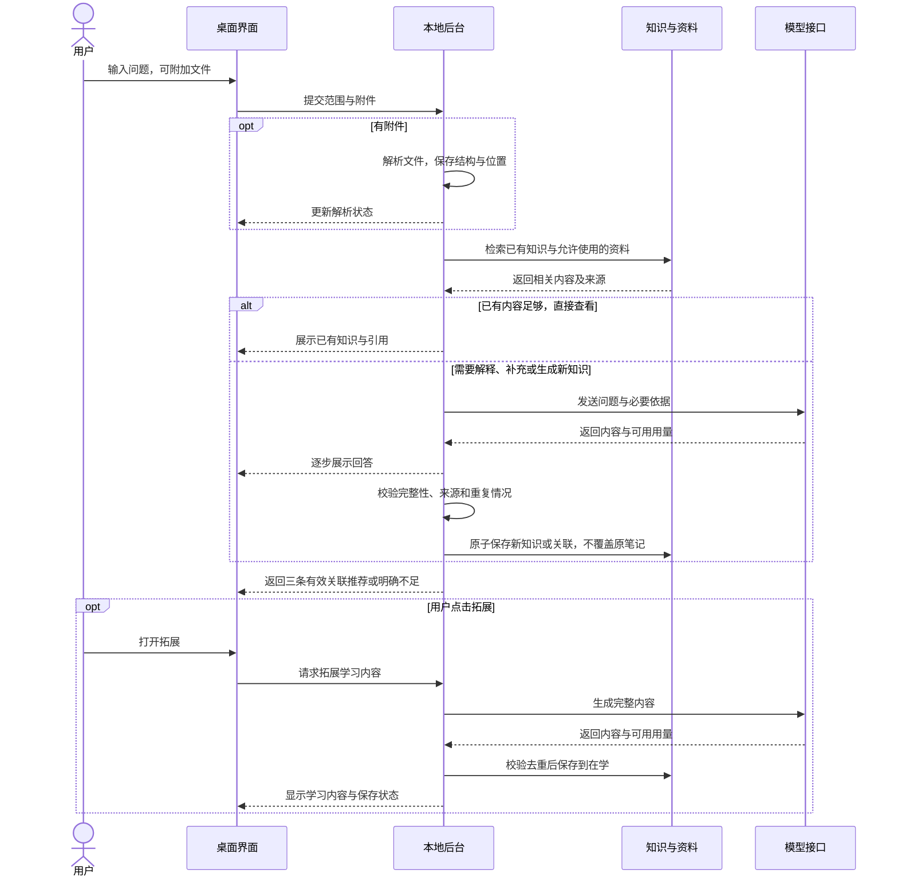

# 个人知识库 Agent：产品方案

> 当前：用户已授权产品开发与本地 Git，开发版本为 `test0.01`。本轮实现可运行测试版，完整 v1 验收仍按本文后续要求逐项进行。OCR、旧 DOC、语义索引、真实接口与干净机器安装不会因开发授权而自动视为通过。
>
> 简单说：现在开始做程序并记录版本；先交付能操作的测试版，没验证的能力明确列出。


| 项目 | 当前状态 |
|---|---|
| 方案修订 | 2 |
| 更新日期 | 2026-10-20 |
| 内容性质 | v1 产品目标与 test0.01 实际支持范围；两者分别标明 |
| 已确认范围 | 桌面应用、本地知识库、API 与用量、A 平衡频率方案、文档提问、本地路径、按需保留资料、所选技术栈、主流模型方向、Windows 11 x64／16GB／无独显验收基准 |
| 开发授权 | 已授权按现有方向开发并加入本地 Git；未决定的首发细节继续保留 |
| 实施／验证状态 | test0.01 已实现并通过本机后台及桌面检查；完整 v1 尚未验收 |

## test0.01 当前可用与限制

已实现桌面窗口、后台自动启动与关闭、SQLite 知识编辑和中文关键词检索、A 频率分区、临时附件、资料保留与删除、引用摘录、可配置生成协议和调用统计。生成完成后检查结构与引用 ID，再事务保存；同标题、相同正文和已完成的同问题复用已有知识。同标题但正文不同的回答明确提示未新建条目，保留原笔记，可手动换标题保存补充。

简单说：这次交付可以实际操作的第一版，能写、查、读文件，配置接口后可生成并积累；不会把还没做的功能写成已完成。

| 当前支持 | 实际边界 |
|---|---|
| MD／TXT／DOCX／文字版 PDF | 按文本、正文块或页定位；图片、复杂分栏、页眉页脚可能遗漏，解析说明会显示 |
| 三种本地文件入口 | 路径入口已做桌面流程测试；文件选择和拖放已接入，仍需人工等价性验收 |
| 本地知识与来源 | 正文、使用记录、必要引用摘录存 SQLite；会话副本退出清理；保留资料使用快照，不修改用户原件 |
| 回答与收录 | 已接 Responses、Chat Completions、Anthropic Messages 流式适配并用模拟响应验证；真实服务及内容质量未实测 |
| 三条关联 | 2＋1／1＋2／0＋3 组合通过合成库存测试；不足明确显示，实际推荐质量待真实模型验收；重开旧条目仅恢复已有知识关联 |
| 取消与退出 | 取消生成不收录残缺结果；桌面正常退出和后台挂起后的超时进程树清理已验证 |
| API Key 与用量 | Windows 凭据存储往返已验证；用量缺失显示未知，价格由用户填写并按请求快照估算 |
| 尚未完成 | 语义索引、同义概念去重、OCR、旧 DOC、分层长文总结、独立安装包及完整 v1 验收 |

单文件最多 50MB，PDF 最多 200 页，一次最多 20 个附件。单次证据约 28000 字，全文超限会要求拆分；知识列表最多 200 条，关键词扫描最近 5000 条。阅读器安全显示正文文本，不执行来源 HTML。内容完整性和依据正确性仍需人工核对，引用 ID 检查不等于结论已获证明。

启动与使用：在项目根目录双击 `启动知序.cmd`，或构建后运行 `npm start`；先新建知识或加入文档，需要生成时再在“API 配置”填写自己的真实接口。连接测试会产生接口调用。详见 [使用说明](../../../README.md)。

简单说：无需先填 Key 就能写笔记、查知识、读本地片段；真实 AI 功能用你配置的接口，产生的费用会留记录。

下文保留完整 v1 产品目标；未在上表声明完成的部分仍为后续目标。

## 1. 目的

面向个人学习建立可检索、可复习、可逐步扩充的知识库，将已有知识检索、文档问答和关联学习连接成一个流程，减少重复查找和笔记分散。

简单说：先找自己已经存过的知识，缺少时帮助学习并留下知识条目，读完再引导你理解相关内容。

目前已有 test0.01 桌面开发测试版，完整 v1 功能仍按下文目标逐步完善。若只做普通聊天，旧知识、文件来源和学习关联很难持续积累，因此第一版重点建设上述闭环。

## 2. 第一版范围

第一版围绕 Windows 11 x64 桌面使用，知识与资料元数据存本地，通过用户配置的模型 API 提供解释、总结、内容生成和可用时的语义检索。验收以 16GB 内存、无需独立显卡的电脑为基准；最低配置、速度和安装体积待实测，不承诺 Windows 10 或其他架构兼容。

简单说：安装后在自己的电脑里管理知识，需要 AI 帮助时才调用配置的接口；本地存储不等于发给外部 API 的内容不会离开电脑。

| 能力 | 第一版计划 |
|---|---|
| 搜索已有知识 | 关键词检索，具备可用向量模型时结合语义检索；展示原有条目与来源 |
| 未知知识学习 | 检索不足时生成学习内容；成功形成的新知识自动收录到“在学” |
| 关联学习 | 正常提供三条有理由的推荐，优先已有知识，至少留一条拓展 |
| 文档提问 | 拖入、粘贴本地路径或点击“＋”加入一个或多个文件后提问 |
| 文档格式 | 核心目标为 MD、TXT、DOCX、文字版 PDF；扫描 PDF／OCR 和旧 DOC 为待确认兼容范围 |
| 知识组织 | 常用／在学／归档，支持自动变化与手动固定 |
| 编辑维护 | 查看、编辑和删除知识；管理主动保存的资料；删除操作明确告知影响 |
| API 与统计 | 多配置、连接测试、模型选择、请求用量与费用估算、失败记录 |
| 本地使用 | 无 API 时仍可浏览和进行关键词检索；生成、外部向量化等功能说明不可用原因 |

跨设备同步、多人协作、浏览器采集、在线 Google Docs／网页解析、自动联网研究、考试与掌握程度评估、复杂知识图谱展示，以及修改其他应用的 API 配置，不纳入当前第一版基线。

通俗地说，先把“查、读、存、联想”做完整；频率表示常不常用，不代表已经掌握。

## 3. 搜索和知识收录

系统先检索本地知识；已有足够内容时优先展示原条目，只有部分内容时明确缺口，确无足够依据时再生成学习内容。不能仅凭关键词没命中，就断言知识库中不存在同义知识。

简单说：换一种说法也尽量找到旧笔记，避免把同一个概念重复保存多次。

| 检索情况 | 用户看到的结果 | 保存规则 |
|---|---|---|
| 已有足够知识 | 原有条目、相关片段及来源，可进一步请求解释 | 不重复新建条目 |
| 只有部分相关内容 | 已有知识与待补充部分分开展示 | 补充形成独立关联内容或经用户操作合并；不静默覆盖个人笔记 |
| 缺少相关知识 | 整理后的学习内容，明确其生成性质 | 成功且完整的新知识自动进入“在学” |
| 请求失败或取消 | 已有本地结果及失败／取消状态 | 不将残缺的生成内容保存成正式知识 |

学习内容按问题复杂度组织，通常包括概念、原理、使用方式、例子、误区和相关知识；不强迫简单问题使用冗长模板。未知不等于必须给出确定答案，存在争议或依据不足时应标明不确定性。

自动收录内容保留生成标记、时间、模型信息和实际来源。没有检索到外部资料时，不编造参考链接或“已核实”标记。个人编辑内容与 AI 建议的修改应可区分。

## 4. 文档提问

### 4.1 输入与解析

文档入口统一放在搜索框：拖入文件、点击“＋”选文件、或粘贴本地文件路径。附件显示名称、移除按钮及待解析／解析中／可提问／失败状态。仅有路径而无法访问文件时，提示具体问题，不假装已经读到内容。

简单说：文件先成为本次提问的附件，再由搜索框里的问题决定回答什么。

本地路径是用户已确认的第一版边界。HTTP 文件链接、网页链接与在线文档不属于第一版支持范围。空问题不自动触发付费总结，可提示用户输入问题或主动选择总结。

解析保存标题、正文、代码块、表格及可获得的来源位置。短文档可整体处理，长文档按结构拆分并检索；全文总结应覆盖全文，可分段汇总，不能只用几个相似片段冒充全文阅读。多文件问题需要明确引用各文件。

### 4.2 回答依据与范围

带附件时，默认采用“本次文件＋知识库”，以本次文件为主要依据，已有知识为明确标注的补充；提供“仅本次文件”和“仅知识库”切换。没有附件时默认检索知识库。

简单说：你能看到答案来自刚加入的文件、旧笔记，还是模型额外补充的解释。

“仅本次文件”范围找不到依据时，回答“文档中未找到足够依据”，不自动补入未标明的通识结论；混合范围可以提供标注后的补充。冲突资料并列说明，不静默选成同一个事实。

回答引用跳到 PDF 页码、DOCX 标题／段落、MD 标题／行或段落等实际可获得的位置。DOCX 不承诺固定页码。解析不到可靠位置时降低定位精度并说明，不伪造页码。

### 4.3 资料按需入库，知识自动积累

本次附件默认用于会话，不自动成为长期资料。“加入资料库”才保存受管理的原文件和索引；问答中成功形成的可复用新知识自动进入“在学”，保留相关引用摘录和来源位置。

简单说：问过的新知识留下来，整本书是否长期保存由你决定。

| 对象 | 保存与清理 |
|---|---|
| 临时附件 | 会话期间可连续追问；会话结束后清理应用临时副本，不删除用户原文件 |
| 新知识 | 保存概念内容、引用摘录、文件名／版本指纹和位置；去重后新增或关联 |
| 主动入库的资料 | 保存应用管理的原文件副本与索引，供以后无附件检索；用户修改原路径文件不会自动改变已保存副本 |
| 原文件未长期保存时的引用 | 仍显示保留的摘录与位置；明确提示完整原文未保留，可重新选择匹配文件 |

并非每一句闲聊、错误提示或重复回答都新建条目；自动收录针对完整、可复用的新知识。具体知识提取与去重效果需要样例验收。用户删除资料时说明引用和索引的处理；已有知识可保留摘录并标记来源原文已移除。

## 5. 固定三条关联推荐

推荐必须与当前知识有关、互不重复，并附一句关联理由。已有知识优先，但不为了数量混入无关条目。

简单说：既告诉你“接下来可以看什么”，也告诉你“为什么值得接着看”。

| 足够相关且不重复的已有知识数 | 正常推荐组合 |
|---|---|
| 至少 2 条 | 2 条已有＋1 条拓展 |
| 1 条 | 1 条已有＋2 条拓展 |
| 0 条 | 3 条拓展 |

关联包括前置基础、原理相似、容易混淆和应用场景，不仅是同义词。附件里出现但尚未形成知识条目的概念，可作为“文档内待学习”的拓展，不计为已有知识。

拓展卡片先给标题、理由和简述，点击后才生成完整学习内容，生成成功自动收录到“在学”。重复点击或同一概念已收录时打开已有内容，不重复新建。失败时显示重试入口；若无法形成三条有效推荐，明确显示不足或失败，不能编造条目凑数。

## 6. 常用／在学／归档

分区按近期使用频率变化，支持手动固定和恢复自动管理；自动归档不会删除内容。新知识默认进入“在学”，已归档知识仍可被检索、打开和重新激活。

简单说：常用内容更容易找到，暂时不用的收起来；经常查询不等于已经学会。

用户已选择 A 平衡方案，以下为第一版频率规则。日内重复打开只计一个使用日，后台行为不增加热度。

| 规则 | 已确定的 A 平衡方案 |
|---|---|
| 有效使用 | 用户主动打开知识详情；后台召回、自动生成和只展示推荐不计入 |
| 防重复计数 | 同一知识在同一用户本地自然日内，多次打开只算一个有效使用日 |
| 常用 | 最近 14 天至少有 3 个有效使用日 |
| 归档 | 已收录至少 30 天，且最近 30 天没有有效使用 |
| 在学 | 其余自动管理知识；新收录不因零点击立即归档 |
| 手动固定 | 覆盖自动分区，直到用户恢复自动管理 |

常用知识不再满足频率条件时回到“在学”；归档知识重新主动打开后回到“在学”，满足常用条件后可再次进入“常用”。手动固定优先。

统计以记录时的本地日期和时区为依据，不因切换显示时区悄悄重写历史。阈值允许调整；改变阈值只重新计算自动分区，不丢弃使用记录。14／30 天是产品分区规则，不代表科学记忆规律或掌握程度。

## 7. API 配置与用量

应用管理自身使用的供应商、接口地址、凭据和模型，为内容生成与语义检索分别配置。不同供应商通过适配层接入，不把“兼容接口”理解为所有协议完全一致。

首批接入方向已确定：GPT 优先，同时支持 DeepSeek、Claude、Grok 等主流模型。具体型号可配置，不写死“最新型号”；通过供应商适配层区分协议，实际使用官方接口还是中转接口、可用模型与额度仍需确认。

简单说：这些主流模型都列入接入目标，GPT 优先；换供应商时按真实接口适配，不能只换模型名称就宣称兼容。

生成模型和向量模型独立配置，聊天能力不代表有向量能力。切换生成模型不要求重建知识库；切换向量模型可能需要重建语义索引，但知识正文保留。具体协议、能力和价格需查阅对应接口资料并实测，不在本文承诺最新型号或单价。

调用记录包含用途、配置标识、模型、时间、耗时、结果、接口实际返回的用量和费用估算。重试、拓展生成和向量化分别记录，不能重复合计。缺失用量标为未知，不能用零冒充；预估费用与供应商账单区分。

API Key 使用操作系统凭据能力保存，不放入普通配置、知识库正文或日志。调用外部模型时会发送必要的问题和相关片段；优先减少无关内容，不能声称本地保存就代表全程离线。

连接失败、接口超时、模型不可用时保留已有知识浏览和关键词搜索；未配置向量模型时说明退化为关键词检索。每日预算提醒和单次生成上限为建议项，是否纳入首发待确认。

## 8. 界面草图与操作方式

界面围绕一个搜索／阅读主区域，侧栏切换频率分区、资料库、API 配置和用量统计；详情页提供编辑、来源和分区调整。

简单说：主要在一个窗口完成提问和阅读，配置功能放在侧边，不干扰学习。

```text
┌─────────────────────────────────────────────────────────┐
│ 个人知识库                                               │
├──────────┬──────────────────────────────────────────────┤
│ 搜索     │ [输入问题，或拖入文件……               ] [发送]│
│ 常用     │ [＋] [设计说明.pdf ×] [笔记.md ×]               │
│ 在学     │ 范围：[本次文件＋知识库 ▾]  文件状态：可提问    │
│ 归档     ├──────────────────────────────────────────────┤
│ 资料库   │ 知识标题                         [在学 ▾]      │
│          │ 回答／知识正文…… [1]                          │
│          │ [1] 设计说明.pdf · 第 12 页 [查看原文]          │
│          │ [编辑] [查看来源] [加入资料库]                 │
│          ├──────────────────────────────────────────────┤
│ API 配置 │ 相关知识                                      │
│ 用量统计 │ [已有＋关联理由] [已有＋关联理由] [拓展＋理由] │
└──────────┴──────────────────────────────────────────────┘
```

使用时先提问或加入附件，等解析就绪后阅读回答，按需打开引用；需要保留整份文件时选择加入资料库，点击拓展则自动积累新知识。后台处理显示进度，支持取消，取消或失败不伪装成保存成功。

## 9. 主要流程

计划先完成解析与检索，再向模型提供有来源的相关内容。完整结果经去重和校验后保存，末尾生成推荐；用户点击拓展时才执行下一次完整学习生成。

简单说：先找依据，再回答和保存；没完成的结果不会混入正式知识。



## 10. 预期效果与边界

验收时应能通过不同表达找回已有知识，带文件获得可追溯回答，成功的新知识只保存一次，推荐按库存情况组成三条，分区按已确定规则变化，调用统计区分真实用量与估算。

简单说：知识能找回来，答案有出处，拓展会留下，常用与少用能分开，花费有记录。

主要风险是复杂 PDF 解析不准、OCR 较慢、模型生成不可靠、语义检索漏召回，以及 Python／OCR 打包增加体积。基础运行库已通过本机开发验证，但不能据此宣称支持全部文档或达到未经测量的引用准确率。

用户要求 OCR 选型先查找现有开源项目；已查阅 RapidOCR、PaddleOCR、Docling 和 OCRmyPDF 官方资料。RapidOCR＋ONNX Runtime 是优先验证候选，Docling 是复杂版面增强候选；此为调研建议，不是用户已确认的最终库组合。调研与来源见 [技术设计](技术设计.md)。

OCR 方案拟逐页判断是否需识别，保留页码与识别位置，优先验证 CPU 路径。OCR 的首发交付、资源准备方式及旧 DOC 兼容范围仍需确定；若延后必须明确支持边界，不能静默忽略扫描页。接下来以已确认的 Windows 基准和代表性文件验证，不能直接把开源说明中的性能当本应用实测。
