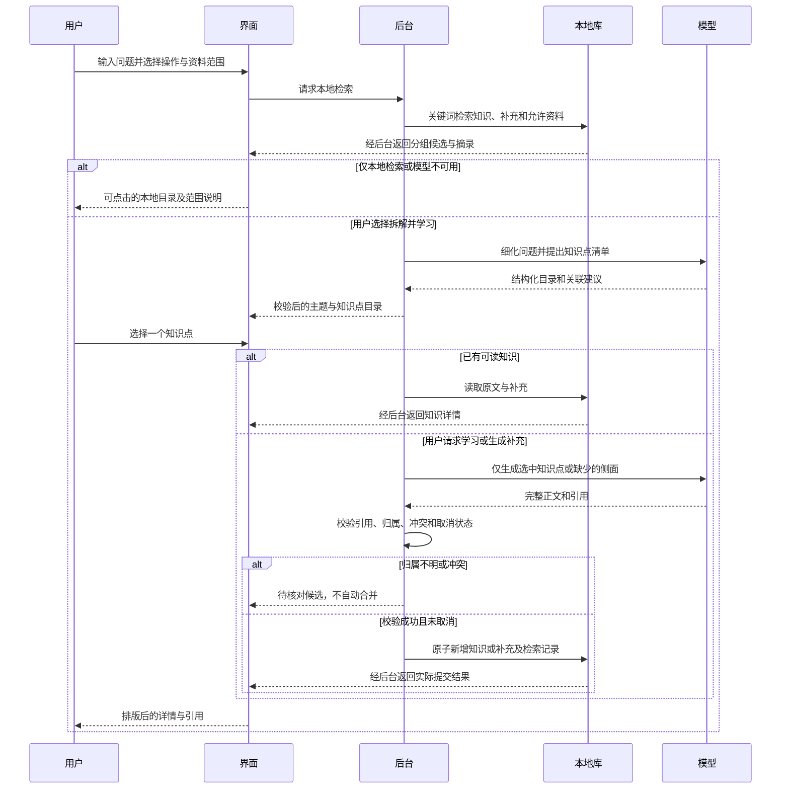
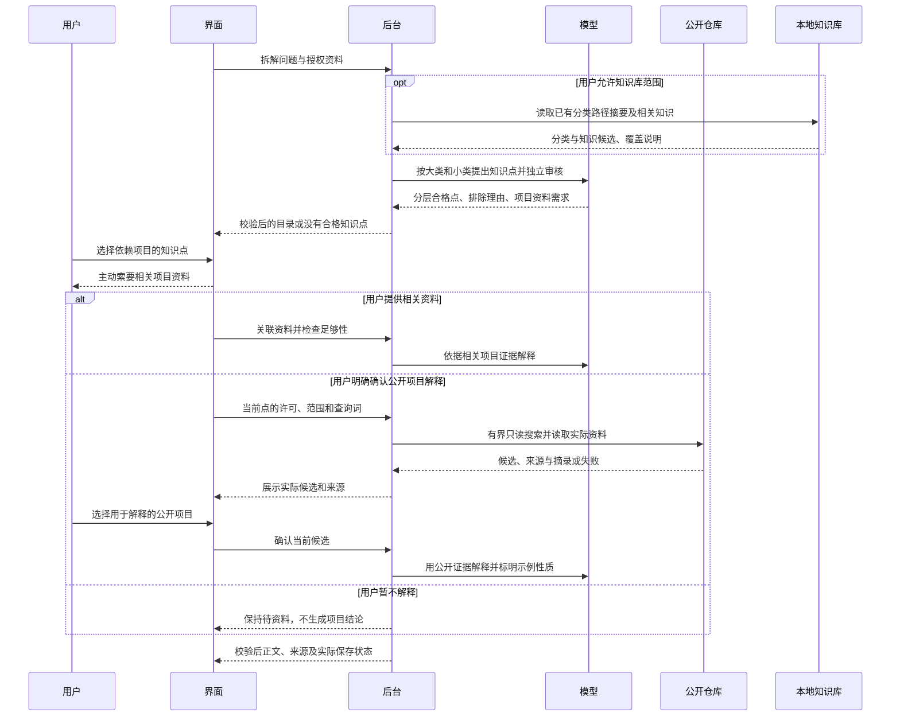
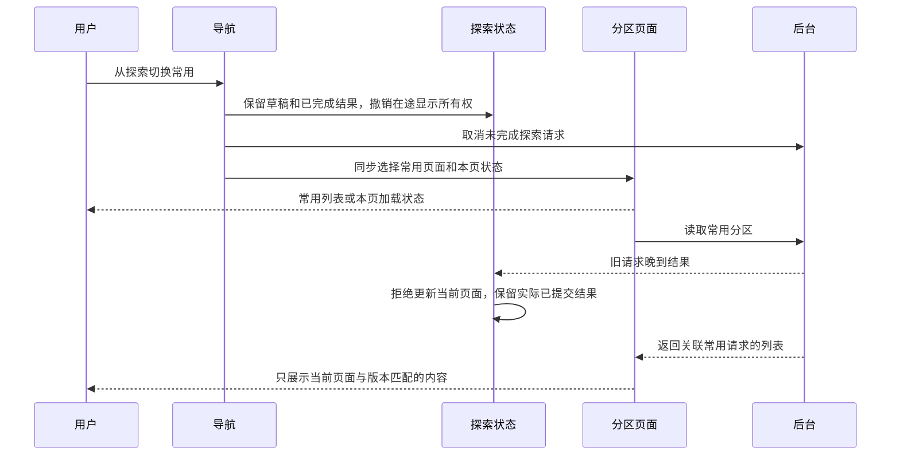
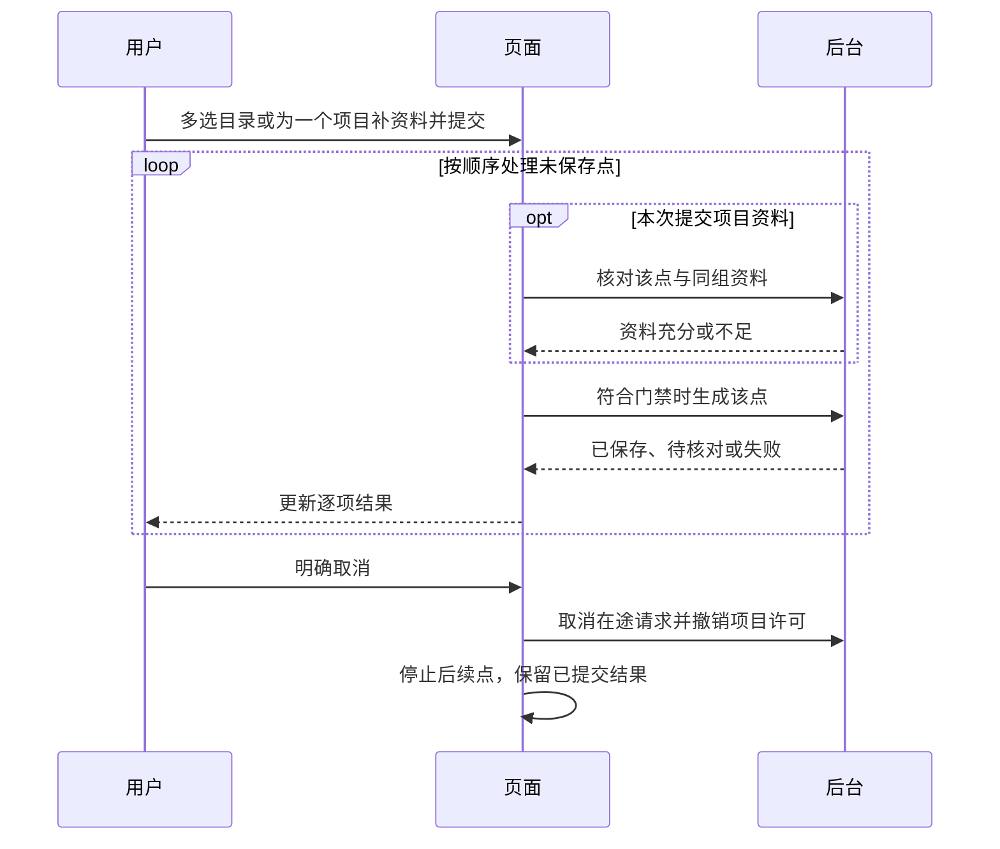
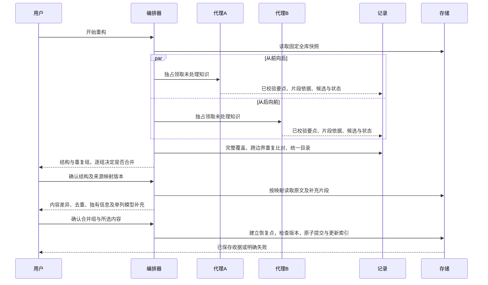
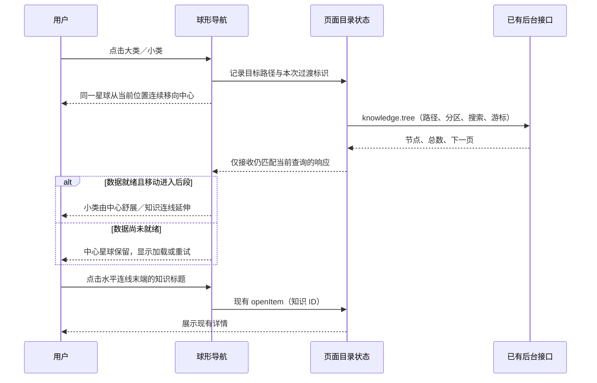
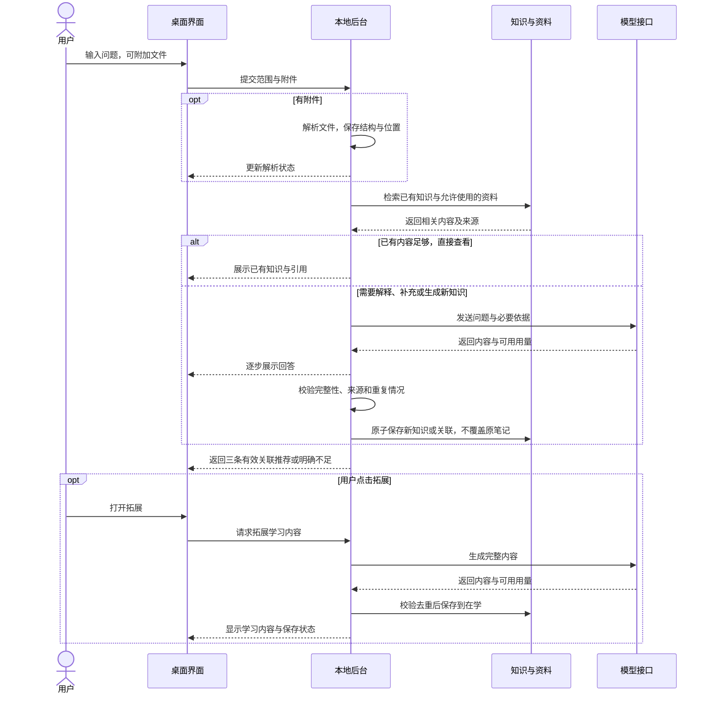

# 个人知识库 Agent：产品方案

> 当前代码保持 `test0.03`。用户已授权顺序实施并逐项提交：先修订 11 星球导航，再修订 9 重构，最后接续设置任务。星球导航已实施并提交；修订 9 重构已接入双路分析、逐组决定及可追溯存储，已通过本机隔离验收并提交 a398697；修订 12 设置已完成并通过本机隔离验收。
>
> 简单说：现在先查本地、看目录，再选择知识点学习；新内容核对后追加，原笔记保留。


| 项目 | 当前状态 |
|---|---|
| 方案修订 | 12，设置、独立模型价格与用量汇总；修订 11 导航和修订 9 重构已提交并通过本机隔离验收 |
| 更新日期 | 2026-10-21 |
| 内容性质 | v1 产品目标、test0.01 历史支持范围与修订 4 实际支持内容分别标明 |
| 已确认范围 | 桌面应用、本地知识库、API 与用量、A 平衡频率方案、文档提问、本地路径、按需保留资料、所选技术栈、主流模型方向、Windows 11 x64／16GB／无独显验收基准 |
| 开发授权 | 用户要求逐项完成导航、重构和设置，每项完成后先 Git 提交；本次依此执行 |
| 实施／验证状态 | 星球导航代码已实施，已通过本机隔离验收；修订 9 重构排在导航提交之后 |

## 当前可用与限制（保留 test0.01 兼容入口）

已实现桌面窗口、后台自动启动与关闭、SQLite 知识编辑和中文关键词检索、A 频率分区、临时附件、资料保留与删除、引用摘录、可配置生成协议和调用统计。生成完成后检查结构与引用 ID，再事务保存；同标题、相同正文和已完成的同问题复用已有知识。上述复用规则保留在旧 `question` 兼容入口；主提问入口已改为知识点目录，后续新内容经核对以独立补充保存，不被旧问题缓存阻止。

简单说：这次交付可以实际操作的第一版，能写、查、读文件，配置接口后可生成并积累；不会把还没做的功能写成已完成。

| 当前支持 | 实际边界 |
|---|---|
| MD／TXT／DOCX／文字版 PDF | 按文本、正文块或页定位；图片、复杂分栏、页眉页脚可能遗漏，解析说明会显示 |
| 三种本地文件入口 | 路径入口已做桌面流程测试；文件选择和拖放已接入，仍需人工等价性验收 |
| 本地知识与来源 | 正文、使用记录、必要引用摘录存 SQLite；会话副本退出清理；保留资料使用快照，不修改用户原件 |
| 回答与收录 | 已接 Responses、Chat Completions、Anthropic Messages 流式适配并用模拟响应验证；真实服务及内容质量未实测 |
| 三条关联 | 2＋1／1＋2／0＋3 组合通过合成库存测试；不足明确显示，实际推荐质量待真实模型验收；重开旧条目仅恢复已有知识关联 |
| 取消与退出 | 取消生成不收录残缺结果；桌面正常退出和后台挂起后的超时进程树清理已验证 |
| API Key 与用量 | Windows 凭据存储往返已验证；用量缺失显示未知，价格由用户填写并按请求快照估算 |
| 尚未完成 | 语义索引、同义概念去重、OCR、旧 DOC、分层长文总结、独立安装包及完整 v1 验收 |

单文件最多 50MB，PDF 最多 200 页，一次最多 20 个附件。单次证据约 28000 字，全文超限会要求拆分；四页已有知识树覆盖全库或本区，分类与叶子每页最多 50 项；独立搜索每页 30 条。阅读器安全渲染 Markdown，不执行来源 HTML。内容完整性和依据正确性仍需人工核对，引用 ID 检查不等于结论已获证明。

启动与使用：在项目根目录双击 `启动知序.cmd`，或构建后运行 `npm start`；先新建知识或加入文档，需要生成时再在“API 配置”填写自己的真实接口。连接测试会产生接口调用。详见 [使用说明](../../../README.md)。

简单说：无需先填 Key 就能写笔记、查知识、读本地片段；真实 AI 功能用你配置的接口，产生的费用会留记录。

下文保留完整 v1 产品目标；未在上表声明完成的部分仍为后续目标。

## 1. 目的

面向个人学习建立可检索、可复习、可逐步扩充的知识库，将已有知识检索、文档问答和关联学习连接成一个流程，减少重复查找和笔记分散。

简单说：先找自己已经存过的知识，缺少时帮助学习并留下知识条目，读完再引导你理解相关内容。

目前已有 test0.01 桌面开发测试版，完整 v1 功能仍按下文目标逐步完善。若只做普通聊天，旧知识、文件来源和学习关联很难持续积累，因此第一版重点建设上述闭环。

## 2. 第一版范围

第一版围绕 Windows 11 x64 桌面使用，知识与资料元数据存本地，通过用户配置的模型 API 提供解释、总结、内容生成和可用时的语义检索。验收以 16GB 内存、无需独立显卡的电脑为基准；最低配置、速度和安装体积待实测，不承诺 Windows 10 或其他架构兼容。

简单说：安装后在自己的电脑里管理知识，需要 AI 帮助时才调用配置的接口；本地存储不等于发给外部 API 的内容不会离开电脑。

| 能力 | 第一版计划 |
|---|---|
| 搜索已有知识 | 关键词检索，具备可用向量模型时结合语义检索；展示原有条目与来源 |
| 未知知识学习 | 检索不足时生成学习内容；成功形成的新知识自动收录到“在学” |
| 关联学习 | 正常提供三条有理由的推荐，优先已有知识，至少留一条拓展 |
| 文档提问 | 拖入、粘贴本地路径或点击“＋”加入一个或多个文件后提问 |
| 文档格式 | 核心目标为 MD、TXT、DOCX、文字版 PDF；扫描 PDF／OCR 和旧 DOC 为待确认兼容范围 |
| 知识组织 | 常用／在学／归档，支持自动变化与手动固定 |
| 编辑维护 | 查看、编辑和删除知识；管理主动保存的资料；删除操作明确告知影响 |
| API 与统计 | 多配置、连接测试、模型选择、请求用量与费用估算、失败记录 |
| 本地使用 | 无 API 时仍可浏览和进行关键词检索；生成、外部向量化等功能说明不可用原因 |

跨设备同步、多人协作、浏览器采集、在线 Google Docs／通用网页解析、无人确认的自动联网研究、考试与掌握程度评估、复杂知识图谱展示，以及修改其他应用的 API 配置，不纳入当前第一版基线。修订 6 增加经单次明确确认的公开项目示例检索，具体边界见第 3.6 节。

通俗地说，先把“查、读、存、联想”做完整；频率表示常不常用，不代表已经掌握。

## 3. 搜索、知识点目录和增量积累（修订 4，已实施）

### 3.1 目的、诊断与本轮范围

将一次提问转换为可选择的知识点目录，让同一主题的知识能跨多次提问持续积累。避免整段问题成为条目名称、回答难以阅读，以及补充内容因同标题去重而未保存。

简单说：问题可以很长，留下来的应该是一个个有名称、能找到、能补充的知识点。

实施前代码核查确认（历史诊断，以下缺口已在主入口修复）：`AnswerPanel` 将正文直接作为文本显示，模型提示允许 Markdown，因此会露出 `###`、`**` 和证据 ID；当前本地关键词搜索已经存在，但主要是列表筛选和生成前召回。问答只校验并保存单个标题／正文，没有多知识点结构；程序未强制直接用问题当标题，但也没有阻止这种结果。同问题缓存直接返回旧笔记，同标题不同正文不覆盖也不追加，导致缺少更新通路。截图中的具体标题来源未经真实请求重放，不能断言由程序硬编码生成。

简单说：显示问题来自缺少排版；积累问题来自目前“一问一篇、同名只复用”的流程。

| 方案 | 范围与效果 | 主要代价和风险 | 选择 |
|---|---|---|---|
| 推荐：本地关键词检索＋知识点目录＋增量补充 | 独立本地搜索；模型细化问题；按主题列出知识点；按需学习并追加 | 关键词可能漏同义词，模型可能分错主题，需校验及待核对入口 | 用户已选择 |
| 可选：同期加入本地语义检索 | 在上述流程中额外加入嵌入模型和向量召回 | 增加模型、资源、索引版本与迁移维护，不能消除误归类 | 本轮不采用 |

本轮涉及探索与知识阅读界面、Python 问答与检索用例、跨进程增量契约及 SQLite 增量迁移。主题分类与“常用／在学／归档”相互独立。保留现有接口配置、附件范围、引用、手工笔记及频率规则，不扩展 OCR、联网研究、语义索引、安装包或发布。

简单说：这次集中完成“查、拆、选、读、补”，不把使用频率误当作知识类别。

### 3.2 如何处理提问与本地检索

提供明确的“本地检索”操作：程序在本地检索主题、标题、正文、补充内容及已保留资料的文字块，展示分组结果、相关摘录和来源。搜索不请求模型，不要求 API 或网络；支持中文及多个关键词，结果分页，不能继续静默只扫描最近 5000 条。切换频率分区时显示搜索范围，主界面的“本地检索”固定搜索全部频率分区；目录的附件／混合范围结果则按该次范围分页。临时附件只在本次授权范围使用。

简单说：只想找旧知识时直接在电脑上查；旧笔记里的补充内容也能找到，不必先问大模型。

“拆解并学习”先清理空白、拆出显式分点并取得本地候选；有可用接口时，由模型结合本次问题、允许的资料和候选主题生成结构化知识点清单，再由程序校验。清单使用“主题 → 具体知识点”，一个问题可以对应多个点；标题表达细化后的概念，不把整段原问题原样当标题，也不为简单问题硬拆多个空洞类别。原问题只作为本次查询上下文。

简单说：例如“Qt 怎么接相机、怎么避免界面卡顿、掉线怎么处理”，拆成“相机接入”“采集线程与界面更新”“掉线重连”，分别放到合适主题下。

目录标明“已有知识／待补充／待学习／待核对”。目录最多 16 点，当前会话保留最近 24 份，重启后重新拆解；正式保存的知识和补充不受目录会话过期影响。本地命中不等于内容已完整回答，关键词没命中也不等于不存在同义内容。无接口、接口失败或取消拆解时，保留可点击的本地结果；本地只能做确定性的分点和匹配，不宣称具备完整语义理解。模型只能建议分类与已有条目关联，不能自己执行保存或覆盖。

简单说：大模型负责理解，程序负责查找、检查和组织；大模型不可用时仍能查阅本地内容。

### 3.3 目录选择、正文排版与引用

问题处理完成先展示目录，默认不铺开一篇长回答。点击已有知识直接打开本地详情，不调用模型；点击待学习项后按“学习这个知识点”才生成该知识点，点击待补充项后明确选择“生成补充”。目录占位项尚不是已收录知识，只有详情完整生成、通过校验并保存后才显示已收录。新生成内容自动进入“在学”，背景召回和目录展示不计有效使用，主动阅读仍按原规则计数。

简单说：先看有哪些内容，再点你要看的；没打开、没生成的选项不会被假装存成知识。

正文按 Markdown 语义显示标题、加粗、列表、表格、引用和代码块，代码保留缩进并可横向滚动。有效证据标记显示为可点击的引用序号，可查看来源、位置和摘录；不把长证据 ID 作为主要阅读内容。原始 HTML 和脚本不执行，危险链接被阻止；代码块中的 `**`、`#` 和类似引用的文本保持原样。编辑器保留 Markdown 原文，老笔记无需重写即可改善阅读。

简单说：阅读时看排版后的正文和引用，编辑时仍能修改原文；不能简单删除所有符号，以免破坏代码。

```text
┌ 探索 ───────────────────────────────────────────────┐
│ 问题…… [添加文档] [范围 ▾]                          │
│ [本地检索] [拆解并学习]   接口／模型／强度            │
├ 知识目录 ────────────────┬ 知识详情 ─────────────────┤
│ Qt／设备接入            │ 选择左侧知识点查看内容      │
│  · 相机接入 [已有知识]  │                            │
│ Qt／线程与交互          │ 标题、列表、表格、代码      │
│  · 采集线程 [待补充]    │ 原有内容                    │
│ Qt／可靠性              │ 新增补充 · 日期 · 来源      │
│  · 掉线重连 [待学习]    │ [引用 1] [引用 2]           │
│                         │ [生成补充] [编辑原笔记]     │
└─────────────────────────┴────────────────────────────┘
```

窄窗口中目录与详情改为上下排列；返回目录保留本次结果和已完成状态。原有三条关联推荐保留在知识详情中，不用推荐卡片替代本次问题拆出的知识目录。

### 3.4 同主题的后续补充

主题及知识点采用稳定标识；后续提问按细化点查找已有条目。新侧面形成同一知识点下的独立补充，保留时间、生成模型、来源和引用；不同侧面过大时形成同主题下的独立知识点。新内容不能因问题相同或标题相同而直接丢弃，也不将整个旧正文替换成新回答。

简单说：后面又问到了相机断线的退避策略，就补在“掉线重连”下，原来的内容还在。

完全重复的补充只复用，不重复写入；可确认归属的新内容追加保存。仅名称相似、跨上下文同名或与旧结论冲突时，显示待核对候选，让用户选择关联目标或保留为独立知识；不自动把相反结论合成一个事实。手工编辑的原正文不被模型覆盖；补充也能单独编辑和删除，删除知识点时说明会同时移除所属补充与索引，不删除用户原文件。

简单说：同一知识越积越丰富，但不能“名字差不多就合并”，更不能把你改过的笔记改回去。

同一详情的并发点击、重试和重复终态必须幂等；不同问题同时补充同一知识点也要在提交时重新检查目标和重复内容。每个知识点或补充独立原子提交：取消只丢弃未提交结果，已经保存的其他知识点保留并如实显示。模型或保存失败不能显示收录成功，不自动重试增加费用。

### 3.5 预期效果、用法及迁移风险



使用时，“本地检索”只查本地，“拆解并学习”可能调用所选模型；已有目录项直接打开，缺少的内容按需生成。详情同时显示原有内容、历次补充、来源及生成性质。没有外部证据时，不编造参考链接、核实标记或“文档已证明”的结论。

简单说：找旧知识免费离线可用；让模型拆解、学习和补充会产生调用记录，只生成你要看的内容。

预期验收包括：离线能查到旧条目与补充；一个含多个问题的输入变成多个具体知识点；阅读中不裸露 Markdown 标记；后续新信息能追加、重启仍在；重复点击不重复保存；取消和失败不污染知识。

简单说：最终要实际验证“看得懂、找得到、能选择、补得进去”，不能只把目录画出来。

分类、补充和检索数据需要 SQLite 从版本 2 增量到 3。迁移前创建一致性恢复点，失败回滚并阻止继续写入；重复启动不重复迁移。旧条目保留 ID、标题、正文、引用、手工编辑、频率和凭据位置，初始可列为未分类，不批量调用模型改写或重新归类。只有用户后续使用并确认关联时才逐步组织。

简单说：升级不重写旧知识；先留好恢复点，旧内容照常可查，再在使用中整理。

主要风险是模型拆错知识点、同义内容漏检、同名内容误归并、迁移失败和多阶段调用增加费用。控制措施是本地结果保底、显式范围、校验后提交、模糊归属待核对、恢复点及逐次调用记账；不能承诺自动分类或知识事实完全正确。必要配套仅限本轮契约、迁移、依赖与验证，不包含其他模块清理。本轮行为已通过隔离数据与模拟接口验证；真实模型质量、正式数据迁移及性能尚未验证。

### 3.6 知识点审核、项目说明与阅读修正（修订 6，已实施）

目的：在目录展示前判断候选是否为可独立学习、解释和复用的概念、原理、方法或实践；项目相关结论先取得必要资料；阅读器兼容明确的模型排版错误。

简单说：先判断“这算不算知识”，涉及你的项目先问你要依据，正文应当像文章一样阅读。

#### 修改前原因与证据边界

- `PLAN_SYSTEM` 只要求拆成 1–16 项，`validate_plan` 仅检查结构、标题、重复、候选和引用。没有知识资格判断，且强制至少一项，容易把工作经历、操作要求或文档整理任务硬拆成知识点。
- `TopicWorkflow.learn/generate` 从目录直接进入模型生成，契约没有项目缺口、资料确认或联网许可状态；已有附件也未被判断是否足以支持项目结论。当前供应商请求没有联网工具，不能声称已在网上找过项目。
- 截图中的星号原因用当前 `react-markdown` 依赖合成复现：`**整体开发与设备接入： **独立负责` 显示字面星号，`**整体开发与设备接入：** 独立负责` 正常加粗。此前桌面测试只有合法加粗，本轮已补入该类输入及原文不变验证。截图对应的实际数据库正文未读取，具体原文仍未核实。

简单说：以前检查了格式是否合法，却没判断内容适不适合收录；排版组件已经有了，但不能自动理解写错的 Markdown。

#### 完整处理方案

1. **候选先审核。** 拆分后增加独立的语义审核阶段，返回保留／排除／待澄清及理由。可复用的“有限状态机”“线程间结果传递”可保留；“简历整理稿”、公司名称、任职日期、项目名称、纯职责描述、重复项和空泛标题不单独作为知识点。工作经历中真实体现的方法可抽为知识，不因来自简历而全部排除。允许零个合格点，并说明原因；被排除项可展开查看，用户可补充问题后重新拆解。待澄清项不进入自动学习或收录，审核失败保留本地结果，不直接放行未经审核的候选。
2. **项目依据先补齐。** 针对“这个项目为何采用某方案、代码如何实现”等依赖具体项目的点，展示项目点标题、需要的资料与缺少的内容，先邀请用户提供相关说明、支持格式的文件或代码片段。复用现有附件入口，不读取整个项目目录、不扫描仓库或导入压缩包。资料需要关联到当前点并核对相关性；无关文件不能解锁项目解释。能独立解释的通用概念可以正常学习，不能冒充用户项目事实。
3. **公开示例需单独确认。** 未提供足够项目资料时，默认停留在“待项目资料”。用户可从探索入口加入相关附件并检查资料；也可以暂不解释，或确认本点公开示例范围和查询词后进行检索。学习按钮、文档中的指令、模型建议和旧目录许可都不构成联网授权。“仅本次文件”仍可在当前知识点上明确勾选“本点公开示例”并再次同意；范围、查询词或附件变化会撤销旧许可。
4. **确认后真实检索。** 使用有界的 GitHub 公开仓库搜索与 README 读取，依据已展示的通用技术关键词检索，最多选择三个候选供用户确认，再解释选中的公开项目。查询词允许用户编辑，不自动发送用户项目名、私有代码或附件正文给搜索接口。只读公开资料，不克隆、下载运行项目，也不访问任意模型提供的链接。结果记录仓库 URL、实际读取位置、摘录与检索时间；没有实际读取证据不得标成“已检索”。网络失败、限流或没有合适项目时明确停止，不能用模型记忆伪装搜索结果。
5. **确认与结果绑定。** 许可仅用于当前目录项、资料范围和展示的查询词；变更目录项、问题或范围后重新确认。取消、目录过期、移除关联资料后，旧授权和晚到结果不得解锁新解释；已提交内容按实际保存结果显示。解释与入库区分用户项目证据和公开示例，公开项目不能被写成用户实际完成的工作。
6. **按语法修排版。** 生成提示要求合法的标题、加粗和列表；展示前仅对以冒号结尾的成对加粗标签修正结束边界空格，不全局删 `*`、`#`。跳过代码块、行内代码、转义文本、链接目标及无法判定的星号表达式，保留编辑原文、合法列表和引用。旧笔记不批量重写；非知识类回答仍可展示，但不自动成为知识点或正式知识。

简单说：先筛一次，再按需要向你要项目；你同意后才找公开示例，并清楚区分“你的项目”和“参考项目”。星号修正在阅读时生效，代码和原笔记不会被乱删。

```text
┌ 知识目录 ─────────────────┬ 选中知识点 ──────────────────────┐
│ 状态机 [待项目资料]       │ 状态机如何应用于工件流转          │
│ 线程间结果传递 [待学习]   │ 需要：流程说明、相关代码片段      │
│ [查看排除项及原因]        │ [检查本次附件] [撤销许可]         │
│                          │ [勾选本点公开示例] [同意并检索]      │
│                          │ 查询词：Qt 状态机 工件流转 [编辑] │
│                          │ 检索后：候选项目、来源、选择解释   │
└──────────────────────────┴──────────────────────────────────┘
```



#### 效果、代价与验收

验收时，同一份含公司、日期、职责和技术方法的合成简历，只将可复用方法纳入目录；全是整理任务时返回零个知识点。项目资料不足时，后台拒绝绕过界面的生成或搜索；无关附件、过期许可和取消后的结果不能放行。确认后能看到真实公开来源，失败不得生成“已查证”的结论。截图同类文本正常加粗，代码、列表和引用保持语义。

简单说：不仅看按钮有没有出现，还要验证模型没有越过你的选择、没把任务当知识，也没破坏代码排版。

独立审核比现状通常多一次模型调用，资料足够性分析也可能产生调用，均逐次记账、没有自动重试。语义判断仍会误判；排除理由和待澄清状态用于恢复。GitHub 公开项目覆盖不全且可能限流，失败时回到提供资料或暂不解释。受限排版兼容不能保证修好任意损坏 Markdown。错误修复须重点防止将乘法、指针、转义星号或用户手工内容误作格式标记。

简单说：更严格的判断会增加时间和用量；联网找不到时如实停下，不保证任何一句模型输出都能自动排好版。

本轮已修改目录规划、单点学习与相关生成入口、附件关联、受限跨进程契约、公开项目只读适配、安全阅读组件及对应测试；修订 6 另增加第 3.7 节独立页面及第 3.8 节分层分类。第 3.6–3.8 节合为本轮完整已实施范围。不改数据库结构，不批量清理旧知识，不自动获取正式凭据、不做付费接口验证、不递增版本、不提交或发布。

### 3.7 探索与知识分区为独立页面（修订 6，已实施）

目的：探索、常用、在学、归档分别呈现自己的内容和交互状态，进入知识分区的第一屏即为该分区列表或加载／空状态。探索中搜过什么、看过什么，不应占据另一个页面。

简单说：点“常用”就先看常用知识，不再先看到探索的输入框、结果和回答。

修改前原因：`useNavigation.bodySection` 将四个入口视为同组；`AppContent` 对它们统一挂载 `ExplorationPage`，该组件始终包含输入、目录、回答、推荐与列表。`useAppModel` 组合的阅读、探索目录和回答未按页面隔离。`useLibrary` 切换后等待 160 毫秒才刷新，原列表在新响应前继续保留，因此还存在首屏短暂显示上一分区条目的风险。切页 effect 目前只撤销异步选择并取消任务，没有隔离已经显示的内容。以上是修改前的源码诊断；修改后的首帧、迟到响应和滚动恢复已通过隔离桌面回归。

简单说：现在主要换了标题和列表条件，页面主体及内容状态没有真正分开；只清空一次回答也修不完整。

现将探索单独路由到探索页面，常用／在学／归档各自路由到知识分区页面，可复用相同的分区组件实现。分区首页只显示本区列表、筛选、新建入口及本区主动打开的详情，不挂载探索输入、目录或探索推荐。探索保留自己的问题、附件、检索结果、目录与已完成回答，返回时可以继续；四个入口的筛选、选中项和阅读上下文按页持有，切换不能相互覆盖。首次进入分区不自动打开探索选择的知识。

简单说：组件可以复用，页面的内容和选择必须各管各的；回来探索时也不用重新输入问题。

导航提交时同步切换页面显示归属，列表结果须与当前页面、筛选词和请求版本匹配后才显示；无匹配结果先显示本页加载状态，不能拿旧列表填空。请求尚未完成时也能切页；晚到的成功、错误、进度或清理回调不能写入当前其他页面，不能把用户拉回探索。切页继续会话任务，已提交知识保留并如实报告；新请求不被旧请求的 `finally` 清除。探索中的附件仍由会话持有，切页不删除用户原件；未保存编辑草稿不因页面隔离静默丢失。页面首屏与滚动位置按页管理，首次进入分区从列表顶部开始。

简单说：切页立即生效，等接口返回时也不闪回旧内容；任务留在发起页继续，不把已经保存的知识说成撤销。

```text
[探索] → 问题／附件 → 分层目录 → 本次结果与解释
[常用] → 常用列表／本页筛选 → 本页主动打开的详情
[在学] → 在学列表／本页筛选 → 本页主动打开的详情
[归档] → 归档列表／本页筛选 → 本页主动打开的详情
```



风险是状态隔离时漏接打开、编辑、推荐、提示或取消回调，导致原来可用的保存流程失去刷新；必须覆盖四页互切、慢列表、后台失败、已提交竞态及未保存草稿。此修改不改变常用／在学／归档的频率规则，存储仍为同一知识库。

简单说：分开的是页面操作，不是复制四份知识，也不改变知识什么时候进入常用或归档。

### 3.8 参考已有知识的大类、小类与知识点（修订 6，已实施）

目的：结合用户问题、允许访问的已有知识分类和模型推断，以“大类 → 小类 → 知识点”组织目录。项目中的具体实现与 C++ 等语言知识、框架知识、通用设计方法分别归类；不把全部内容混进一个项目标题下。

简单说：先看属于哪一大类，再看小类，最后才是能独立学习的一条知识。

历史诊断：旧目录只有自由字符串 `theme`，无法表达层级；现已增加兼容的 `category`／`subcategory` 字段和全库分类摘要，旧主题仍原样保留。

先读取已授权知识库的分类路径摘要和相关知识候选，优先沿用含义匹配的现有大类／小类；模型再依据问题推断必要的新类，独立审核检查分类是否合理。已有分类不匹配时不强行套入，来源不足或歧义大的点待澄清。分类摘要来自全库路径汇总能力，不从最近列表或六个候选冒充全库；送入模型的上下文仍有上限，选取和遗漏范围须说明。“仅本次文件”继续禁止读取或发送库内分类与知识，改为根据本次文件和问题推断。

简单说：先参考你已经整理过的分类，确实没有合适的再新建；你选择只用文件时，就只分析文件。

例如以下为可能的目录，实际分类随问题与已有库确定，不硬编码成唯一类别：

```text
项目实践
  工业视觉压字码上位机
    工件流转的具体实现 [待项目资料]
编程语言
  C++
    RAII 与资源释放
    值语义与对象生命周期
框架与工具
  Qt
    信号槽与跨线程调用
软件设计
  并发与通信
    有界队列与背压
```

项目名称可以是分类上下文，但名称、公司、日期本身仍不能作为合格知识点。项目中的“队列如何与设备应答衔接”归项目实践；可跨项目复用的“有界队列与背压”归通用设计。允许通过说明或关联表达两者的关系，不为每个项目复制一份相同通识，也不把不同项目的实现当成同一事实自动合并。

简单说：同样提到队列，通用原理和你项目中的用法可以相关，但应分清内容归属与证据。

目录按大类和小类分组显示，叶子是具体知识点及学习状态；常用／在学／归档是使用分区，与知识分类独立。新增知识保存规范分类路径，并在后续提问、阅读、搜索和补充中继续沿用。保持现有数据库结构，以兼容的主题路径保存新分类；旧笔记不自动搬动、改名或合并，旧平面主题未能可靠拆分时继续原样显示并标为旧分类，不猜测层级。只有用户已授权的目录生成才调用模型，不批量对旧库重新分类。

简单说：新知识按层级积累，旧知识先保住；“C++”不会因为你经常看就变成“常用”这个类别。

验收覆盖混合项目／C++／Qt 问题、已有分类复用、新类推断、无合适类、同名不同义、严格文件范围、旧主题兼容、分类保存后重启及再次规划。主要风险是模型误分类、同义分类漂移和旧主题误解析，须保留可见分类依据与待核对状态，禁止自动覆盖已有身份。

简单说：不只看树形目录画出来，还要验证分类能保存、后面能复用、不同含义不会被乱合并。

### 3.9 右侧操作、批量生成与分区提问（修订 7，已实施）

目的：解决未生成知识点右侧空白、逐个点击生成、项目材料反复提交的问题，并使常用／在学／归档可以直接提问。

简单说：左边选要学什么，右边补资料、生成和阅读；一次能选多个或整类，不必逐个点。

原因：原 `DirectoryPanel` 把生成和项目操作放在左列底部，右列只根据正文显示；目录只有单点选择，资料核对也只作用于当前点。修改后左侧仅保留目录、复选框和分类全选，右侧集中显示批量提交、项目资料、单点生成／补充核对及正文。

项目按目录已审核的大类／小类分组，右侧各组可选择文件、输入路径或拖入文件，并明确勾选该项目使用的资料。点击“补充资料并生成本项目全部知识点”后自动对每个未保存点核对材料并生成；附件无关或不足不会放行。一次补充指一次用户提交，不代表只调用一次模型；后台材料核对与知识生成逐项计量。

简单说：一个项目上传一次，按钮帮你处理这一组的所有点；不同项目仍各选自己的资料，用量按实际调用记录。

批量生成固定提交时的目录、模型和文件选择，串行处理所选未保存项；显示已保存、待核对、缺资料和失败。单项失败继续其他项，不自动重试；明确取消后停止后续项，切页和普通阅读继续执行，已提交知识保留。已有知识跳过，生成的补充预览保留在对应目录项，选择后按原规则确认归属或独立保存，不能批量覆盖手工笔记。选择其他知识点撤销公开示例授权，但保留同目录中仍有效的已核对项目材料；输入、范围或附件改变仍撤销受影响资料许可；切页保留当前任务依据。

简单说：新知识能一起生成，涉及原笔记的补充仍要你核对；取消只停止还没做的部分。

常用／在学／归档新增一个输入框和“确认”键，使用与探索相同的检索、目录规划、知识资格审核、生成、引用、推荐、用量和项目门禁。生成接口、模型、强度、范围沿用探索当前设置；不增加另一套设置。四页的问题草稿、目录、阅读与反馈隔离，进入分区不会显示探索的旧目录，返回可恢复本页内容。该增量扩展 3.7 的“分区无提问入口”旧限制，频率规则不变。

简单说：三个页面也能直接提问，设置到探索里统一调整；页面内容不会互相串。

```text
左：目录与多选                  右：批量生成所选
大类 [全选待生成]                   项目待补充资料（路径／选文件／拖入）
  小类 [全选待生成]                 本项目一次补充并全部生成
    [ ] 知识点                      当前点生成／核对补充
    [ ] 知识点                      正文、引用、逐项处理结果
常用／在学／归档：[输入问题                     ] [确认]
```



预期效果是减少重复操作且不降低资料门禁、补充确认或取消约束。主要风险是批量中断后的部分成功、目录分类未能区分不同项目、文件解析失败及模型逐项核对产生额外用量；界面显示组名和每点结果，不将“批量结束”解释为“全部成功”。真实模型的分类、相关性和生成质量仍须实际使用验收。

简单说：省的是手动点击，不是跳过核验；没生成成功的点会如实显示。

### 3.10 切页继续任务、完整知识库与确认式重构（修订 9）

#### 目的与范围

将生成流程的生命周期从当前导航和阅读选择中独立出来，并增加完整知识库入口。知识库、常用、在学、归档四个页面均按“大类 → 小类 → 知识点”浏览；知识库展示全部正式知识，三个频率分区只展示属于本区的知识。修订 8 已实现单路重构；修订 9 已改为双代理逐条记录、统一分类及重复组确认，结构确认后提取整理原文，经内容差异确认后提交；新生成的拓展与普通知识采用同一分类规则。

简单说：切页不打断工作；总库和三个分区都分层显示，旧内容可先预览、再整理，新拓展也自动放进合适的位置。

知识库覆盖常用、在学、归档的同一批正式知识，补充显示在所属知识点内；保留的原始文件仍由资料库管理，通过引用打开，不将每个资料块冒充知识点。手工笔记和没有分类的旧知识同样纳入总目录，先显示在“未分类／待整理”；可靠的旧平面主题按原名保留，不猜测拆分。

简单说：知识库是知识总览，资料库是文件管理；旧笔记不会因为没有分类而消失。

#### 已查明的停止原因与修复

修改前源码确认：`useDirectoryRequests` 在 `section` 变化时调用 `api.cancel` 并递增共享 `selectionSequence`；`useReading` 在导航渲染时也递增该版本。拆分在本地检索之后以及模型响应之后检查该版本；批量生成在每项及材料核验与生成之间同样检查，因此切页会中断请求或停止后续项。`useProjectRevocation` 还会因页面变化及 effect 清理撤销项目材料和公开检索许可。普通拓展即使后台已保存，阅读版本改变也可能让结果不再显示。上述停止链路已由会话任务替代；本轮隔离桌面验证拆分与独立审核、批量生成和重构在切页后继续，不使用真实接口。

简单说：原来把离开页面当成了取消；现在导航只换显示，任务和结果由会话保管。

由应用会话持有任务标识、发起页、目录版本、输入和模型快照、当前阶段、进度、错误、结果及显式取消标志。切页只改变显示，不取消任务、不让批量版本失效，也不撤销任务已获准使用的项目资料。阅读选择与任务有效性分别管理；结果保存到原页面和原目录，不覆盖当前其他页面的正文、提示或草稿。任务完成后使全库和相关分区列表失效，下次显示时重新读取。

简单说：任务自己继续跑，界面可以随便切；回到发起页看原任务，其他页面不会被它抢走。

保留一次一个生成流程，期间允许浏览、检索和编辑已有知识。修订 9 只在同一重构任务的结构确认前允许两个分析代理并发，不并行启动其他生成任务。全局状态条显示发起页、阶段和进度，允许返回或明确取消；各代理请求使用独立请求 ID，取消须覆盖两个在途请求并阻止下一项。已有补充继续先预览、逐项确认。

简单说：这次解决切页不中断，不增加多任务抢跑；你可以看别的知识，也能随时找到正在运行的工作。

明确取消、源问题／范围／相关附件替换、任务所用资料主动移除、目录重新拆解或应用退出仍终止受影响任务。正在执行的公开检索只使用已经确认的单次许可，不因切页扩大授权；改变输入或资料时仍撤销。已提交结果保留，未提交的残缺内容不入库；保留现有单次请求 180 秒超时，不自动重试，也不承诺关闭后继续或重启恢复。主要回归风险是任务继续了但结果归属错位、项目许可过期或旧终态清除新任务，必须专项验证。

简单说：切页继续不等于永远执行；你主动停止或改掉任务依据时仍会停，已经保存的内容不会被说成撤回。

#### 知识库与三个分区页面

侧栏增加“知识库”，保留探索及频率分区。默认显示全库类别及数量，展开小类后分页读取知识点，选择叶子打开完整正文、补充和引用。关键词筛选保留父级路径；无结果、未分类、空库与加载失败分别显示。全库计数与目录读取不得复用最多 200 条的旧卡片列表，超过 200 条仍须全部可达。无接口配置也可浏览和搜索。

简单说：分类可以逐层展开，大库也不会少显示后面的知识；打开总目录不调用大模型。

常用、在学、归档将原平铺卡片列表改为相同的分层目录：分类路径与总库一致，计数、搜索、展开加载和分页均先按当前分区过滤；没有本区知识的分类不显示，不能把其他分区的叶子或数量带进来。保留各分区已有的简洁提问、新建、编辑和目录学习能力；“已有知识目录”与提问后产生的“待学习目录”分别标明，不把未生成的点算作已入库。四个页面各自保存筛选词、展开项、分页、阅读选择和滚动位置，切换时不互相覆盖。

简单说：三个分区也都是树状目录，只看本区的知识；提问和学习功能继续可用，但待学习的点不会混充已经保存的知识。

分区只表示使用频率，分类表示知识主题，两者独立。使用日增长、手动改分区或自动归档使叶子在分区之间变化，但不改变分类；重构改变分类时同步刷新四页对应目录，不复制知识或改变频率规则。知识详情读取仍按原主动使用规则记账，分类展开、搜索和重构概览不增加使用日。

简单说：知识从“在学”变“常用”时，大类小类不变；整理目录也不会把所有知识都算成常用。

```text
┌ 侧栏 ─────┬ 知识库 · 共 N 条 ─────────────────────────┐
│ 探索      │ [搜索全部知识……]       [重构知识库]       │
│ 知识库 ●  ├ 分类目录 ──────────┬ 知识详情 ─────────────┤
│ 常用      │ ▾ 编程语言 (40)    │ 标题／所属分类        │
│ 在学      │   ▾ C++ (25)       │ 正文／补充／引用      │
│ 归档      │     RAII           │ [编辑]                │
│ 资料库    │     值语义         │                       │
│ API 配置  │ ▸ 项目实践         │                       │
│ 用量统计  │ ▸ 未分类／待整理   │                       │
├───────────┴───────────────────┴───────────────────────┤
│ 任务：探索 · 正在生成 3/8    [返回任务] [取消任务]       │
└───────────────────────────────────────────────────────┘
```

三个分区复用同一布局，下面以“常用”为例：

```text
┌ 常用的知识 · 本区 N 条 ────────────────────────────────┐
│ [搜索本区知识……]                       [＋新建知识]  │
├ 已有知识目录 ─────────┬ 知识详情 ───────────────────────┤
│ ▾ 编程语言 (本区 8)   │ 选中知识的正文、补充和引用      │
│   ▾ C++ (本区 5)      │ [编辑] [调整频率分区]          │
│     RAII             │                                │
│ ▸ 未分类／待整理     │                                │
├─────────────────────┴────────────────────────────────┤
│ [输入学习问题……] [确认]                              │
│ 待学习目录／学习工作区（提问后显示，与已有目录区分）    │
└───────────────────────────────────────────────────────┘
```

#### 重构流程与内容保护（修订 9，已实施，本机隔离验收通过）

目的：用两个应用内分析代理从相反方向处理同一全库快照，逐条记录依据，再统一规划结构及重复组；结构确认后才从相关原知识提取内容、整理及适当补充。两个代理是所选接口下的独立模型请求与工作状态，不依赖开发工具自身的子代理能力。改动涉及重构页面、Python 编排、生成提示、跨进程契约、合并与来源存储及检索；其他探索与频率规则继续有效。

简单说：两个人分头读、记清楚，汇总成一个方案；你同意结构后，再整理具体内容。

**分析与记录。** 开始时固定知识集合、内容版本、接口、模型及强度；知识按创建时间、ID 稳定排序，代理 A 从前向后领取，代理 B 从后向前领取，遇到已领取或已完成的条目则跳过，直到相遇。共享领取记录由程序串行更新，同一知识点同一时刻只归一个代理；并非各自完整读一遍全库。每点覆盖全部正文与补充，记录知识 ID／版本、代理、片段覆盖、关键概念、限定条件、来源位置、分类建议、重复候选与理由、状态及错误。领取状态、处理完成和疑似内容重复分别展示，不能把处理了两次当成知识重复。记录保留在当前后台会话，切页不丢；退出后本轮草案不恢复，正式知识不受影响。

简单说：一个从头读，一个从尾读；谁读了哪条、读到哪段、为什么这样归类，都有记录。相遇时不会抢着重复处理同一条。

**统一结构与重复组。** 两边完成后汇总完整清单、归类词表及候选，补做跨代理、跨批次的重复候选比对，再统一生成目录。不是把两个局部目录直接拼接。相似标题仅供召回；重复判定必须指出原文重叠、各自独有内容、适用范围及结论是否冲突。“同义重复”“部分重叠”“相关但不同”“结论冲突”分别标记，后两类不得作为可合并重复。相似关系不传递，A 与 B、B 与 C 重叠不能直接认定三条等价；合并组须核对全组的独有信息和冲突。语义检测仍可能漏判或误判，界面允许移除错误标记、补选原知识到重复组并重新核对。全量覆盖、未知 ID、分类碰撞或未解决冲突检查不通过时，不开放结构确认。

简单说：最后一起核对两边读到的内容；看起来相近不等于能删，独有内容和不同结论都要留住。

**用户确认结构。** 展示“大类 → 小类 → 知识点”、新旧位置、每个目标点的来源 ID、重复组和建议保留点。没有合并的原知识恰好映射一次；确认合并的多条原知识可以映射到一个保留点，但每条来源都须明确归属。重复组默认不接受合并，用户逐组选择合并或分别保留，决定保留的 ID／标题／位置；手动分区冲突时也明确选择。选择暂未决定的组不得偷偷按合并执行，可取消合并并保留各条。未接受合并且同路径同名时，先调整名称或分类解决冲突。改结构、来源集合或组内选择后，旧结构确认和受影响的内容建议失效。

简单说：你先看新目录，每组重复都能决定合不合、留下哪条；没同意的不会合。

**确认结构后准备内容。** 对每个目标点，按已确认来源映射提取原正文和补充的相关片段，核对完整覆盖记录；摘要只用于定位，不能仅凭压缩摘要重建正文。整合重复表述时保留独有内容、限定条件和原引用；原结论冲突并列说明，不擅自挑一边。模型新增解释单列“模型补充，未由原库来源核实”，与原库提取内容分开预览、默认不接受，不伪装成原引用支持的新事实，也不自行联网。手工正文／已编辑补充保留原样，整理稿作为可选独立补充；符合既有条件的机器生成、未编辑正文可以显示替换建议。长文分段准备，单条有界建议不能容纳时明确未完成，不能通过删掉尾部来通过校验。

简单说：整理时回到原文取内容，重复的少说一遍，各自有用的都留下；模型额外解释另外列出，由你决定要不要。

**最终差异与提交。** 结构确认只授权准备建议，不立即写正式库。差异页展示原文、整理稿、重复片段处理、独有内容保留、引用来源和模型补充；每个被接受的合并组须作为完整单元确认最终内容，不能只合并目录而漏掉其独有内容。未接受合并的知识和未选更新保留原状。“仅应用目录”适用于无合并的目录；存在合并时须先取消合并并重新确认结构，或接受该组完整内容后提交。

简单说：同意目录后先看实际会怎么改；合并不能只留下一个名字、却把另一条的内容丢掉。

为使合并可追溯，增加最小化数据库升级：保留原记录及其手工正文、补充、引用、创建信息，记录来源到保留点的映射及整理来源。确认合并后，常规目录／检索仅展示保留点，旧 ID 可定位保留点并查看只读原记录；不直接删除原知识。保留点沿用用户选择的 ID 和手动分区，使用日按自然日集合合并、不把重构算使用。合并后的编辑只作用于保留点；旧来源作为只读依据。本轮普通删除对合并组拒绝并说明原因，避免级联丢失原记录；解除合并与物理清理另行设计。升级代码已实现，并在隔离库验证备份、失败回滚与版本兼容；本轮不运行正式数据迁移。

简单说：合并后平时看到一条，但原来各条的内容和出处仍查得到；旧链接不会突然失效。

最终确认绑定目录、重复组及内容版本。提交前创建唯一一致性恢复点，并在同一事务内检查全库内容／补充／分类／合并关系版本，写入接受的分类、内容、来源映射与索引；期间库内容变化须重新规划，使用日变化不使正文过期。失败整体回滚，重复提交返回原收据。取消必须停止两代理和后续汇总，等待任务收束，晚到结果不得复活草案；提交完成后如实报告已保存。

简单说：最后一次确认才保存；你中途改过原知识就重新核对，失败不会只合并一半。

**原报错的诊断与限制。** 已确认当前 `summary` 必须为非空字符串且不超过 1600 字符；缺失、类型错误或超长都复用“知识点知识要点无效，未采用模型目录”，本次究竟是哪种尚无原始响应证据。修订 9 将区分具体原因、失败知识和片段及长度，保留已验证记录供显式重试；不静默截断、不无限重试。单段读取继续有界，当前 7000 字符块／1600 字符累计要点、分类每批 8 条及 26000 字符输入边界作为初始约束。两代理不能保证输出符合结构，也不能保证知识语义判定正确；高强度和并发不保证更快，汇总与重复比对会新增调用。每次实际调用分别记账，用量未知显示未知，界面说明双代理和补充会增加调用，不使用“固定翻倍”等未经测量的估计。

简单说：双代理解决分工问题，摘要格式错误仍要单独处理；读得快不等于不会出错，也不代表费用更少。

使用方式：开始重构 → 查看双代理进度与逐条记录 → 调整目录、逐组决定合并 → 确认结构 → 查看提取内容与补充差异 → 最终确认保存。导航继续任务；失败时查看准确原因，显式重试失败项，或取消草案。上述流程已接入；原文提取采用保守整段保留，模型解释独立，不承诺语义去重完备。

```text
┌ 重构知识库 · 分析与结构预览 ────────────────────────┐
│ A 从前向后：完成 6  B 从后向前：完成 5  全库 11/13  │
│ [逐条记录] 失败 1 · 疑似重复 2 组                    │
│ 大类 → 小类 → 知识点 · 原位置 → 新位置              │
│ 重复组 A/B：重叠片段／各自独有内容／来源             │
│ ○ 分别保留  ○ 合并到 [保留点]  ○ 尚未决定           │
│ [调整并重新规划] [确认结构，准备内容] [取消]         │
├ 内容差异（结构确认后）─────────────────────────────┤
│ □ 接受组 A/B 的完整整理稿 · [查看原文与来源]        │
│ □ 接受模型新增解释（未由原库核实）                  │
│ [最终确认并保存]                                    │
│ 无合并时：[仅应用目录]                              │
└────────────────────────────────────────────────────┘
```



#### 拓展自动分类与限制

探索目录学习、普通提问和推荐拓展的新增正式知识均获得规范两级分类，优先复用含义匹配的现有路径，必要时新建；补充继承所属知识分类。分类作为生成结果的受校验字段与知识原子保存，不先保存无分类知识再静默补分类。分类失败或输出非法时保留明确的未收录结果，不报告成功。仅文件范围可用当前生成内容推断分类，但不得读取或发送旧库分类。重构完成后的路径用于后续归类，不每次重新扫全库正文。

简单说：新拓展存下来时就归好类，后续沿用整理后的目录；分类出错会告诉你，不暗中丢进某个类别。

每个后台会话最多保留一个重构草案，取消当前阶段后可在本次会话继续，丢弃草案或退出后不能恢复。正文快照在内存中持有，大库内存和耗时未实测。主要风险为摘要遗漏限定条件、模型误分类、同名知识碰撞、确认期间数据变化和正文建议失真；通过覆盖校验、理由与差异预览、用户选择、版本校验、原子提交及恢复点控制。大库耗时、真实供应商上下文适配与整理质量需要实际验收。本轮不增加关窗后台常驻、重启续跑、并发生成、语义索引或自动付费重试；也不修改数据位置、凭据标识或发布版本。

简单说：这一轮保证流程可控、旧内容受保护；真实模型分得好不好，仍需要结合你的知识实际核对。

### 3.11 球形分类导航（修订 11）

目的：将已保存知识的折叠分类树改为逐级聚焦的空间导航，突出大类、小类与知识点的归属关系。

简单说：用“点球进入下一层”的方式找知识，不再逐行展开列表。

范围：知识库、常用、在学、归档四页共用这一展示方式；沿用当前分类、分区筛选、搜索、数量与完整分页。探索的待学习目录、批量勾选和知识整理预览保留各自用途。本增量可单独实施，不依赖第 3.10 节待开发的双代理及合并。

简单说：换的是截图中的“已有知识目录”，其他生成和整理流程仍按各自方案处理。

采用用户描述的星球式方案：球面具有柔和的明暗交界、细腻的云带／地表纹理和轻薄的大气边缘光，统一光照方向，以低饱和的自然色形成体积感。不同分类可以有稳定、轻微的色调和纹理差异，避免仅靠一个光滑渐变圆表现所有分类。类别名称与数量作为清晰的正向标注，不跟随球面旋转，不被纹理或光晕遮挡；环绕的小类保持稳定位置，便于选择。

简单说：球要像自然受光的小星球，有表面细节和明暗层次；文字始终看得清，分类位置不能一直转来转去。

以下三级导航保持原方案：

| 层级 | 显示与点击行为 |
|---|---|
| 全部大类 | 展示当前范围内各大类球体，标注名称和知识数量；点击一个球体平滑移到中心 |
| 大类内部 | 当前大类为较大的中心球体，其小类球体围绕分布；点击小类，将小类球体移到中心 |
| 小类内部 | 中心保留小类球体，具体知识点以可读标题分布在左右，通过水平细线连接球体；知识点本身不强制画成球 |
| 阅读知识 | 点击知识标题走现有详情打开流程，选中标题高亮，当前小类位置保留 |
| 返回上层 | 顶部保留“全部分类／大类／小类”路径和返回按钮，可回到上层并恢复其位置 |

简单说：第一层选大类，第二层选小类，第三层点横线末端的知识标题阅读。

```text
全部大类                  选择“编程语言”                 选择“C++”
                          全部分类 / 编程语言            全部分类 / 编程语言 / C++
   ◯操作系统                     ◯Python
                       ◯C++      ●编程语言    ◯Rust      模板 ───── ●C++ ───── 引用
 ◯网络编程  ◯编程语言             ◯Java                  智能指针 ── 球体 ──── 移动语义
   ◯框架与工具
```

图中分类和知识标题仅为示意，不代表已读取用户知识或已有真实归类结果。

#### 星球进入中心的完整过渡

正常动效模式下，必须能看见所点击的同一颗星球从当前屏幕位置移动到中心，不能先清空画面、在中心重新出现，或只用淡入淡出代替移动。大类进入中心、小类接替中心及返回上层都遵循连续的位置变化。

| 阶段 | 用户看到的效果 | 初始调校范围 |
|---|---|---|
| 点击响应 | 星球轻微突出、进入选中状态，当前位置保持连续 | 约 80–120 毫秒，与移动衔接 |
| 聚焦移动 | 星球沿平滑轨迹移向中心，柔和起步、平稳加速、减速停住；大小与阴影同步渐变，其他节点适度退让或淡出 | 约 500–700 毫秒，初始以 600 毫秒调校 |
| 展开下一层 | 移动后段开始，小类由中心向外舒展到环绕位置；进入小类时，知识标题就位，水平连线由球面向标题延伸 | 展开约 180–280 毫秒，节点间约 35–60 毫秒错开，可与移动后段重叠 |
| 返回 | 当前焦点球连续退回原来的环绕／大类位置，上层球与同级节点恢复；不要闪回上层静态画面 | 约 450–650 毫秒 |

以上时长是初始视觉调校参数，不是已测性能承诺；完整切层目标约 700–900 毫秒，避免把每个子节点的等待时间串成漫长动画。位移、缩放和层级展开共同构成过渡，过度弹跳、大幅甩动和长时间绕行不属于本方案。

简单说：点击后先看见这颗星球顺滑地“飞到中间、稳稳停住”，周围的小星球再舒展开；返回时也能看见它退回原位。

动画开始即可按需加载下一层。若球体已到中心但数据还没返回，中心球保留并显示加载状态，数据就绪后再展开；加载失败原地提示重试，保留返回入口。不能为了等待请求结束而先跳到中心，也不能为了动画提前显示未取得的分类或知识。

动画期间合并重复点击，避免重叠切层；用户返回、切页或搜索时，依据当前可见位置有序结束或接续过渡，过时的动画完成回调不能把新状态切回旧分类。窗口变化时目标中心随实际可用区域调整，不重新从旧起点播放。系统启用“减少动态效果”是明确例外：减弱大范围位移，使用短时柔和过渡；该模式不能作为正常模式缺少居中动画的理由。

简单说：网络慢时让星球留在中心等，快速操作时也不能闪烁、乱飞或跳回旧页面；系统要求减少动画时才减弱移动。

#### 布局与状态

子节点过多时分页显示，保留总数及下一页入口；不能让未画出的节点失去访问路径。窄窗口保留中心星球和两侧水平连线，适当减少每页节点数量，长标题换行，不能靠缩小到不可读来塞下内容。纹理、大气光和可能的装饰边缘均不得覆盖相邻点击区域或知识连线。

简单说：类别多、标题长、窗口窄时也要看得清、点得到；不让球互相遮挡或把后面的知识藏起来。

路径、搜索及分页按页面隔离。改变搜索回到匹配的大类入口；清空恢复全范围。返回页面恢复仍有效的导航路径；分类删除或数据刷新使路径无效时，回退到最近有效父层。加载、空结果和失败重试均在当前范围显示；旧查询结果不得把新路径切回去。点击分类只读目录，不记作使用知识；点击知识仍遵守现有阅读与使用频率规则。



预期效果：层级切换围绕一个稳定中心发生，分类关系和返回路径都可见；浏览分类不调用模型，也不修改正式知识。主要风险是密集节点、长标题碰撞、快速切换导致结果错位，以及切页后路径丢失，实施时需分别验证。

简单说：看起来像围着中心展开的知识地图，同时继续保证搜索完整、分类准确和阅读可靠。

本轮实现分层星球导航、同节点 600 毫秒移动与后段展开、页面独立路径和有界展示分页。接口、数据库和模型工作流沿用原实现。实际验证证据见实施与验收及执行记录；此前示意不能代替桌面运动证据。


### 3.12 设置、模型价格与用量汇总（修订 12）

目的：统一配置入口，方便查找本地数据与诊断日志，并让每个模型的可选单价与实际调用费用对应。

简单说：接口和路径都去“设置”找；先看 token，用到哪个模型就按它自己的价格估算。

范围：侧栏用“设置”替代独立 API 配置入口，页内分“API 配置”和“存储与日志”。保留接口编辑、模型发现、手动添加／移除模型、可选默认模型及凭据保护。用户已选择路径只读并能打开目录，每个模型分别维护输入／输出每百万 token 单价与币种（USD/CNY/EUR）。本次不移动数据，不修改真实凭据、版本或用户数据位置。

简单说：已有模型配置照常使用，路径只看和打开，价格不填也能调用。

```text
设置
  [API 配置] [存储与日志]
    接口与模型目录       本地数据／数据库／资料副本／日志实际路径
    计价模型 [选择]      [打开目录]（仅固定目录）
    [ ] 添加模型价格
    输入／输出单价、币种
用量统计
  调用次数／成功次数／输入 token／输出 token／总 token 或已知小计
  各币种已知费用估算与未知条数；最近 500 条明细
```

用量聚合覆盖全部历史尝试，独立于明细 500 条上限。未返回的输入／输出 token 显示未知，并列出缺失条数；部分已知用量只称“已知小计”。两侧实际用量与两侧单价齐全才估算费用，空白不是零，显式零价表示免费。每次调用保留实际模型、币种和单价快照，修改配置不重算历史，不混加币种。

简单说：没有价格就只记 token；模型没返回用量也不猜，缺什么明确显示。

兼容迁移：在重构已占用的 schema 4 基础上升级至 5，先创建唯一一致性备份再事务建立模型价格表；旧单价只迁给旧默认模型，其他模型不套价。失败停止写入，保留知识和备份，修复后可重试；正式数据迁移尚未验收。


## 4. 文档提问

### 4.1 输入与解析

文档入口统一放在搜索框：拖入文件、点击“＋”选文件、或粘贴本地文件路径。附件显示名称、移除按钮及待解析／解析中／可提问／失败状态。仅有路径而无法访问文件时，提示具体问题，不假装已经读到内容。

简单说：文件先成为本次提问的附件，再由搜索框里的问题决定回答什么。

本地路径是用户已确认的第一版边界。HTTP 文件链接、网页链接与在线文档不属于第一版支持范围。空问题不自动触发付费总结，可提示用户输入问题或主动选择总结。

解析保存标题、正文、代码块、表格及可获得的来源位置。短文档可整体处理，长文档按结构拆分并检索；全文总结应覆盖全文，可分段汇总，不能只用几个相似片段冒充全文阅读。多文件问题需要明确引用各文件。

### 4.2 回答依据与范围

带附件时，默认采用“本次文件＋知识库”，以本次文件为主要依据，已有知识为明确标注的补充；提供“仅本次文件”和“仅知识库”切换。没有附件时默认检索知识库。

简单说：你能看到答案来自刚加入的文件、旧笔记，还是模型额外补充的解释。

“仅本次文件”范围找不到依据时，回答“文档中未找到足够依据”，不自动补入未标明的通识结论；混合范围可以提供标注后的补充。冲突资料并列说明，不静默选成同一个事实。

回答引用跳到 PDF 页码、DOCX 标题／段落、MD 标题／行或段落等实际可获得的位置。DOCX 不承诺固定页码。解析不到可靠位置时降低定位精度并说明，不伪造页码。

### 4.3 资料按需入库，知识自动积累

本次附件默认用于会话，不自动成为长期资料。“加入资料库”才保存受管理的原文件和索引；问答中成功形成的可复用新知识自动进入“在学”，保留相关引用摘录和来源位置。

简单说：问过的新知识留下来，整本书是否长期保存由你决定。

| 对象 | 保存与清理 |
|---|---|
| 临时附件 | 会话期间可连续追问；会话结束后清理应用临时副本，不删除用户原文件 |
| 新知识 | 保存概念内容、引用摘录、文件名／版本指纹和位置；去重后新增或关联 |
| 主动入库的资料 | 保存应用管理的原文件副本与索引，供以后无附件检索；用户修改原路径文件不会自动改变已保存副本 |
| 原文件未长期保存时的引用 | 仍显示保留的摘录与位置；明确提示完整原文未保留，可重新选择匹配文件 |

并非每一句闲聊、错误提示或重复回答都新建条目；自动收录针对完整、可复用的新知识。具体知识提取与去重效果需要样例验收。用户删除资料时说明引用和索引的处理；已有知识可保留摘录并标记来源原文已移除。

## 5. 固定三条关联推荐

推荐必须与当前知识有关、互不重复，并附一句关联理由。已有知识优先，但不为了数量混入无关条目。

简单说：既告诉你“接下来可以看什么”，也告诉你“为什么值得接着看”。

| 足够相关且不重复的已有知识数 | 正常推荐组合 |
|---|---|
| 至少 2 条 | 2 条已有＋1 条拓展 |
| 1 条 | 1 条已有＋2 条拓展 |
| 0 条 | 3 条拓展 |

关联包括前置基础、原理相似、容易混淆和应用场景，不仅是同义词。附件里出现但尚未形成知识条目的概念，可作为“文档内待学习”的拓展，不计为已有知识。

拓展卡片先给标题、理由和简述，点击后才生成完整学习内容，生成成功自动收录到“在学”。重复点击或同一概念已收录时打开已有内容，不重复新建。失败时显示重试入口；若无法形成三条有效推荐，明确显示不足或失败，不能编造条目凑数。

## 6. 常用／在学／归档

分区按近期使用频率变化，支持手动固定和恢复自动管理；自动归档不会删除内容。新知识默认进入“在学”，已归档知识仍可被检索、打开和重新激活。

简单说：常用内容更容易找到，暂时不用的收起来；经常查询不等于已经学会。

用户已选择 A 平衡方案，以下为第一版频率规则。日内重复打开只计一个使用日，后台行为不增加热度。

| 规则 | 已确定的 A 平衡方案 |
|---|---|
| 有效使用 | 用户主动打开知识详情；后台召回、自动生成和只展示推荐不计入 |
| 防重复计数 | 同一知识在同一用户本地自然日内，多次打开只算一个有效使用日 |
| 常用 | 最近 14 天至少有 3 个有效使用日 |
| 归档 | 已收录至少 30 天，且最近 30 天没有有效使用 |
| 在学 | 其余自动管理知识；新收录不因零点击立即归档 |
| 手动固定 | 覆盖自动分区，直到用户恢复自动管理 |

常用知识不再满足频率条件时回到“在学”；归档知识重新主动打开后回到“在学”，满足常用条件后可再次进入“常用”。手动固定优先。

统计以记录时的本地日期和时区为依据，不因切换显示时区悄悄重写历史。阈值允许调整；改变阈值只重新计算自动分区，不丢弃使用记录。14／30 天是产品分区规则，不代表科学记忆规律或掌握程度。

## 7. API 配置与用量

应用管理自身使用的供应商、接口地址、凭据和模型，为内容生成与语义检索分别配置。不同供应商通过适配层接入，不把“兼容接口”理解为所有协议完全一致。

简单说：在应用里管理自己的接口，按接口真实支持的方式调用模型。

### 7.1 已实现：接口编辑和模型选择（修订 3）

本次沿用现有 API 配置与提问功能，补齐配置维护及每次生成的模型选择。此前后台已有按原配置 ID 更新、Key 留空复用原凭据的逻辑，但界面只有添加入口；前后端都把单个必填模型当作默认模型，尚无模型列表和推理强度参数。

简单说：此前缺少编辑入口和临时换模型能力，本轮已把界面和实际请求一起补齐。

| 功能 | 当前行为 |
|---|---|
| 编辑已有 API | 卡片增加“编辑”，复用表单并显示“保存修改／取消”；保存沿用原 ID 和当前接口状态，不新增重复配置；取消不保存 |
| 编辑 Key | 不读取或显示旧 Key；编辑时留空保留，填写新值替换；新增接口仍须填写 Key |
| 获取模型 | 使用当前表单的协议、地址和新 Key；编辑且 Key 留空时由后台使用该配置的旧凭据。请求模型列表，不发送问题、文档或生成测试 |
| 模型列表 | 获取后在表单合并、去重；允许手动添加／移除模型 ID。获取失败保留已有列表，允许继续手动配置；点击保存才持久化 |
| 可空默认模型 | 下拉第一项为“不设置默认模型”；模型列表和默认值都可留空并保存；有默认值时必须属于列表 |
| 主界面模型 | 输入框下方显示当前接口和模型菜单。可选“使用接口默认模型”或列表里的具体模型；显式选择优先，不改配置默认值；切换接口不串用另一接口的选择 |
| 未选择模型 | 有接口默认值则使用；没有则显示“请选择模型”。本地检索照常可用，确需生成或测试连接时先提示选择，不发送空模型、不猜第一个模型 |
| 推理强度 | 主界面提供独立菜单，默认“由模型决定”（不发送强度参数）。按实际协议提供可用档位，详见技术设计；切换模型重置为默认，避免沿用不兼容值 |
| 请求状态 | 提交时固定接口、模型和强度；生成中锁定这些控件。列表获取有独立加载／失败状态，表单切换或地址、协议、Key 变化后忽略旧响应 |

使用时，在“设置 → API 配置”编辑或新增接口，获取或手动添加模型，按需选择默认模型并保存；回到主界面可临时改选模型和强度，再提问或点击关联拓展。临时选择仅在本次应用会话内按接口保留，重启重新使用接口默认值；列表修改在保存后生效，无需重启。隔离桌面测试已验证编辑、获取、空默认、问题选择及请求负载。

简单说：常用模型可以预设，也可以每次在主界面选；强度跟着这次问题走，不会改掉接口设置。

```text
┌ API 配置 ─────────────────────────────────────────────┐
│ 已保存接口：我的接口  [使用中]  [编辑] [测试连接] [删除] │
│ 编辑接口：名称／协议／地址／Key（留空保留）             │
│ 模型列表                 [获取模型列表] [手动添加]      │
│ model-a [移除]     model-b [移除]                      │
│ 默认模型 [不设置默认模型 ▾]                            │
│ 价格／币种                    [取消] [保存修改]         │
└───────────────────────────────────────────────────────┘
┌ 主界面 ───────────────────────────────────────────────┐
│ 输入问题……                                             │
│ [添加文档] [回答范围 ▾]                 [检索并提问]     │
│ 我的接口 · [模型：使用接口默认模型 ▾] [强度：默认 ▾]    │
└───────────────────────────────────────────────────────┘
```

预期结果是已有 API 可直接维护，同一接口可管理多个模型，默认值可省略，普通提问与关联拓展都使用发送时选定的参数。模型列表不保证每个模型都支持文本生成或全部强度；不支持的参数应明确报错，不自动换模型或重试。原有知识复用规则保留，复用结果会明确显示“未调用模型”，切换模型不强制重新生成已有知识。

简单说：选中的模型会用于新调用；如果只是打开已有知识，就如实说明这次没有请求模型。

修订 12 后，多模型价格由用户按模型独立填写；调用按实际选中模型取价，未定价时费用显示未知，改变默认模型不清除其他模型的价格。旧配置的单模型自动作为列表首项及默认值保留，凭据标识与知识数据位置不变。获取模型不等于测试生成，生成连接测试仍可能产生费用，未选模型时必须先选择。

简单说：升级后原来的接口仍能用；不同模型不乱套同一个价格，也不会在获取列表时顺带生成回答。

截图只作为布局和交互参考；不引入截图中的子代理配置、Codex 重启要求或固定型号。本次不增加自动重试、强制重新生成、向量检索或安装包交付，也不调用真实凭据验证。

### 7.2 继续有效的接入与记账规则

首批接入方向已确定：GPT 优先，同时支持 DeepSeek、Claude、Grok 等主流模型。具体型号可配置，不写死“最新型号”；通过供应商适配层区分协议，实际使用官方接口还是中转接口、可用模型与额度仍需确认。

简单说：这些主流模型都列入接入目标，GPT 优先；换供应商时按真实接口适配，不能只换模型名称就宣称兼容。

生成模型和向量模型独立配置，聊天能力不代表有向量能力。切换生成模型不要求重建知识库；切换向量模型可能需要重建语义索引，但知识正文保留。具体协议、能力和价格需查阅对应接口资料并实测，不在本文承诺最新型号或单价。

调用记录包含用途、配置标识、模型、时间、耗时、结果、接口实际返回的用量和费用估算。重试、拓展生成和向量化分别记录，不能重复合计。缺失用量标为未知，不能用零冒充；预估费用与供应商账单区分。

API Key 使用操作系统凭据能力保存，不放入普通配置、知识库正文或日志。调用外部模型时会发送必要的问题和相关片段；优先减少无关内容，不能声称本地保存就代表全程离线。

连接失败、接口超时、模型不可用时保留已有知识浏览和关键词搜索；未配置向量模型时说明退化为关键词检索。每日预算提醒和单次生成上限为建议项，是否纳入首发待确认。

## 8. 界面草图与操作方式

界面围绕一个搜索／阅读主区域，侧栏切换频率分区、资料库、API 配置和用量统计；详情页提供编辑、来源和分区调整。

简单说：主要在一个窗口完成提问和阅读，配置功能放在侧边，不干扰学习。

```text
┌─────────────────────────────────────────────────────────┐
│ 个人知识库                                               │
├──────────┬──────────────────────────────────────────────┤
│ 搜索     │ [输入问题，或拖入文件……               ] [发送]│
│ 常用     │ [＋] [设计说明.pdf ×] [笔记.md ×]               │
│ 在学     │ 范围：[本次文件＋知识库 ▾]  文件状态：可提问    │
│          │ 当前接口 · [模型 ▾] [推理强度 ▾]              │
│ 归档     ├──────────────────────────────────────────────┤
│ 资料库   │ 知识标题                         [在学 ▾]      │
│          │ 回答／知识正文…… [1]                          │
│          │ [1] 设计说明.pdf · 第 12 页 [查看原文]          │
│          │ [编辑] [查看来源] [加入资料库]                 │
│          ├──────────────────────────────────────────────┤
│ API 配置 │ 相关知识                                      │
│ 用量统计 │ [已有＋关联理由] [已有＋关联理由] [拓展＋理由] │
└──────────┴──────────────────────────────────────────────┘
```

使用时先提问或加入附件，等解析就绪后阅读回答，按需打开引用；需要保留整份文件时选择加入资料库，点击拓展则自动积累新知识。后台处理显示进度，支持取消，取消或失败不伪装成保存成功。

## 9. 主要流程

计划先完成解析与检索，再向模型提供有来源的相关内容。完整结果经去重和校验后保存，末尾生成推荐；用户点击拓展时才执行下一次完整学习生成。

简单说：先找依据，再回答和保存；没完成的结果不会混入正式知识。



## 10. 预期效果与边界

验收时应能通过不同表达找回已有知识，带文件获得可追溯回答，成功的新知识只保存一次，推荐按库存情况组成三条，分区按已确定规则变化，调用统计区分真实用量与估算。

简单说：知识能找回来，答案有出处，拓展会留下，常用与少用能分开，花费有记录。

主要风险是复杂 PDF 解析不准、OCR 较慢、模型生成不可靠、语义检索漏召回，以及 Python／OCR 打包增加体积。基础运行库已通过本机开发验证，但不能据此宣称支持全部文档或达到未经测量的引用准确率。

用户要求 OCR 选型先查找现有开源项目；已查阅 RapidOCR、PaddleOCR、Docling 和 OCRmyPDF 官方资料。RapidOCR＋ONNX Runtime 是优先验证候选，Docling 是复杂版面增强候选；此为调研建议，不是用户已确认的最终库组合。调研与来源见 [技术设计](技术设计.md)。

OCR 方案拟逐页判断是否需识别，保留页码与识别位置，优先验证 CPU 路径。OCR 的首发交付、资源准备方式及旧 DOC 兼容范围仍需确定；若延后必须明确支持边界，不能静默忽略扫描页。接下来以已确认的 Windows 基准和代表性文件验证，不能直接把开源说明中的性能当本应用实测。
