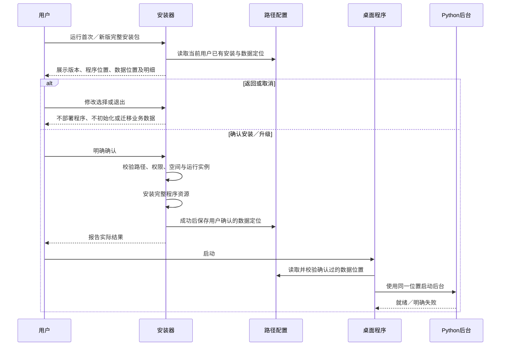

# 知序：安装、路径确认与手动升级

## 0.13.0 正式版（2026-10-24）

用户已授权提交 Git 并发布安装包。本轮把修订 24 的本地记忆、INT8 混合检索、单次直接回答及探索精选发布为 0.13.0；沿用冻结后台、Electron 和 NSIS 流程，验证后发布安装包、SHA-256 与清单。

简单说：下载一个安装程序即可运行；语义模型约 24.34 MB，在设置中单独准备，安装包和运行内存不受模型 100 MB 限制。

保持应用／安装器身份、数据位置与凭据服务 `KnowledgeBase.test0.01`。首次打开旧库前创建一致性备份，再事务迁移 schema 6→7，失败停止打开。安装包未签名，不增加自动更新。本轮不在正式用户库安装或调用付费接口。本地构建与隔离验证已完成，证据如下。

- 安装包：`release/KnowledgeBase-Setup-0.13.0-x64.exe`，149,186,573 字节（约 149.19 MB／142.28 MiB），未签名。
- SHA-256：`61728d253d53ec603597195f331178ad6bbae0a3b983a3cd6e2f91f89921d601`；配套 `.sha256` 与 `release-manifest.json` 已核对。
- `npm run check` 通过：329 项后台、29 项宿主，以及规范／格式／Ruff／类型／构建；`npm run test:ui` 通过：54 项检查、74 张截图（`artifacts/0.13.0`），已查看记忆设置截图。
- 原生 NSIS 28 项路径检查、页面取值、定位保留及实际分盘测试通过。安装包内嵌 7z 完整性测试通过；NSIS 尾部数据提示符合封装结构。提取的 `app.asar` 与 `knowledge-worker.exe` 和已验证的打包目录 SHA-256 一致。
- 实际打包 EXE 在临时工作目录、中文／空格数据路径和 PATH 无 Python／Node.js 时启动／重启通过；沙箱、版本一致、定位优先级、保存知识、本地查询、偏好保留及精选上限通过。打包后台真实 INT8 索引／同义命中／记忆／EOF 退出通过，零付费调用。
- 未验证干净 Windows／ARM、完整真实安装升级／卸载、大型真实库整体延迟／峰值内存、广泛语义准确率及真实供应商回答质量／节费比例。合成 16/16 不等于生产准确率。

简单说：本机隔离验证覆盖实际打包程序和安装包内容；模型需首次显式准备，使用后的答案仍需核对。

发布状态：本地构建与验证已完成，准备提交 `main`、创建 `v0.13.0` 并发布 [GitHub Release](https://github.com/20050404yxc-collab/KnowledgeBase/releases/tag/v0.13.0)。

## 0.12.0 正式版（2026-10-23）

用户已授权提交正式版并更新安装包。当前源码与内部版本同步为 `0.12.0`，本地安装文件为 `release/KnowledgeBase-Setup-0.12.0-x64.exe`，配套 `.sha256` 与 `release-manifest.json`。新增选区连续问答、本地优先检索和预览确认入库；已完成本地构建与隔离运行验证。

简单说：运行新版完整 EXE 即可手动升级，先查已存知识，解决不了再问模型，好回答可以确认保存。

沿用现有安装向导、应用身份、路径定位和凭据服务 `KnowledgeBase.test0.01`；本轮不增加数据库结构，schema 6 保持。来自历史 0.1 库的既有增量迁移仍由应用负责，不能把本轮“无新增迁移”等同于从所有旧版本升级均已验收。不增加自动更新；源码与 `v0.12.0` 标签已推送，安装包、SHA-256 与发布清单已发布到 [v0.12.0 Release](https://github.com/20050404yxc-collab/KnowledgeBase/releases/tag/v0.12.0)。当前仓库为公开状态，本次发布未修改仓库可见性。

简单说：不改知识和密钥的存放位置；安装过程依旧先确认目录。尚未验证的升级与干净机器场景如实保留。

### 本次交付结果

- 安装包：`release/KnowledgeBase-Setup-0.12.0-x64.exe`，130299056 字节，约 124.26 MiB，未签名。
- SHA-256：`275866186d79bcafd1d58318d82ae3d0437c4ae1d3e80b902c71bcbb63592e4f`；配套校验文件与发布清单已生成，完整包内归档检查通过。提取的 ASAR 与冻结后台哈希和实际运行验证的包内程序一致。
- 工程检查通过：317 项后台、29 项宿主及规范／格式／类型／构建；桌面隔离回归通过：52 项检查、70 张截图（artifacts/0.12.0）。原生安装器路径及定位保留检查通过。
- 实际打包 EXE 在临时 profile／中文数据目录中启动并正常退出，未依赖 PATH 中的 Python／Node；本地选区问答命中零模型调用；重启后已存知识保留，临时会话清空。此项验证包内程序，没有对正式安装执行覆盖。
- 仍未验证干净 Windows、实际旧安装升级／修复／卸载／重装全矩阵、正式旧库迁移、真实供应商质量与 SmartScreen。完整证据见实施与验收及任务验证记录。

简单说：本地包已经生成并实际运行过；这些结果不代替干净电脑和旧安装升级的完整验收。

以下保留 0.1 首次交付与安装路径修正的历史方案、流程及证据；其中版本号和旧包校验不代表新版验证结果。

## 历史 0.1 安装交付

| 项目 | 状态 |
|---|---|
| 当前方案 | 修订 2，2026-10-22；用户已选择修复误判并精简限制，路径修正已实施；本地回归通过，修正版安装包已重建 |
| 用户已明确的要求 | 0.1 首次正式交付；EXE 安装包；不自动更新；新版可手动升级；安装前确认程序与存放路径 |
| 本页提出的细节 | 沿用当前用户安装、升级保留目录与数据；本次修正路径校验与提示 |
| 验证状态 | 安装路径回归、完整 npm run check 与桌面测试通过；干净机器验收未完成 |

## 目的与范围

将当前依赖开发目录的程序制作成 Windows x64 完整离线安装包，显示版本为 `0.1`、内部版本为 `0.1.0`，在安装写入前由用户确认程序和数据的实际位置。

简单说：发给别人一个 EXE，对方看清楚装在哪、知识存在哪后再安装，不用另装 Node.js 或 Python。

本次覆盖安装向导、后台运行环境打包、目录配置与显示、手动覆盖升级、卸载和版本一致性。不增加自动检查、下载或安装更新，不扩展 OCR、旧 DOC、语义索引或业务功能。Windows 11 x64、16GB 内存沿用既有验收基准，不是已验证最低要求。

简单说：先把现有功能可靠地交付出去；以后你发新版安装包，用户自己运行它升级。

## 安装前确认的路径

首次安装分别选择程序目录与业务数据根目录。默认延续现有 `KnowledgeBase` 应用身份和数据位置；以下环境变量只是文档记法，安装页必须展开为当前电脑上的完整绝对路径。

| 内容 | 建议默认值／规则 | 是否可选 |
|---|---|---|
| 程序文件 | `%LOCALAPPDATA%\Programs\KnowledgeBase` | 首次安装可选 |
| 数据根目录 | `%APPDATA%\KnowledgeBase`，与现有默认数据目录一致 | 首次安装可选；可选择其他本地磁盘的专用目录 |
| 知识数据库 | `<数据根目录>\knowledge.sqlite3`；运行时可能有 SQLite 辅助文件 | 随数据根目录变化 |
| 保留的资料副本 | `<数据根目录>\sources` | 随数据根目录变化 |
| 诊断日志 | `<数据根目录>\logs` | 随数据根目录变化 |
| 临时资料副本 | `<数据根目录>\sessions` | 随数据根目录变化 |
| 数据库升级恢复点 | 当前机制在数据根目录生成的 `before-*.sqlite3` | 随数据根目录变化 |
| 路径定位配置与桌面缓存 | 固定当前用户系统应用数据位置 `%APPDATA%\KnowledgeBase` | 展示说明；不随业务数据根目录迁移 |
| API 密钥 | 当前 Windows 用户的凭据管理器 | 展示说明；不是普通文件目录 |

用户只需选择一个业务数据根目录，数据库、资料、日志、临时副本与恢复点按固定相对位置组织。安装向导会展示这些派生位置；不能把安装目录当作数据目录，也不能选择相互包含的程序／数据目录。系统临时文件和安装器缓存由 Windows／安装器管理，不承诺所有系统文件均写入用户选择的目录。

简单说：可以把知识与资料放到 D 盘；少量用于记住这个选择的配置、桌面缓存，以及 Windows 管理的密钥仍留在系统用户区域，安装前会说明。

默认当前用户安装，不要求使用者为准备 Python 或 Node.js 获取管理员权限。选择无权限的位置时提示更换目录；不以管理员身份偷偷改写其他用户的数据。自定义目录以本地固定磁盘为首版范围，不承诺网络盘和云同步目录的 SQLite 一致性。

简单说：建议普通用户直接安装；若所选位置不能写入，先处理路径问题，再继续。

## 路径校验与本次修正

已复现的问题是：输入合法但尚未创建的目录后，原 NSIS 路径转换返回空字符串，代码继续检查并可能覆盖最初错误，导致误报“超过 220 字符”或“目录相互包含”。原测试仅覆盖单个路径函数，没有覆盖页面取值后的完整链路。

简单说：不少用户选的路径没有问题，是安装器把新文件夹当成了错误路径。

本次使用不要求目标已存在的 Windows 路径转换；校验失败后保留首个具体原因。取消统一的 220 字符上限，中文、空格、新建多级目录及程序／数据分盘按正常路径处理。目录仍受 Windows、安装组件及随包资源的实际能力约束，不承诺无限长路径。

简单说：不用先手动建好文件夹；路径有问题时会说明是磁盘、权限、格式还是文件冲突。

数据位置可以保留普通文件，不再一律要求空目录。没有可识别的知序数据库或已记录的数据位置时，已有 `sources`、`sessions`、`logs` 或数据库辅助文件仍视为业务名称冲突，以免接管其他内容；已识别数据目录继续复用。固定业务子项不能是链接，目录与文件类型必须正确。

简单说：数据文件夹里有普通文档可以继续，但不会接管其他软件的同名工作目录。

首次程序目录仍要求空的专用目录；程序与数据目录不能相同或相互包含，不允许直接选磁盘根目录、网络盘或链接路径。保留固定本地磁盘范围、写入权限检查、原数据库缺失时拒绝新建空库、升级沿用原位置及卸载保留数据。当前卸载组件会递归删除程序目录，因此不能简单取消程序目录隔离。

简单说：保留的限制用于避免卸载删到知识或其他文件；已有知识找不到时先恢复原位置。

本次不改变页面布局、数据库结构、凭据身份和版本号。预期结果是截图中两组独立的新目录可进入最终确认页，确认前不创建目标目录或业务数据库。主要回归风险是路径规范化后未发现重叠或链接，以及放宽非空目录后误接管业务同名内容；通过安装器实际函数、页面输入和隔离启动测试验证。

简单说：看起来还是原来的安装页，但新路径能够正常通过，危险路径会给出准确提示。

## 安装向导与流程

流程为：欢迎／检测已有版本 → 选择程序位置 → 选择数据位置 → 确认完整路径与安装方式 → 安装 → 完成。最终确认之前不部署程序、不初始化业务数据库、不迁移已有知识；安装器自身解压临时文件除外。用户可以返回修改或取消。

```text
┌────────────── 知序 0.1：确认安装 ──────────────┐
│ 安装方式：首次安装／从旧版本升级               │
│ 程序位置：C:\Users\…\Programs\KnowledgeBase   │
│ 数据位置：D:\知序数据                         │
│   知识库：D:\知序数据\knowledge.sqlite3        │
│   资料：  D:\知序数据\sources                 │
│   日志：  D:\知序数据\logs                    │
│   临时副本与升级恢复点：位于上述数据目录        │
│ 路径配置与桌面缓存：当前用户系统应用数据目录    │
│ API 密钥：Windows 凭据管理器                   │
│ 升级保留现有知识、资料与设置；不自动更新        │
│                 [上一步] [安装／升级] [取消]   │
└──────────────────────────────────────────────┘
```

技术上采用 Electron 桌面打包与携带 Python 后台的完整资源包，再通过 electron-builder／NSIS 提供自定义安装页面。使用 PyInstaller 的目录形式打包后台，宿主按开发／已安装环境分别启动后台；不复制整个开发虚拟环境。依赖版本锁定，随包组件与许可证按实际运行依赖核查，排除正式数据、密钥、测试样例和开发依赖。

简单说：安装包里准备好程序真正要用的东西，用户不需要运行命令或联网下载开发工具。



安装器检测运行中的程序时要求正常退出后继续，不能强杀任意 Python 进程。安装失败不得显示成功，也不得把新路径配置留给未完成的安装；定位配置缺失、损坏、指向不可用目录或疑似旧库丢失时明确阻止静默回退，不能偷偷新建空库冒充原库。

简单说：装不成功就说明失败；找不到原知识时先提示处理，不显示一个看似正常的空知识库。

## 新版本手动升级

发行 `0.1.1`、`0.2.0` 等完整新版安装包，用户自行下载并运行。稳定应用身份、安装器识别标识与凭据服务名，安装器检测当前用户已有版本，展示“旧版 → 新版”、原程序路径、原数据路径和明细，用户确认后替换程序文件。

简单说：以后不用卸载旧版，运行你发来的新版 EXE，看清目录后点“升级”即可。

升级默认沿用原程序与数据路径，并再次展示确认。首版升级页面不提供顺便搬家；改变程序或数据位置作为独立迁移需求处理，避免升级意外连接空目录或遗留多个数据库。若检测到当前开发版默认位置的旧库，必须明确展示并复用，经确认后才能使用；不得自动搬走原库。数据库与资料不由安装器覆盖；API 凭据继续使用现有 Windows 凭据身份 `KnowledgeBase.test0.01`。

简单说：升级只换程序，原来的知识继续用。要换数据盘，以后单独提供带检查和恢复措施的搬家流程。

安装器拒绝旧版本覆盖新版本；同版本可用于修复程序文件，但保留路径和业务数据。数据库结构若未来确需升级，必须另行定义兼容、备份、失败恢复与验收，本次不增加数据库结构。当前程序已有的数据库兼容机制仍在应用启动时执行，不由安装器绕过或重建。

简单说：新程序装完并不等于数据库能安全降级；不把装回旧程序当作数据恢复办法。

## 使用、卸载与预期效果

安装后通过桌面或开始菜单快捷方式打开，设置页继续显示并打开实际数据、资料和日志目录。Electron 启动、日志、后台及设置页统一使用已确认的数据位置，开发测试保留 `KB_DATA_DIR` 的隔离能力；正式安装运行不让意外环境变量静默改掉已确认的业务目录。

简单说：安装时选了哪里，日后运行和设置页看到的就应是哪里。

卸载只删除安装器管理的程序文件、快捷方式与安装登记，默认保留知识、资料、日志、路径定位配置及凭据，不增加删除用户数据的选项，不碰用户导入的原件。重新安装时识别保留的数据位置并要求确认。

简单说：卸载程序不会顺便清空知识；重装时仍应能找回原来的位置。

交付预期为一个完整 EXE 安装包，无 Node.js／Python 的目标机也可安装启动；在线模型仍需网络及使用者自己的 API 配置。发布说明必须列出实际功能边界、安装包 SHA-256、未签名状态或签名信息及验证范围，不将开发测试通过等同于安装验收。

简单说：用户只需要这个安装包，但不能把“能安装”说成“所有模型与文档都已验证”。

## 验证与限制

- 执行 `npm run check`、`npm run test:ui`，并单独验证打包后的后台及应用，不以开发目录运行代替。
- 干净 Windows 11 x64 环境验证离线安装和本地功能、无开发环境启动、中文／空格路径、程序与数据分盘、路径无权限／被占用／失效、取消和安装失败。
- 使用隔离旧库验证新版覆盖、开发版默认旧库识别、手工内容与资料保留、稳定凭据身份、同版修复、拒绝降级、卸载和重装；不得拿正式知识库做破坏性演练。
- 密钥验证使用专用测试凭据并清理，不读取正式密钥、不调用付费接口。目录或配置失败至少验证一个安全日志路径，避免记录私密完整路径与正文。
- 体积、性能、许可证核查、代码签名与 SmartScreen 实际表现均尚未验证；未签名安装包可能出现系统提示，不承诺无提示安装。

修正版安装包位于 `release/KnowledgeBase-Setup-0.1.0-x64.exe`，配套 `.sha256` 与 `release-manifest.json` 已更新。代码与 `v0.1.0` 标签已推送，安装包和校验文件已发布到 [v0.1.0 Release](https://github.com/20050404yxc-collab/KnowledgeBase/releases/tag/v0.1.0)，上传后的大小和 SHA-256 与本地一致。当前仓库为私有仓库，下载需要仓库访问权限。发布验收未完成时必须如实列出未覆盖项，不因版本命名为 0.1 就宣称完整 v1 已验收。
