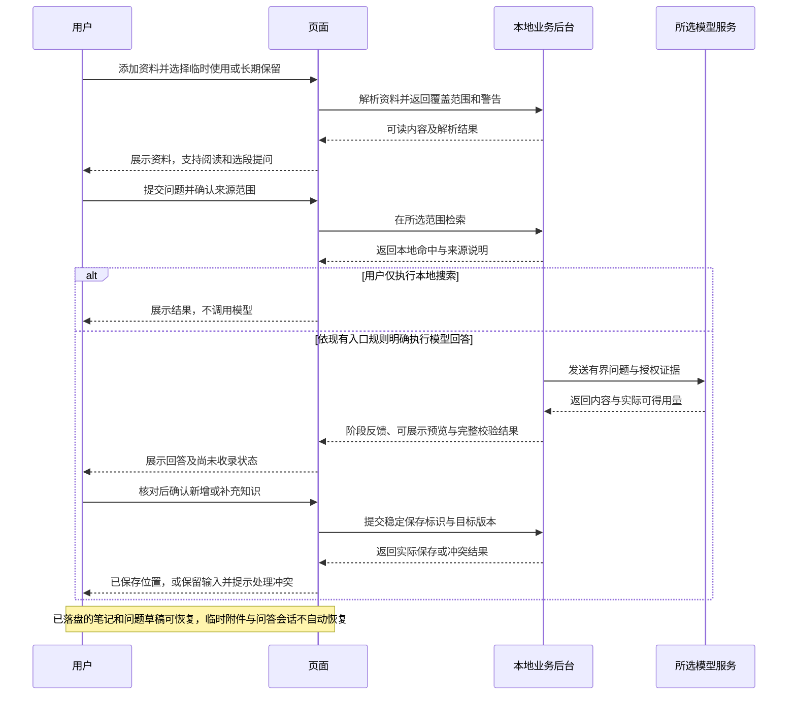

# 知序：总体优化方案

| 项目 | 内容 |
|---|---|
| 文档日期 | 2026-11-07 |
| 当前方案 | 总体优化第 1 版；产品任务修订 27 |
| 当前状态 | 用户要求根据本方案一次性完成优化，已授权实施；按下列实施细则执行 |
| 实施状态 | M1–M3 本轮源码实现完成，完整工程检查及隔离桌面回归通过；M0／M4 的实测证据和未验证部分见下表 |
| 与已有方案的关系 | 沿用现有产品与架构，承接并保留修订 26；本轮具体行为以下列实施细则和交付结果为准 |
| 阅读对象 | 产品使用者、设计与开发维护者 |
| 适用基线 | 当前工作区源码；已发布安装包是否包含某项增量，以安装与发布文档为准 |

## 1. 优化目标

### 本轮实施细则

本轮已在同一轮完成 M1–M3 的下列可交付能力，保留现有技术栈、数据库版本、用户数据目录和凭据服务名。草稿采用本地有界文件、原子替换和版本检查，与正式知识分开；笔记按页面保存，问题只保存文字与来源范围，临时附件不落入草稿。草稿保留至成功保存或明确放弃，并提供清除；问答正文仍为运行期会话，不因恢复草稿自动重新调用模型。

简单说：这次一起改完日常使用流程；未保存的输入能恢复，临时附件需重新添加，回答不会偷偷长期保存或重发。

阅读采用宽窗口目录／正文分栏，窄窗口列表／详情切换，管理控件折叠；正文支持字号、当前已加载正文的章节导航与代码复制。搜索提供关键词、类型和分类筛选、命中高亮、补充及长文命中段定位；搜索状态独立保留。资料库直接导入时明确选择临时使用或长期保留，逐项显示失败和重试。

简单说：找、读、问、存尽量在当前任务附近完成，出错能接着处理。

Markdown 导出包含所选知识完整正文、补充和引用；完整备份使用 SQLite 一致性快照并纳入保留资料、配置、草稿和项目路径登记，排除系统凭据、临时附件、日志及可重建模型／索引资源。备份／隔离恢复期间拒绝并发业务请求，恢复只创建新目录，不覆盖正在使用的数据。清单记录格式版本、逐文件 SHA256 和大小，恢复前检查路径、容量、校验和与数据库完整性。

简单说：成果能带走，备份能核对并试恢复；原数据和原文件不会被覆盖。

M0／M4 以合成样例建立性能与相关性证据并记录支持边界；OCR 的正式接入需要授权真实样例、离线资源及安装体积决定，本轮不下载模型、不调用付费接口。长文继续使用现有分页及明确覆盖提示；深色模式按需评估，不把缺少质量证据的能力标为交付。非开发试用者观察及真实环境验收仍需实际使用者参与。

简单说：能验证的在这次验证；需要真实资料、真实用户或额外资源的项目清楚列出，不虚报完成。

### 本轮交付结果

| 工作包 | 本轮结果 | 验证与边界 |
|---|---|---|
| M0 使用基线 | 完整任务回归；101／1001／5001 条合成知识性能基线 | 未开展非开发使用者观察；热缓存后端计时不代表真实大库、启动总耗时或内存峰值 |
| M1 高频流程 | 首次使用入口、阅读分栏／窄屏切换、阅读工具、搜索筛选高亮和长文定位、直接资料导入 | 隔离 Electron 实际流程、宽窄窗口、键盘与截图核对通过；缩放使用等价 CSS 宽度，未测 OS 缩放 |
| M2 工作保护 | 分页笔记草稿、问题文字和范围恢复、最近八篇阅读、可读生成预览、失败重试 | 实际退出重启、版本冲突／写入失败、模态焦点验证；最近阅读保存窗口滚动位置，不保存长文页码；会话与临时附件不跨重启 |
| M3 数据携带 | 完整 Markdown 导出、在线一致性备份、逐文件校验、独立新目录恢复；保留原有确认式分类／批量整理 | 备份损坏、缺失资料、越界路径、失败补偿和取消竞态通过；不新增分类批量导出或归档，不切换当前库 |
| M4 增强评估 | 复测现有离线 INT8 语义模型，保留长文分页和范围提示 | 固定小样本 16／16 正例首位命中；并非独立准确率验证。OCR、复杂文档／全文总结和深色模式未实现 |

完整工程检查通过：后台 361 项通过、1 项跳过，宿主 31 项通过，规范、格式、类型与构建通过。隔离桌面回归及详细证据见[实施与验收](实施与验收.md#总体优化验收修订-27)。以上为优化实施阶段的证据；用户随后授权正式发布，本次以 0.14.0 同步版本和安装包，交付结果见[安装与发布](安装与发布.md)。

围绕“获取资料 → 找到内容 → 阅读理解 → 提问深化 → 保存成果 → 下次继续”建立连续的个人知识工作流程，降低学习成本、操作成本和结果不确定性。

简单说：打开后知道做什么，操作时少绕路，关掉再打开还能继续，积累的内容以后能找回来。

整体优化需要同时回答五个问题：

1. **会不会用：**没有阅读说明书，能否完成第一次记录、导入和提问？
2. **用起来是否顺手：**是否需要频繁切页、滚动和重复设置？
3. **能否放心使用：**内容是否保存、用了哪些资料、失败后如何恢复，能否看清楚？
4. **能否持续积累：**知识增多后，是否仍能查找、整理、导出和备份？
5. **是否适合长期阅读：**文字、密度、布局和交互是否舒适且一致？

## 2. 实施前评估依据与现状

本节记录实施前的发现，以下问题表不代表完成优化后的当前行为。方案形成时依据产品文档、相关代码和既有桌面截图；实施阶段已执行完整隔离桌面回归和实际重启，结果见第 1 节及实施与验收。全程未访问正式知识、正式凭据或真实付费模型接口。

简单说：这是一份有现有实现依据的优化规划；实际使用速度、模型答案质量和用户是否容易理解，仍需后续验证。

### 2.1 已有能力应作为基线

- 本地笔记、知识编辑、多层分类、常用／在学／归档、紧凑目录与可选星球视图。
- 全库关键词搜索，以及问答链路已有的混合检索能力；两者的搜索方式和范围不完全相同。
- 文档解析、临时附件与保留资料、资料阅读和基于资料再次提问。
- 直接问答、学习目录、选区连续问答、预览确认入库和知识补充。
- 切页继续任务、进度与取消、失败反馈、用量记录和可选模型计价。
- 回收站、知识快照、完整目录备份指引、项目标签与本地路径登记。
- 修订 26 已整理主导航、输入操作层级、设置入口、主题变量及样式归属。

这些能力不应被重新包装为“从零新增”。本轮优化重点是流程衔接、信息层级与尚未覆盖的日常场景。

### 2.2 当前发现与证据强度

| 发现 | 使用影响 | 依据与限制 |
|---|---|---|
| 首次引导仍主要介绍生成目录，与直接回答主入口不一致 | 新用户不易确定起步方式 | 当前 `FirstUseGuide`、输入工具栏与已有首页截图 |
| 首页存在多处说明和模型配置提示 | 任务入口被说明文字分散 | 已有宽窄屏截图；实际理解成本待观察 |
| 全库搜索、列表筛选和问答检索范围不同 | 结果不一致时难以理解原因 | 搜索页、目录筛选与直接问答检索实现 |
| 知识库目录与详情使用纵向组合，正文前有管理控件 | 查阅内容需要额外滚动 | 当前页面与样式；适用窗口尺寸待实测 |
| 笔记草稿和问答会话主要在运行期保留 | 重启后不能接续未保存工作 | 页面状态 hook、编辑 hook 与会话创建逻辑 |
| 资料库添加资料需经探索附件入口 | 管理资料存在跨页绕行 | 当前资料页与空状态说明 |
| 常规生成反馈主要显示阶段和接收字数 | 等待过程中缺少可读成果 | 当前任务订阅与进度组件；不能据此断言模型实际速度慢 |
| 完整备份需要关闭应用并手动复制目录 | 普通使用者执行和核对困难 | 当前备份指引；知识快照已有，不能描述成完全无备份 |
| OCR、长文全文总结及复杂文档质量仍存在支持边界 | 部分资料无法完成预期处理 | 当前解析规则及产品文档；不是本轮新发现的回归 |

主要源码依据：

- [首次引导](../../../apps/desktop/renderer/src/features/exploration/FirstUseGuide.tsx)、[输入操作](../../../apps/desktop/renderer/src/features/exploration/ComposerToolbar.tsx)。
- [知识库页面](../../../apps/desktop/renderer/src/features/knowledge/LibraryPage.tsx)、[阅读区](../../../apps/desktop/renderer/src/features/knowledge/AnswerPanel.tsx)、[阅读布局样式](../../../apps/desktop/renderer/src/shared/styles/knowledge.css)。
- [搜索页](../../../apps/desktop/renderer/src/features/search/SearchPage.tsx)、[直接问答检索](../../../services/knowledge-agent/knowledge_agent/application/direct_questions.py)。
- [草稿状态](../../../apps/desktop/renderer/src/features/knowledge/use_note_editor.ts)、[页面状态](../../../apps/desktop/renderer/src/shared/use_page_state.ts)、[资料列表](../../../apps/desktop/renderer/src/features/sources/SourceList.tsx)。
- [任务反馈](../../../apps/desktop/renderer/src/app/use_session_task.ts)、[备份说明](../../../apps/desktop/renderer/src/features/settings/BackupGuide.tsx)。

## 3. 总体路线与范围

### 3.1 路线比较

| 路线 | 范围与方式 | 可观察效果 | 主要代价与风险 |
|---|---|---|---|
| **推荐：分阶段整体优化** | 沿用现有产品，逐条打通核心流程，并同步整理相关视觉 | 每批完成一类真实任务，体验逐步一致 | 需要严格控制各批范围和兼容 |
| 可选：仅做视觉整理 | 调整排版、颜色、间距、图标和控件状态 | 界面更清晰，改动较集中 | 草稿恢复、资料入口和流程问题仍在 |
| 暂不建议：整体重写 | 重新设计工作区及数据组织，再重建功能 | 设计自由度最高 | 周期与回归成本高，已有能力容易丢失 |

本轮采用沿用现有产品、逐条打通流程的路线，并按用户“一次性优化完”的要求在同一轮交付；原分阶段建议不再构成等待逐批授权的边界。

简单说：按完整的使用任务逐步改，每一批都能实际使用和评价。

### 3.2 优化范围

范围包括信息架构、首次使用、首页、知识阅读与编辑、搜索、资料管理、问答反馈、工作恢复、数据携带与备份，以及相应的可访问性、性能和稳定性验证。

简单说：从打开程序到下一次回来继续，覆盖主要日常使用环节。

继续使用 Electron＋React／TypeScript＋Python＋SQLite，遵守[项目编码与分层规范](../工程规范/项目编码与分层规范.md)。本轮新增草稿文件和受限数据操作协议，设计见[技术设计](技术设计.md#总体优化实现修订-27)；未新增数据库迁移、依赖或安装资源。

本规划不纳入多人协作、云同步、移动端、自动联网搜集、自动发布或整体技术栈替换。深色模式、OCR 等按后文顺序评估，不作为第一批完成条件。

## 4. 面向真实任务的产品结构

### 4.1 主要使用场景

| 使用者此时想做的事 | 推荐起点 | 应获得的结果 |
|---|---|---|
| 快速记下一段想法 | 新建笔记 | 输入被保护，保存状态明确 |
| 找以前学过的内容 | 顶部全库搜索 | 结果可筛选、可定位，返回不丢查询 |
| 看一份资料并解决疑问 | 资料库导入／最近资料 | 解析范围明确，阅读与提问连续 |
| 弄懂一个新问题 | 探索输入 | 有来源说明的回答，按需预览收录 |
| 系统学习一个主题 | 探索中的主题学习入口 | 学习目录、进度与已生成内容可辨认 |
| 接着昨天的工作 | 首页最近使用／恢复提示 | 回到原内容、阅读位置或未完成草稿 |
| 整理和带走自己的积累 | 知识库整理／设置中的数据管理 | 变更可核对，成果可导出，备份可验证 |

### 4.2 导航与页面职责

保留探索、知识库、资料库三个主要工作入口。搜索继续拥有独立结果页，并由顶部固定入口触达。回收站、设置和用量统计放在次级导航区域；第一阶段不再增加顶层入口。

简单说：提问去探索，读自己整理的内容去知识库，管原始材料去资料库；常用入口保持稳定。

知识库继续包含全部／常用／在学／归档。问答历史和最近使用优先嵌入相关页面，不为每项新增能力单独扩展主导航。历史记录保存不等于正式知识入库。

### 4.3 工作区概念草图

以下只表达布局职责，最终尺寸、控件细节及视觉稿在各批实施前细化。

```text
┌──────────┬──────────────────────────────────────────────┐
│ 知序     │ 搜索知识与资料                    [新建笔记] │
├──────────┼──────────────┬───────────────────────────────┤
│ 探索     │ 分类／结果   │ 标题 · 来源 · 保存状态        │
│ 知识库   │ 筛选与排序   │                               │
│ 资料库   │              │ 正文／资料内容                │
│          │ 当前选中项   │                               │
│ 最近使用 │              │ 引用与相关内容                │
│          │              │ [继续提问] [编辑] [更多]      │
├──────────┴──────────────┴───────────────────────────────┤
│ 按需显示任务进度、取消入口和保存反馈                     │
└────────────────────────────────────────────────────────┘
```

窄窗口改为列表和详情分别展示，详情提供返回列表；保留原筛选、选择与滚动位置。探索首页以输入与最近使用为主，不强行套用阅读分栏。

### 4.4 典型资料问答与保存流程



流程优化保留不同问答入口既有的模型触发规则，不把本地搜索和模型回答合并成无法区分的一次操作。

## 5. 优化工作包

优先级按用户影响定义：P0 保护内容和可信状态；P1 改善高频任务；P2 扩展整理与处理能力。优先级不代表可以跳过前置设计。

### 5.1 P1：首页、首次使用和功能发现

**目的：**缩短从打开程序到完成第一件事的路径，消除首次引导与主操作不一致。

简单说：用户不必先理解模型、目录和分区，才能开始记录或提问。

**做法：**首页突出问题输入、新建笔记和继续上次阅读；压缩宣传区和重复说明。无可用模型时提供简短配置提示，并保持本地功能可用。直接回答作为常规入口，系统学习目录作为独立目的；设置保留快速开始说明，避免两页重复占据大块空间。引导根据实际可用状态展示，不只判断是否存在配置记录。

**效果：**新用户可以独立完成本地记录；配置模型后能辨别直接提问与主题学习。是否采用可关闭且记住状态的引导，在实施批次明确。

### 5.2 P1：阅读布局和知识操作

**目的：**减少找到内容后仍需滚动查找正文、来回切换目录的成本。

简单说：把内容放在眼前，管理操作需要时再展开。

**做法：**宽窗口恢复稳定的目录／正文分栏，窄窗口使用有返回位置的详情视图；正文前保留标题、来源、状态和关键操作，分类、频率等归入管理区。增加阅读字号、适合中文的行距与宽度、长文目录、代码复制、返回原位置。继续保留紧凑／星球偏好，不因视觉优化重置分类路径或阅读状态。

**效果：**用户选择知识后即可阅读；连续浏览多篇知识时无需反复从页面顶部重新寻找。

### 5.3 P1：搜索、筛选与内容定位

**目的：**让查找范围和结果来源可理解，提高已有内容的复用率。

简单说：知道查了哪里，点开就能到相关内容。

**做法：**统一全库入口、列表筛选命名和空结果说明；增加内容类型、分类等必要筛选，以及命中高亮和定位。评估把问答已有语义能力复用于搜索页，保留可明确选择的关键词方式和可说明的回退路径。返回搜索保留查询、页码、筛选和阅读位置。

**效果：**相同关键词在不同入口的差异能够解释；搜索结果能带用户到知识正文、补充或资料对应片段。语义效果以固定样例和真实使用反馈评估，不宣称必然比关键词更好。

### 5.4 P1：资料导入、解析与再次使用

**目的：**打通原始材料进入阅读、提问和积累的路径。

简单说：在资料库就能加资料、看资料、问资料。

**做法：**资料库增加直接导入；明确临时使用与长期保留选择，不因新增入口自动改变现有附件保留规则。解析结果优先说明可读范围、扫描空页和重要遗漏，提供查看内容与处理建议。资料阅读支持就近提问、摘录为笔记、查看关联知识和从引用定位。项目路径继续是有界按需读取，不伪装成完整导入。

**效果：**用户能判断资料是否已进入可用状态；再次提问不需要重复添加同一保留资料。导入失败保留可重试项，不影响其他已完成项或用户原件。

### 5.5 P0：草稿、会话与继续工作

**目的：**保护尚未正式保存的投入，让工作能够跨重启接续。

简单说：写到一半、问到一半，下次有机会接着做。

**做法：**先实现本地笔记和问题草稿恢复，再评估可清理的问答历史与最近阅读。草稿、历史和正式知识分开存储和展示；仅对实际完成持久写入的内容显示恢复承诺。定义自动保存时机、失败提示、过期清理、版本冲突、重命名／删除目标后的恢复方式。附件原来是临时的，恢复时应提示重新添加或经用户选择明确保留，不能静默永久保存。

**效果：**重启后恢复已成功落盘的草稿；恢复不覆盖用户已保存的新版本，也不重复调用模型或重新计费。

**本轮决定：**每个草稿槽位最多 850,000 字节，输入停止 400 毫秒及窗口失焦时尝试写入，仅成功回执后显示已保护。失败保留输入，版本冲突不自动覆盖；笔记目标失效可另存。没有静默过期，明确放弃／成功保存写入版本墓碑。最近阅读最多八条，仅含标识、标题、时间和窗口位置，支持清除。问答会话继续运行期暂存。

### 5.6 P0：可信保存、取消和失败恢复

**目的：**让用户准确知道结果是否已保存，以及失败后可以如何继续。

简单说：页面上的“成功”“取消”和实际发生的事一致。

**做法：**复核现有保存幂等、目标版本、取消与提交竞态；把恢复操作放到失败位置。区别尚未提交、已提交、结果待查询确认；保留主错误及可检索编号，技术细节按需展开。输入和已完成结果不因一次失败清空。重试由用户明确触发，可能已提交时先查状态，避免重复保存或调用。

**效果：**断线、超时、双击、取消和切页时没有假成功、重复知识或串页结果。已有机制通过复核保留，发现具体缺陷后再按证据修复，不预先宣称这些场景当前都有错误。

### 5.7 P1：问答等待、来源与收录衔接

**目的：**降低等待的不确定性，帮助用户判断回答是否值得保存。

简单说：知道正在做哪一步、答案根据什么、是否已经留下来。

**做法：**按实际过程显示检索、生成、校验、保存等阶段，不展示没有依据的百分比或剩余时间。适合的回答支持生成中预览；结构化输出先转换成可读内容，不暴露原始 JSON。未完成输出不得进入正式知识。来源区分用户资料、本地知识与模型补充；引用 ID 合法不描述成事实已核验。新增或补充的保存预览就近可达，展示目标位置及差异。

**效果：**用户能判断是否继续等待、取消或保留成果；已有不同入口的收录规则保留其明确性。

### 5.8 P1：视觉系统与可访问性

**目的：**形成适合长期阅读和持续维护的一致界面。

简单说：文字容易看，按钮容易认，不同页面像同一个程序。

**做法：**保留绿色品牌，正文以中性色提高层级清晰度；正文 15–16px、辅助文字 12–13px 作为设计起点，结合缩放和窗口实测调整。统一字号、间距、圆角、按钮等级、图标、输入、弹窗、空状态、加载和错误样式。每个任务区突出一个主要操作；完成键盘顺序、焦点可见、弹窗焦点返回、文本对比度和减少动态效果适配。移除没有真实账户含义的个人标识，设置入口使用对应语义。

**效果：**正常、悬停、选中、禁用、加载、错误等状态可辨认；窄窗口与 Windows 125%／150% 缩放下主要流程可完成。字号方案不等于无障碍合规认证，需单独验证。

### 5.9 P2：知识整理、导出与完整备份

**目的：**支持知识规模增长及用户带走、恢复自己的积累。

简单说：内容多了仍能管理，换电脑或误操作时有退路。

**做法：**先提供所选知识的 Markdown 导出，再按需求增加分类导出、批量移动和归档。批处理先展示影响数量，避免选中范围被分页误解。已有回收站和确认式整理继续保留；自动模型整理不替代手工管理。完整备份向导明确知识、资料、配置和凭据的覆盖差异；使用一致性快照或受控停写机制生成备份，提供完整性核对和隔离恢复验证。

**效果：**用户能自行导出成果，能分辨知识快照与完整备份。普通备份不导出系统凭据；恢复前保护现有数据，不能用运行中随意复制数据库实现“一键备份”。

### 5.10 P2：文档处理与搜索能力增强

**目的：**扩大能处理的真实资料类型，同时保留质量与资源边界。

简单说：扫描资料和长资料逐步能用，并能看清哪里处理得不完整。

**做法：**先收集授权样例，验证扫描 PDF／图片 OCR 的文字准确率、顺序、引用位置、耗时、内存和安装体积；再决定技术选型及资源准备方式。超长资料采用分段处理、覆盖记录和分层总结，展示处理／遗漏范围及可得费用信息。复杂表格、公式、旧 DOC 等按真实需求单独评估。语义搜索复用现有模型与索引能力，先测相关性，再扩充依赖。

**效果：**新增支持通过清晰的样例验收；未支持或解析不可靠的内容明确说明。OCR、长文总结和更强模型都不能自动保证事实正确。

## 6. 性能、稳定性与工程约束

性能优化以实际用户等待和交互阻塞为依据，先建立基线，再设置量化预算。

简单说：先测清楚哪里慢，再改最影响人的地方。

- 测量冷启动到本地可操作、搜索首屏、打开正文、导入首个有效反馈及生成首个可读反馈；区分本机工作与外部模型等待。
- 使用合成数据覆盖小、中、大三档知识库和长正文；样例规模、机器、重复次数、冷暖状态及目标值在实施批次固定。
- 不以加载动画证明性能改善；保持界面响应，限制解析、索引和并发任务占用。
- 分栏、搜索定位、历史恢复都必须保持页面状态、请求归属、取消和资源清理的正确性。
- 新持久化如需升级结构，单列版本识别、备份、事务、失败恢复和旧版本兼容方案；不更改凭据服务名和既有用户数据位置。
- 产品流程不展示无助于操作选择的内部协议、模型参数或存储细节；诊断信息按需提供。

## 7. 工作包与本轮交付

以下保留原工作包划分，便于核对范围。本轮按用户要求连续完成实施与验证，不再逐批等待确认；实际完成情况以第 1 节交付表为准，包含真实用户和资源条件的条目不以合成测试代替。

| 阶段 | 核心内容 | 交付物与完成条件 | 前置依赖 |
|---|---|---|---|
| M0：建立使用基线 | 走通记录、搜索、读资料、提问、保存、重启接续；核对现有问题 | 任务路径、问题清单、关键页面草图、性能基线和风险分级；区别已复现缺陷与体验假设 | 本总体方向进入具体设计 |
| M1：高频流程与视觉基础 | 首页与引导、阅读分栏、搜索命名和定位、资料直接导入；同步统一相关控件 | 四类主要任务形成连续流程；宽窄窗口、缩放、键盘及页面状态回归通过 | M0；确认关键布局和入口语义 |
| M2：工作保护与问答连续性 | 优先落地草稿恢复，再实施选定的历史策略、最近阅读、可读生成反馈和失败恢复 | 隔离环境验证重启恢复、写入失败、版本冲突、取消／提交竞态；无隐式重发 | 明确持久化期限、附件规则和存储设计；P0 可独立提前实施 |
| M3：整理与数据携带 | Markdown 导出、批量管理、完整备份与恢复向导 | 导出结果核对、批量作用范围准确、备份完整性和隔离恢复验证 | 明确导出与备份格式及数据范围 |
| M4：增强能力与质量打磨 | 语义搜索评估／扩展、OCR、长文分层处理；按需深色模式 | 以真实授权样例评估质量、性能与资源；满足基准后再纳入正式支持 | 真实需求和样例、资源与费用边界 |

本轮首页、阅读、导入、草稿及数据携带一起完成；原有已实现的批量分类与确认式整理继续回归，不新增未经定义的批量归档或分类导出格式。

## 8. 验收标准

### 8.1 使用者验收

| 编号 | 场景 | 预期行为 |
|---|---|---|
| U1 | 无模型的新用户首次打开 | 能辨认本地功能与 AI 功能，独立新建并找回一条笔记 |
| U2 | 查找一篇旧知识 | 理解搜索范围，打开到相关位置，返回保留查询与结果状态 |
| U3 | 导入一份资料并提问 | 在资料库完成导入，看到解析结果，基于明确来源提问并预览保存 |
| U4 | 阅读多篇长内容 | 目录与正文易于切换，返回保留位置，管理控件不阻碍正文阅读 |
| U5 | 写到一半重启 | 恢复已持久化的草稿，显示其时间和目标，不覆盖较新的正式内容 |
| U6 | 生成失败、取消或后台断开 | 实际保存状态准确，输入和已完成内容保留，可执行明确恢复动作 |
| U7 | 整理、导出与备份 | 作用范围和结果可核对；完整备份能在隔离目录恢复验证 |
| U8 | 窄窗口、缩放和键盘操作 | 主要操作可达，正文无整页横向溢出，弹窗可关闭并返回合理焦点 |

M0 使用不参与开发的试用者进行小规模观察，记录是否需要帮助、操作步骤、绕行、误解与耗时；试用人数和任务基线在执行时确定。未开展观察前，不宣称“所有用户都觉得更好用”。

### 8.2 工程验收

产品实施后执行 `npm run check`；桌面或跨进程行为执行 `npm run test:ui`，并补足实际风险相关场景。验证使用隔离数据、合成资料和模拟服务，不读取正式凭据或调用付费接口。

重点覆盖保存幂等、取消与提交边界、过期异步结果、页面状态隔离、原件保护、资料删除后的引用、持久化失败、迁移恢复和日志脱敏。通过后仅因新修改、失败或未解决风险追加验证。

真实供应商效果、真实文档质量、大库性能和干净机器安装分别验收；模拟通过不能替代这些结论。本轮已运行完整工程检查与隔离桌面测试，已建立合成库性能及离线模型证据；真实环境边界见[实施与验收](实施与验收.md#总体优化验收修订-27)。

## 9. 关键取舍与风险

| 事项 | 推荐方向 | 需要在对应批次确定的内容 |
|---|---|---|
| 视觉风格 | 保留绿色品牌，强化正文、中性色与操作层级 | 关键页面样稿、信息密度与阅读字号 |
| 草稿与会话 | 草稿恢复优先；历史与正式知识分开，可清理 | 默认保存策略、保留期限、是否包含附件及隐私开关 |
| 模型调用 | 保留明确触发和现有来源范围 | 新流程是否改变调用时机、预估信息和重试方式 |
| 数据与恢复 | 兼容现有数据，恢复前保护当前状态 | 是否迁移、备份格式、校验、回滚与跨版本范围 |
| OCR 与长文 | 先样例验证，再承诺支持 | 首发是否需要、模型资源、安装体积和可接受耗时 |
| 深色模式 | 在主主题稳定后按需实施 | 是否进入本次总体优化的必做范围 |

最容易“看起来完成、实际上没有解决”的三类情况：界面变清爽但仍有绕行；草稿显示已保存但落盘失败；生成预览看似完整但未通过校验。分别用真实任务观察、失败注入与重启验证、未完成状态及保存边界测试检查。

最可能受真实环境影响的是模型兼容性、复杂文档解析和磁盘写入。后续方案需要提供保留输入、明确局限和可执行恢复路径，不能靠增加自动重试掩盖问题。

## 10. 交付结论与后续边界

总体预期是形成一个能连续完成知识工作的桌面应用：进入容易、查找直接、阅读舒适、提问可理解、保存可信、积累可携带。每项效果以第 8 节场景验证，不把规划列出的能力描述为已经完成。

简单说：用户可以少研究软件本身，把精力放在自己的资料、问题和思考上。

本轮源码优化和隔离验证已经完成。真实用户观察、正式库与真实供应商、OCR／复杂文档样例和干净机器验收仍未完成；后续已获用户授权，正在以 0.14.0 执行正式发布流程。具体使用规则、实现和证据同步见[产品方案](产品方案.md#323-总体优化修订-27)、[技术设计](技术设计.md#总体优化实现修订-27)、[实施与验收](实施与验收.md#总体优化验收修订-27)。
