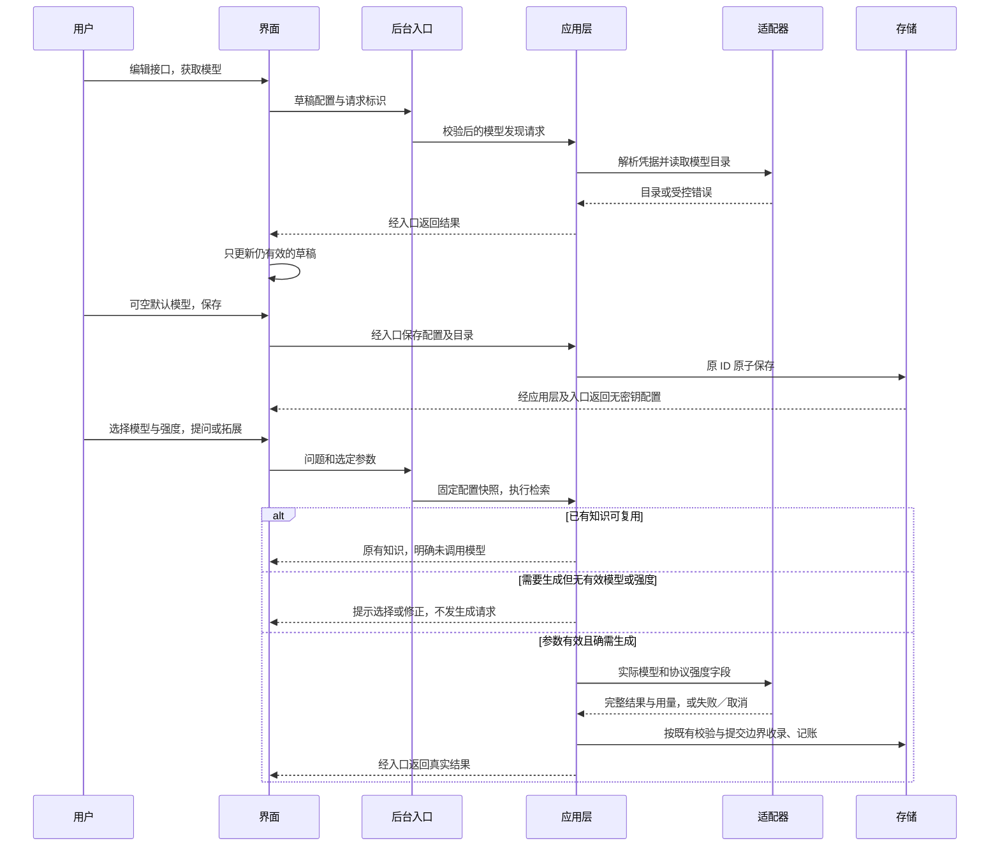

# 个人知识库 Agent：技术设计

> 当前代码为 `test0.03`，修订 7 的右侧工作区、批量生成、项目资料一次提交与分区提问已实现并通过本机隔离验证，设计见末节。第 5.1–5.4 节保留修订 4／6 基线；完整 v1 与真实供应商质量仍待验收。
>
> 简单说：本轮已接通“查、拆、选、读、补”，验证使用模拟接口，不消耗正式 Key。


方案修订：7（末节为本轮增量，第 5.2–5.4 节保留修订 6 基线）；更新日期：2026-10-20。修订 4 已实施基线和修订 3 的证据保留；技术栈、A 频率方案、本地路径与 Windows 基准继续有效，语义检索留待后续。

本页与 [产品方案](产品方案.md)、[实施与验收](实施与验收.md) 共同构成当前完整方案。

## test0.01 实际实现

Electron 主进程负责可信窗口、文件选择、白名单 IPC 和 Python 生命周期；沙箱界面通过 preload 调用限定能力。后台使用 UTF-8 JSON 行协议，解析在线程中执行；数据库写入在后台事件循环串行完成。生成请求在提交前接受取消，知识与同问题复用标识在同一事务写入。启动时标记上次中断的调用，并清理应用所属孤立资料副本及遗留会话。

简单说：界面不直接读写数据库或执行系统命令；后台没完成的结果不会变成正式知识，重启保留已提交的数据。

后台目前使用中文双字与英文词匹配，尚无向量索引。MD／TXT 保留原文文本，DOCX 保留正文块和表格顺序，PDF 逐页提取文字，缺字页提示 OCR 未接入。模型内容先以 JSON 接收完整流，再检查标题、正文和引用 ID；界面显示接收进度与最终文本，不将原始 JSON 或来源 HTML 当作可执行内容。

简单说：引用能看到实际摘录和位置；复杂排版与答案内容质量仍需核对，关键词检索也可能漏掉同义表达。

当前模型适配提供 Responses、Chat Completions 和 Anthropic Messages；真实供应商服务未调用。Windows 凭据管理器保存 Key，普通 SQLite 配置只保留标识；每次调用独立记录结果、返回用量与用户输入价格快照。缓存、推理等复杂定价未做完整适配，费用只作基础估算。

简单说：可以填写自己的接口，价格以你输入的单价估算；不宣称任何型号已通过真实连接验收。

正常关闭先结束输入、取消任务并清理会话；2.5 秒未退出时仅终止本应用 Python 进程树。Windows 虚拟环境可能包含启动器与实际运行时两个进程，正常和挂起后的强制清理均已在隔离数据上验证。模型请求的等待上限为 180 秒，网络读超时为 120 秒。

使用与维护：双击启动入口或运行 `npm run dev`；数据目录由 Electron 用户目录决定，可在界面底部查看。运行前仍需项目开发依赖，当前未提供携带 Python 的独立安装包。完整结构和命令见 [使用说明](../../../README.md)。

简单说：现在是可运行的开发版，复制源码到没有开发环境的电脑还不能直接运行。

以下章节描述完整 v1 目标。向量模型切换、分层总结、OCR 和完整安装交付等尚未实现的部分继续按计划保留。

## 1. 目的与范围

使用适合 Windows 桌面交互、文档解析和模型接入的技术组合，实现可维护的个人知识库，先打通本地文件到带引用回答的完整链路。

简单说：界面用成熟的桌面网页技术，处理文档用 Python，知识放在本地数据库里。

技术设计覆盖界面、后台通信、数据与文件、检索、解析、API 和打包；暂不设计云服务、账号系统、同步或多 Agent 自主协作。

## 2. 已选技术与待验证候选

| 职责 | 已选方向／候选 | 决策状态 |
|---|---|---|
| 桌面外壳 | Electron | 用户已选择 |
| 界面 | React＋TypeScript | 用户已选择 |
| 后台 | Python | 用户已选择 |
| 数据库 | SQLite | 用户已选择 |
| 前端构建 | Vite／electron-vite 候选 | 工程验证后锁定 |
| 结构化结果校验 | Pydantic 候选 | 兼容性验证后锁定 |
| 模型 HTTP 通信 | httpx 等支持流式与取消的客户端候选 | 适配验证后锁定 |
| 中文关键词检索 | SQLite 全文索引＋中文分词或等效方案 | 不能假设默认分词可用；样例验证后锁定 |
| 向量索引 | sqlite-vec 候选 | Windows 二进制、打包和模型维度验证后锁定 |
| 凭据 | Python keyring 对接 Windows 凭据能力的候选 | 打包和读取验证后锁定 |
| Python 打包 | PyInstaller 等候选 | 干净 Windows 环境验证后锁定 |

设计表保留候选状态；本次开发环境的精确版本、锁文件、安装位置和合成样例运行结果已记录在 [开发环境](开发环境.md)。基础解析、SQLite 扩展和 CPU OCR 已通过本机环境检查，尚未进行代表性文件、真实 API 或产品打包验证；依赖／模型的完整分发许可审计仍待进行。

## 3. 进程边界与生命周期

Electron 主进程负责窗口、可信文件入口和 Python 后台生命周期；React 通过受限的 preload 接口调用；Python 持有数据库、解析任务和模型请求。界面不直接获得任意系统命令或数据库写权限。

简单说：界面负责显示和操作，后台负责处理与保存，避免解析大文件时窗口卡住。

拟采用随应用启动的本地 Python 子进程，通过标准输入／输出上的结构化消息通信，不要求用户启动 HTTP 服务。所有业务日志走独立日志或标准错误流，不污染消息通道。

消息至少包含请求标识、操作、有效载荷；事件包含状态、阶段、进度或文本片段；响应关联原请求并标明成功、失败、取消或已保存。模型输出和文档文本不作为系统命令执行。

解析／OCR 等耗时任务进入有并发上限的工作队列，与异步模型调用协调；SQLite 写入由后台集中管理，避免解析进程同时写同一连接。具体线程／子进程方案在性能与打包验证后锁定。

取消请求传播到任务和模型连接，晚到结果按请求状态丢弃。进入保存事务前取消不得生成正式知识；若事务已经提交，应明确显示已保存并允许用户管理，不假称撤销。关闭窗口时先取消和清理，限定等待时间后结束所属后台，不能留下孤立解析进程。

后台崩溃要让界面结束等待、显示失败并允许恢复；重试必须使用幂等标识避免重复保存。首版仅允许一个写入后台实例，重复启动聚焦已有窗口，降低跨实例锁冲突。

## 4. 文档解析与引用

统一解析产物包括文件指纹、格式、解析器版本、层级结构、文本块、表格／代码类型、可获得的位置和告警；检索与引用使用同一版本的文本块标识。

简单说：换解析库不会改变上层问答入口，回答也能找到它实际引用的原文。

| 格式 | 候选 | 计划验证点 |
|---|---|---|
| MD、TXT | UTF-8／常见编码检测，Markdown 结构解析候选如 markdown-it-py | 中文编码、标题、代码块、相对图片与链接边界 |
| DOCX | python-docx | 段落、标题、表格顺序与定位；不承诺排版页码 |
| 文字 PDF | pdfplumber | 中文、页码、多栏阅读顺序、表格与空文本页 |
| 多格式统一入口 | MarkItDown | 结构与来源位置能否满足引用要求，不因统一转换而丢失位置 |
| 扫描 PDF 的文字识别 | 优先验证 RapidOCR＋ONNX Runtime；PaddleOCR 为其他候选 | Windows CPU、中英文识别、位置、模型资源、体积与打包 |
| 复杂 PDF 的结构处理 | Docling 为增强候选，也可评估 PaddleOCR 的结构处理能力 | 双栏阅读顺序、表格、来源映射、附加模型和资源成本 |
| 旧 DOC | 例如 LibreOffice 转换流程候选 | 转换依赖、无头执行、失败反馈、来源映射和部署许可 |

其他候选参考入口：[MarkItDown](https://github.com/microsoft/markitdown)、[python-docx](https://github.com/python-openxml/python-docx)、[pdfplumber](https://github.com/jsvine/pdfplumber)、[sqlite-vec](https://github.com/asg017/sqlite-vec)。其中 python-docx、pdfplumber 和 sqlite-vec 已试装并记录版本，MarkItDown 未安装；完整分发许可审计仍待进行。OCR 项目已有下述首轮官方资料调研。

### OCR 开源调研结论

用户要求先查找网上开源项目再决定 OCR。2026-10-20 已通过 GitHub API 读取下列官方仓库说明、安装说明或模型授权说明；下表是资料证据。本次另行授权的环境准备已对 RapidOCR 3.10.0＋ONNX Runtime 1.31.0 做合成中英文图片的本机 CPU 检查，结果见开发环境页，不能据此确认真实文件质量或最终选型。

简单说，先确认别人已经提供什么能力，再在本应用里试装、试识别，最后定库；不自行从零开发 OCR 算法。

| 项目与已读取来源 | 官方资料确认的能力／许可 | 对本项目的判断 |
|---|---|---|
| [RapidOCR README](https://github.com/RapidAI/RapidOCR/blob/main/README.md)、[配置](https://github.com/RapidAI/RapidOCR/blob/main/python/rapidocr/config.yaml)、[模型许可](https://github.com/RapidAI/RapidOCR/blob/main/python/MODEL_LICENSES.md) | Windows、默认中英文、离线部署、ONNX Runtime CPU 路径；代码 Apache-2.0；许可说明覆盖的 PaddleOCR 派生模型为 Apache-2.0，其他资产需逐项核查 | 推荐优先验证基本 OCR；尚未最终定库或承诺速度 |
| [PaddleOCR README](https://github.com/PaddlePaddle/PaddleOCR/blob/main/README.md)、[安装说明](https://github.com/PaddlePaddle/PaddleOCR/blob/main/docs/version3.x/installation.en.md) | Windows／CPU、多语言及结构处理能力；仓库标注 Apache-2.0；功能组和推理引擎需按需安装 | 可选识别／结构增强路线，不默认安装全部组件 |
| [Docling README](https://github.com/docling-project/docling/blob/main/README.md)、[RapidOCR 集成示例](https://github.com/docling-project/docling/blob/main/docs/examples/rapidocr_with_custom_models.py) | Windows、扫描 PDF、版面、阅读顺序和表格处理；已有 RapidOCR 自定义模型示例；代码 MIT，模型许可分别核查 | 推荐作为复杂版面增强候选，不能凭集成示例认定组合已在本应用通过 |
| [OCRmyPDF README](https://github.com/ocrmypdf/OCRmyPDF/blob/main/README.md) | 为 PDF 增加可搜索文字层，使用 Tesseract 等外部程序；代码 MPL-2.0 | 当前不优先，第一版主要需要提取内容问答，不必先生成新 PDF |

RapidOCR 会使用转换后的 PaddleOCR 模型，两者不能当成完全独立的识别算法。OCR 读出文字，版面解析恢复顺序和结构；基础 OCR 成功不等于复杂表格和公式无损。

优先验证方案是文字页直接提取、扫描页转图后由 RapidOCR 在 CPU 上识别并关联 PDF 页码和坐标；若双栏和表格样例显示结构恢复不足，再评估引入 Docling。PDF 页面渲染器也需验证和锁定，不把 OCR 引擎本身当作完整 PDF 处理器。

资源首次使用准备、完成后离线识别是推荐部署方式；安装包内附资源是可选方式。首发是否支持 OCR、最终库组合、资源交付和旧 DOC 仍待确定。本次已记录候选发布版本及三项模型的来源／哈希和约 30.3MiB 总大小；真实文件准确度、每页耗时、峰值内存与打包稳定性尚未测量，适用分发许可仍需逐项核查。

识别 PDF 时检查逐页文本覆盖，不能把扫描页提取为空就当解析成功。未具备 OCR 时明确说明扫描页未识别，部分解析保留告警；用于回答的依据不能包含未读到的页面。

相同内容指纹且解析版本相同可复用缓存，文件内容变化产生新版本。PDF 页码可直接定位；DOCX 使用标题和段落；Markdown 使用结构和可用行号。表格、公式和图片解析能力分别说明，不承诺所有格式无损。

## 5. 检索、回答与受控 Agent

采用显式流程编排，让程序决定检索范围、保存条件和推荐数量，让模型负责理解、解释、归纳和提出关联。第一版不依赖复杂多 Agent 框架。

简单说：模型可以帮助思考，但不能自行决定覆盖笔记、删除文件或绕过你的资料范围。

检索先做关键词召回，可用时加入语义召回，再合并去重并按相关性排序。相关性阈值和中文分词效果需要样例标定；低分召回不等于证明库里没有该知识。已有内容足够时直接查看原文；需要解释或新学习内容时才调用生成接口。

普通提问与全文总结采用不同策略：前者检索相关片段，后者先覆盖全文分块再汇总。多文件比较保留各来源；输入超长时分批处理并说明未覆盖部分，不能静默截断后声称完整。

回答结构建议包含正文、引用标识、依据类型、可复用知识候选及不确定性。程序校验引用确实来自本次可用块，校验成功后再提交新知识。文档中的指令视为资料内容，不获得工具或操作权限。

三条关联推荐由程序按库存配比挑选，模型可提供概念和理由；先返回轻量拓展卡片，点击才生成全文。卡片展示不计作有效知识使用。

### 5.1 本轮检索、知识点目录和补充设计（修订 4，已实施）

目的在于把现有单标题／正文问答拆成目录规划和单知识点学习两个用例，同时补齐安全排版与可积累的数据模型；完整用户行为、线框及流程图见[产品方案第 3 节](产品方案.md#3-搜索知识点目录和增量积累修订-4已实施)。

简单说：先确定有哪些知识点，再打开某一项；新的知识和补充都能在本地找到。

| 部分 | 修改方式及职责 |
|---|---|
| React 探索功能 | 独立本地搜索按钮，知识目录状态、主题分组、条目状态和选择；窄屏上下布局；保留输入框、模型控件与附件范围 |
| React 知识功能 | 详情选择与旧回答状态解耦，展示原文和独立补充；添加 Markdown 展示组件和有效引用节点；编辑保留原文，补充独立维护 |
| Electron／协议 | 只扩充白名单和契约校验；维持 JSON Lines、请求关联、取消及关闭语义，不将归类逻辑放宿主 |
| Python 应用层 | 组织本地检索、问题预处理、模型目录规划、选中项学习、归属确认和收录；经窄接口调用索引、模型及事务仓库 |
| Python 领域层 | 目录字段、标题语义约束、主题路径、引用、归属候选、重复补充和冲突状态规则；无外部 I/O |
| Python 基础设施 | 本地索引、分页、SQL 事务、版本迁移、模型协议编解码；不自行决定覆盖或合并规则 |

本地搜索采用中文双字／英文词的确定性词法检索，增加可重建的持久化词法索引，覆盖全部知识和补充、已保留资料文字块，按类型和主题分组返回相关摘录。实现验证 FTS5 能力并使用预分词内容，不能直接假定默认分词适合中文；不支持时用明确提示的分批完整扫描回退。查询文本作为参数，不拼接 SQL／FTS 表达式；设置返回分页、词数和单页大小上限，遍历范围不再受最近 5000 条限制。资料范围、索引删除和重建与正文事务保持一致。

简单说：索引帮助程序在本机查全库，坏了可以从正文重建；没装向量模型也能查。

目录规划输出有界的主题／知识点数组，单点包含短标题、问题侧面、允许的证据 ID、已有目标建议和缺口说明。程序验证类型、长度、数量、重复、原问题整句回填及目标是否真实存在且在授权范围内；过多知识点明确提示未覆盖部分，不静默截断。标题不能靠截取问题前若干字生成。模型规划失败保留本地目录，不用未校验的原始 JSON 填充知识界面。目录标签不收录为正文，未点击项不批量生成。

简单说：大模型提清单，程序检查清单；既不把提问原样存成标题，也不把空目录项当成新知识。

详情生成以稳定目标标识和当前知识版本为输入，针对一个知识点或缺口输出完整 Markdown 与引用。已有知识直接读；有新附件或新侧面时不能被旧问题映射提前短路。问题到条目的旧单值缓存不得作为新目录流程的唯一依据。正式写入前重新读取目标版本，按目标知识点串行处理并检查重复／删除／编辑；归属不明或冲突先返回待核对候选，用户选择后再次校验，不把模型给出的相似标题直接当作合并授权。

简单说：相同问题也可能有新材料；写入时还要检查旧笔记是否已经被改过。

跨进程采用增量操作：`knowledge.search` 返回分页分组结果，`question.plan` 返回目录，`knowledge.learn` 接收选中项和明确的学习／补充意图。补充新增、编辑和删除使用受限操作，`knowledge.get` 增量返回主题与补充列表。保留现有 `question` 及知识 CRUD 的字段语义，新增字段向后兼容；旧入口不破坏旧客户端。新增结果类型、错误及进度同步维护 `contracts/desktop.ts`、`contracts/protocol.md`、协议样例、TS／Python 校验和 API 客户端。完成事件只关联当前请求；切换条目、切页和卸载后忽略晚到结果。

简单说：目录和详情各有明确请求，旧调用仍兼容，上一项的慢响应不能覆盖当前选择。

SQLite 版本 3 增量保存主题／知识点关联与规范身份键、独立补充、提交幂等标识和词法索引。知识点以稳定 ID 定位，主题与规范标题共同约束业务身份，不能沿用“全库同标题即同概念”来误合并不同领域；现有笔记 ID 和原文字段不重写，旧 `concept` 唯一约束与新身份之间需以兼容映射隔离。旧数据先保持未分类，不发模型请求回填。新增或补充正文、引用、归属、幂等记录和索引在一个事务提交；失败全部回滚。索引重建不会删除原始知识。

简单说：既要能持续补充同一知识，也要允许不同领域有同名知识；旧笔记保留原样。

迁移先使用 SQLite backup API 生成 `before-knowledge-topics-v3.sqlite3` 一致性恢复点，再在事务内建结构／回填必要本地映射并提升 `user_version`。失败停止启动写入并提示保留数据目录，重启幂等重试，禁止重建空库绕过。旧版程序遇到版本 3 应拒绝打开；恢复须先关闭程序并按隔离验证后的恢复步骤使用一致性备份，不能在运行中的 WAL 库上直接覆盖文件。数据目录、应用身份、凭据服务名和 API 配置保持原值。

简单说：迁移失败不能继续装作升级成功，也不能通过新建空库丢掉旧知识。

Markdown 使用 `react-markdown 10.1.0`＋`remark-gfm 4.0.1` 的 AST 渲染方案，已锁定依赖；禁用原始 HTML、主动脚本、危险 URL 和未授权远程媒体加载。引用转换仅作用于正文文本节点中真实存在的证据 ID，跳过行内代码和代码块；未知标记不冒充有效引用。普通文本自然显示；编辑器保留原文供复制，既有引用摘录能力保留，适配表格与长代码滚动。不得用全局正则删掉 `#`、`*` 或插入未经处理的 HTML。

简单说：把排版做好，同时保住代码和引用，恶意模型文本不能变成可执行页面。

目录规划与每次详情生成分别记账，按提交时快照固定接口／模型／强度；计划本身不代表收录。用户取消当前学习只阻止未提交内容，不回滚此前已完成的其他点；同步事务前最后检查取消，提交后报告实际保存结果。同一目录项并发点击串行处理并复用已提交结果，不同问题补同一知识点在写入边界去重。无自动重试；各阶段沿用有界输出与超时，超限说明未处理范围。

简单说：每次调用可追踪费用；取消和重试不会把半篇内容或重复补充写进去。

本机隔离验证覆盖 Markdown 与脚本边界、引用定位、完整词法召回和分页、离线零模型调用、多问题目录、范围隔离、手工编辑保护、同名异义、增量补充、并发幂等、取消／已提交竞态、版本 2→3 迁移与故障恢复。按项目规范执行 `npm run check` 和构建后的 `npm run test:ui`；只使用隔离库、合成文档及模拟服务。真实模型拆解／归属／冲突识别质量、正式数据迁移和性能另行验收。

简单说：测试不仅看目录能不能显示，还要确认查得全、补得对、失败不伤旧数据。

补充生成的证据与已有正文共用 28000 字预算；已有内容过长时显示覆盖说明，不声称核对全文。只允许引用实际发送的证据块。索引重建由仓库维护方法 `rebuild_search_index` 提供，没有新增界面按钮；全部补充先预览，确认提交时再次校验目标版本。补充维护与索引同步提交。

### 5.2 知识资格与项目解释门禁（修订 6，已实施）

目的、完整行为、诊断、线框与时序图见[产品方案第 3.6 节](产品方案.md#36-知识点审核项目说明与阅读修正修订-6已实施)。本节只描述如何按现有分层实现；本轮产品代码已按本节实现并完成本地验证。

简单说：先把“审核、要资料、等同意、找示例、再解释”的约束放到后台，按钮负责表达这些状态。

目录编排在 `topic-plan` 后增加独立 `topic-review` 调用；领域规则校验候选 ID 全覆盖且互斥的保留／排除／待澄清结果、理由、项目依赖和资料需求。允许零个合格知识点；缺字段、非法引用或审核失败不得降级为直接学习。审核用同一请求快照和已授权证据，单独计量，取消传播，无自动重试。非知识输出只作本次回答，不进入自动知识收录；直接生成与关联拓展不能绕过相同资格约束。

简单说：模型负责判断含义，程序负责检查判断有没有漏项和越权；不能因为审核失败就放行全部候选。

`TopicWorkflow` 会话记录当前点的资料缺口、明确关联的附件、资料版本、公开示例许可和选择结果；审核排除／待澄清项单独返回，项目上下文状态为 `materials/material-ready/candidates/public-ready`。后台先判断相关项目资料是否足够，资料补入后重新检查，普通的“学习”不授予联网能力。服务端一次性 UUID 挑战绑定会话、点、范围与查询词，不能由模型字段设为已授权。文件范围下，需额外勾选“本点公开示例”并确认才可查询公开来源，原文件证据不混入知识库。临时许可只存在会话，不写配置或数据库；切页／取消撤销请求所有权，换点重新确认，提交边界复核资料和许可版本。

简单说：给这一次解释的同意不能被拿去解释别的点；已有附件也必须相关，不能只看“上传过文件”。

应用层经新增窄 `PublicProjectReader` 能力调用基础设施 GitHub 只读 REST 适配器，由 `bootstrap` 注入；Electron 不承担项目业务。搜索仅接受用户已看到的通用关键词；固定官方 HTTPS 主机、编码查询参数、拒绝跨主机重定向和任意 URL，不使用模型返回的下载地址。默认最多三个候选、每个 README 最多 20000 字节、响应最多 1MB、单次请求超时 15 秒，每次许可最多一次搜索和三次 README 读取；限流或失败不重试。只读元数据与 README，不克隆、执行或递归遍历项目。不读取生产凭据，使用公开匿名接口；实际联网只在产品用户确认后发生，开发验证用模拟 HTTP。

简单说：用可控的公开仓库查找工具，不让模型任意访问网址；找不到、超时或限流都如实说明。

公开资料映射为带仓库 URL、实际 README 路径、字符区间、UTC 读取时间和摘录的证据块；用户选择后才交给模型解释。入库沿用现有正文／引用结构并标明公开示例，禁止把它写成用户项目事实；保持现有原子提交、补充预览、版本检查、幂等与取消边界，无 schema 迁移。搜索费用若供应商没有提供则不能推断，模型生成仍按实际调用记账。

阅读组件增加受限 Markdown 兼容处理，只修复以冒号结尾的成对加粗标签结束边界空格；代码块及含反引号、反斜线、HTML／链接语法的行整体跳过；无法确定时保持原样。不打开 HTML、不新增远程媒体、不全局删符号、不改写存储原文。生成提示同步规范 Markdown，旧数据通过展示路径获益。

简单说：修阅读效果，不批量改旧笔记；格式修复不能扩大脚本或网络权限。

影响 `contracts/desktop.ts`、协议说明／样例与两端运行时校验；React 目录 hook／组件、附件关联和 Markdown 展示；Python 目录与直接生成用例、提示、领域规则、能力接口、GitHub 适配和装配；相关 pytest、宿主边界与 `scripts/check_model_ui.mjs` 桌面回归。执行后运行 `npm run check`、`npm run test:ui` 并视觉检查截图同类排版；真实模型语义质量与 GitHub 网络可用性另列未验证项。

### 5.3 页面与异步状态所有权（修订 6，已实施）

目的及导航流程图见[产品方案第 3.7 节](产品方案.md#37-探索与知识分区为独立页面修订-6已实施)。历史诊断：`AppContent` 曾统一挂载 `ExplorationPage`，全局阅读状态和延迟列表刷新造成页面串内容；现已拆分页面组件、按页保存状态，并为迟到请求加所有权校验。

简单说：问题在页面选择和状态归属，不能只调整列表查询或删掉一次搜索结果。

应用装配层改为显式选择探索和知识分区页面；分区展示组件可复用，但以分区标识绑定各自状态。探索持有问题、附件、目录、搜索、回答与推荐；各分区持有自己的筛选、选择和阅读上下文，不借用探索的 `answer/selected`。共享 Markdown／引用／编辑组件接收当前页明确的数据和动作，避免全局同名字段混用所有者。未保存编辑草稿保留显式所有权，导航不静默丢弃。

简单说：复用展示组件可以，不能共用一份没有页面归属的“当前回答”。

导航同步更换显示所有者；列表以页面、筛选词与请求版本为键，当前键无结果时显示加载。160 毫秒 debounce 仅延迟发送，不延迟页面切换。异步成功、错误、推荐、进度及 `finally` 都校验页面和请求所有权；旧请求不得 `setSection('探索')` 抢回页面或清掉新请求。保留既有切页取消策略、序号失效与提交后真实结果；返回探索恢复已完成快照，不恢复旧联网许可。首次分区展示列表顶部；导航在 DOM 变化前同步记录离开页滚动位置，再由布局 effect 恢复进入页位置。

受影响链路为应用装配、导航／Sidebar、`use_library.ts`、阅读和知识打开／保存 hook、探索／目录 hook、相关组件、反馈和附件对话框条件。拖入附件只在探索入口生效，不在知识分区静默加入隐藏的探索会话；切页不删用户原件。新增桌面检查覆盖首屏、迟到列表／详情／错误、切页取消、保存刷新和草稿保留。

简单说：打开、保存、提示、拖入文件等入口也要接到正确页面，不能只拆开外观。

### 5.4 分类摘要、分层目录与兼容保存（修订 6，已实施）

目的及分类示例见[产品方案第 3.8 节](产品方案.md#38-参考已有知识的大类小类与知识点修订-6已实施)。审核显式输出 `category`、`subcategory`、具体标题及判断理由；`theme` 继续作为兼容路径。领域校验字段、层级、长度、候选范围和规范身份；界面两级分类树下才是可学习叶子，类别节点不是知识点。

简单说：大类、小类是校验过的数据，不是给平面主题加几个缩进。

仓库经窄接口提供全库去重路径摘要能力（扫描全部标签，按相关度排序，路径上下文预算 8000 字符，并报告覆盖范围），不受最近知识列表或六个正文候选的限制；SQL 留在基础设施。应用层在授权范围内选择相关分类和正文，遵守上下文预算并报告遗漏范围。“仅本次文件”在读取分类接口之前即跳过库内数据。模型优先复用含义匹配的路径，再推断新类；独立审核同时检查知识资格、层级及项目／通识区分，不再额外增加第三次分类调用。

简单说：先给模型合适的已有分类参考，再补缺少的分类；只用文件时不读取知识库目录。

新知识将分类字段编码为明确可逆、经校验的路径，保存到现有 `topic_links.theme`，保留主题＋标题身份与原子事务，无 schema 变更。路径使用带版本前缀的 UTF-8 JSON 十六进制编码，不能误拆类别中的符号。历史自由主题保留原值，无可靠层级依据的标为旧分类，不自动搬动、转换或合并。读取、搜索、补充与后续规划使用相同解释；补充沿用目标原分类，分类相似不是合并授权。分类树与频率分区独立。

简单说：新内容按层级保存，旧名字不猜着拆；不能为了目录整齐而改旧知识。

影响目录提示／规则、`TopicWorkflow.context/plan`、分类摘要仓库接口及 SQLite 适配、知识／检索映射、跨进程类型和运行时校验、分类树及面包屑、规划／持久化／范围隔离／桌面测试。验证跨项目通识复用、项目证据隔离、路径重启一致性、同名异义和旧主题兼容；不做全库自动分类迁移或向量模型接入。

## 6. 本地数据与文件

SQLite 保存知识、资料元数据、引用、任务和用量记录；原文件副本放应用数据目录中的受管理资料目录，向量为可重建派生数据。暂不需要单独部署数据库服务。

简单说：核心资料在本机，索引坏了可以重建，不能把原知识当作可随意丢掉的缓存。

| 数据对象 | 核心内容 |
|---|---|
| 知识条目 | 稳定标识、标题、正文、来源性质、生成／编辑时间、自动分区、手动覆盖 |
| 知识关系 | 两端知识、前置／相似／对比／应用关系与理由 |
| 资料及版本 | 文件名、格式、内容指纹、受管理副本路径、解析状态和版本 |
| 文本块 | 资料版本、顺序、层级、文本和来源位置 |
| 引用 | 知识或回答到文本块的关联，以及需要保留的引用摘录 |
| 使用事件 | 知识、时间、事件类型、当日时区和本地日期、幂等标识 |
| 模型配置 | 提供方、协议、接口地址、模型、用途、凭据引用，不含明文密钥 |
| 调用记录 | 请求／尝试标识、用途、模型、状态、时长、返回用量、价格快照和估算 |
| 索引元数据 | 向量模型标识、维度、内容指纹、状态和索引版本 |
| 后台任务 | 请求标识、阶段、状态、错误类型、取消与提交状态 |

知识收录以事务提交，重复事件和重试不得重复创建。个人编辑不被自动刷新覆盖，语义相似但非相同的内容不能直接合并。引用保存必要摘录，临时原文件清理后仍有可读依据，全文回看不可用时明确说明。

用户主动保存资料时复制入应用管理目录；读取文件失败、空间不足或数据库提交失败时，不显示入库成功，并清理未提交副本。删除资料清理对应索引，保留知识需同步标记来源原文已移除；删除知识清理相关关系与索引，不删除用户原始文件。

数据库使用版本化迁移。首版不新增云备份功能；迁移和异常写入恢复方式须在实现时明确，不能以索引可重建为由丢失知识正文。变更向量模型、维度或切块策略时重建派生索引，不能混用不兼容向量。

## 7. API、凭据和用量

### 7.1 修订 3：配置、列表与调用参数（已实施）

目标是在现有协议和运行边界内接通编辑、模型发现、默认值和请求级覆盖；只整理本次触及的功能链路，按[项目规范](../工程规范/项目编码与分层规范.md)组织新代码，不进行全量架构迁移。

简单说：界面负责选择，后台负责校验和请求；把这次功能真正接通，不顺带重写整个应用。

变更前定位：`ProviderForm` 没有编辑入口和模型菜单，提问不传模型；后台保存支持同 ID 更新及保留 Key，但校验要求模型非空；三个协议编码固定使用默认模型，存储也只有单模型。现在相关实现分别位于 `features/providers/`、跨进程契约、`knowledge_agent/application`、`domain` 与 `infrastructure`，新增按配置关联的模型目录表。

简单说：要同时改表单、保存数据和真正发请求的代码，否则界面选了也不会生效。

| 边界 | 实施设计 |
|---|---|
| React | 在现有 `features/providers/` 中增加编辑、模型目录、选择组件和交互 hook；纯展示组件只接收数据和回调。受限 API 客户端负责新增操作的请求／结果校验 |
| Electron／契约 | 保留现有请求 ID、JSON Lines、取消和生命周期；白名单新增 `providers.models`。契约明确保存字段、模型列表结果以及 `question`／`providers.test` 的可选 `provider_id`、`model`、`reasoning_effort`，旧参数调用仍能使用默认值 |
| Python 入口／装配 | 保留 `worker.py` 入口，由 `application/knowledge_service.py` 组合新增用例；沿用 `knowledge_agent` 包内的 `entrypoints/application/domain/infrastructure` 分工，由 `bootstrap` 装配，不在新业务流程中直接操作 SQL 或导入 HTTP 实现 |
| 配置存储 | 增量增加按配置 ID、模型 ID 唯一的模型目录表；现有 `providers.model` 保留为默认值，空字符串表示未设置，不改既有配置 ID。旧非空模型幂等加入目录；保存目录和默认值为同一事务；默认模型不能被移除而仍留为默认 |
| 迁移恢复 | 在原数据位置进行版本化、幂等增量迁移；迁移前创建应用管理的 SQLite 一致性备份，失败回滚并明确阻止写入，不新建空库绕过失败。隔离数据验证原知识、原配置、凭据引用与旧尝试记录不变 |
| 凭据 | 新增必须有 Key；编辑的空 Key 只在后台解析旧凭据；新 Key 仅为瞬时输入。保存失败补偿凭据替换，不把真实 Key 或认证头返回列表、写日志或普通配置 |
| 模型发现 | 校验当前草稿地址／协议／凭据后，Responses 和 Chat Completions 使用基础地址加 `/models`、Bearer 认证；Anthropic 使用同一路径及其 API Key／版本头，按实际分页契约获取。仅 GET 列表，限时、限页、限响应体，不跟随认证重定向；服务不支持时给出可手动添加的错误 |
| 列表状态 | 发现结果只返回模型 ID；去重并保留手动条目。未完整取回时明确提示，失败不覆盖旧目录。请求与草稿版本绑定，切换编辑对象、地址、协议、Key、取消编辑、卸载后拒绝晚到响应 |
| 生成解析 | 在接收请求时固定配置快照；显式模型优先于接口默认值，无值时在网络请求前报错。显式模型必须属于该配置目录；后台同样校验强度，不信任界面状态。普通提问、拓展和测试连接共用解析规则 |
| 状态与复用 | 当前应用会话按接口保留临时模型选择，切换模型重置强度；配置删除或目录变化时清理失效选择并提示。发送中锁定控件；编辑／删除配置不会修改已经提交请求的快照；已有知识复用行为保留并显示未调用 |
| 记账 | 按解析后的实际模型记录尝试与知识来源。默认模型变化清空旧价格，除非重新填写；临时模型不同于默认模型时价格为未知。强度不伪装为 temperature，缺失用量仍未知，不增加自动重试 |

模型目录最多 1000 项、每个 ID 最长 160 字符；单页响应最多 1MB、最多 10 页、总等待上限 30 秒。达到分页上限显示部分结果，合并超限则保留草稿。数据库 `user_version` 从 1 增量到 2，恢复点为数据目录内 `before-model-catalog-v2.sqlite3`；升级失败应先关闭应用、保留完整数据目录及恢复点，再排查重试。

以上接口、存储与状态调整已实现；增量表及旧配置回填通过隔离迁移测试验证。主要回归风险是旧凭据丢失、默认值漂移、请求中配置变化、过期列表覆盖、迁移失败和模型切换导致错误计价；通过事务、快照、响应版本检查及隔离回归验证控制。

简单说：保存失败不能弄丢旧接口；新选择不能串到旧请求里，升级也不能动坏原来的知识。

推理强度按下表编码，默认始终省略参数。列表通常只有模型 ID，因此“协议可表达”与“具体模型已支持”分开标识；兼容协议的未验证模型可尝试基础档位，失败明确显示、不自动换档重发。附加档位仅在能力有明确依据时提供。

简单说：默认最兼容；选择更高强度是在请求模型多思考，不保证每个模型都接受，也不靠改温度冒充。

| 协议 | 初始强度行为 |
|---|---|
| Responses | 默认省略；低／中／高映射到 `reasoning.effort` 的 `low/medium/high`；`minimal/none/xhigh` 等只在明确支持时提供 |
| Chat Completions | 默认省略；低／中／高映射到 `reasoning_effort` 的 `low/medium/high`；兼容端不接受则明确报错 |
| Anthropic Messages | 初始保留“由模型决定”；未适配并验证具体模型的 thinking／effort 契约前禁用其他档位，不直接套用 OpenAI 字段 |



验证计划覆盖同 ID 编辑／取消／空 Key、凭据补偿、模型获取三种认证及失败／分页／晚到结果、空默认值、请求覆盖、未知模型／强度拒绝、实际负载和记账、迁移恢复、已有知识保护。使用模拟服务、临时数据库和模拟凭据；实现后运行类型检查、相关 pytest、Ruff、构建及隔离桌面交互。真实接口兼容性与计费仍需另行验证。

简单说：先用隔离环境验证“选什么就发什么、失败不破坏旧数据”；模拟通过不等于真实供应商全部可用。

### 7.2 继续有效的通用规则

通过供应商适配器统一流式文本、结构化结果、错误与用量。用户已确定 GPT 优先，同时接入 DeepSeek、Claude、Grok 等主流模型。具体型号与实际官方／中转协议仍待核查；不假设模型名称决定协议，也不写死最新型号。生成模型和向量模型分别配置，连接测试只能证明对应测试能力，不代表所有模型与接口均兼容。

简单说：换模型不会让知识丢失，但可能需要重建索引；能聊天也不代表同时能生成向量。

凭据由操作系统保护，界面输入后通过限定消息交给后台，日志不记录密钥、认证头或完整私密正文。普通设置仅保存凭据引用。Markdown 与文件内容渲染应过滤主动脚本；界面禁用 Node 直接执行并使用上下文隔离。

流式显示与持久化分开，只有内容完整、校验通过才保存。请求取消可能已经产生供应商费用，统计不能因为本地取消就自动记零。每次重试是一条调用尝试，既保留明细又防止汇总重复计数。

用量缺失显示未知；本地估算单独标明依据；缓存和推理等特殊用量按接口真实语义解释。价格记录带生效时间和币种，不把不同币种直接相加；无单价时仅统计可用用量，不臆造费用。

## 8. 拟议目录与交付

test0.01 已采用以下职责分布；测试样例由 tests 下的代码在临时目录构造。

```text
apps/desktop/              Electron 主进程、preload、React 界面
services/knowledge-agent/  Python 后台、解析、检索、模型适配与数据访问
contracts/                进程消息和结构化结果的共享协议说明／定义
tests/                    合成文档、领域行为、协议与模拟接口测试
docs/确认页/              当前中文方案
task-specs/                开发执行与验证记录
```

用户运行数据放系统应用数据目录，不写进安装目录或项目仓库。安装包应带后台运行环境，核心文件提问不要求用户另装 Python；OCR 模型与转换工具是否随包、按需准备或延后，属于待确认兼容范围。

已确认首版以 Windows 11 x64、16GB 内存、无需独显为验收基准。该基准不是已验证最低要求；Windows 10、ARM64 和其他系统未纳入首版兼容承诺。实际 CPU、系统版本、内存占用、首次准备与缓存后耗时应在验证时记录。

## 9. 预期效果与验证边界

此方案期望让文件解析、流式回答和数据库写入互不阻塞，知识保存在本地，引用可追溯，失败与取消不会制造重复条目或残留后台。首个技术验证就应尝试打包，而不是界面全部完成后再处理部署。

简单说：先证明“装得上、读得了、答得出、能找出处、能保存、能关干净”，再完善所有功能。

开发环境已记录依赖版本、验证 Windows sqlite-vec 加载、准备校验后的 OCR 模型，并完成合成样例检查。test0.01 产品程序已实现并通过本机后台与桌面检查；完整分发许可证、真实文件质量、安装包大小与响应性能仍未验证。Electron 与 Python 会增加基础体积，OCR 也会增加资源成本；本次开发目录大小不能视作最终安装包指标。

### 修订 7：右侧工作区、批量与页面提问

复用 `KnowledgeWorkspace` 展示目录右侧的 `BatchPanel`、`ProjectMaterials`、`PointActions` 和正文，目录仅负责阅读和复选。`generateBatch` 串行调用原 `knowledge.learn`，每阶段前检查选择版本；项目文件由当前小类组件明确选择，一次提交依次执行 materials 与 learn/supplement。结果缓存按页和点 ID 持有，补充不得自动 confirm，已保存点不会再次生成。

简单说：组合现有单点能力处理多个选择，保留原保存和补充保护，不引入另一套后台生成用例。

`useDirectory` 改用页面键保存目录、选择、预览、结果和简洁问题草稿；搜索分页参数也按页面持有。三个分区调用同一个 `buildDirectory(text)`，不修改探索输入，继承探索的生成与范围设置。依赖仍通过功能公开入口连接。切页取消及迟到结果隔离沿用请求／选择版本；已提交结果可更新发起页目录，不能写入当前其他页。

简单说：每页保管自己的内容，共用后台和设置；切页后不会被旧请求拉回。

兼容增加 `knowledge.learn.public_only?: boolean`，仅在 action=revoke 且值严格为 true 时保留经过 check 验证的 material-ready 状态及其 pending；公开许可仍撤销。问题、范围、附件或页面变化使用完整撤销。保留原协议名、DTO 结果、数据路径和 schema；不引入新的联网许可、重试或自动确认。

简单说：切换知识点时材料不用重新上传，但公开检索仍须重新同意，改文件后旧材料许可立即失效。
