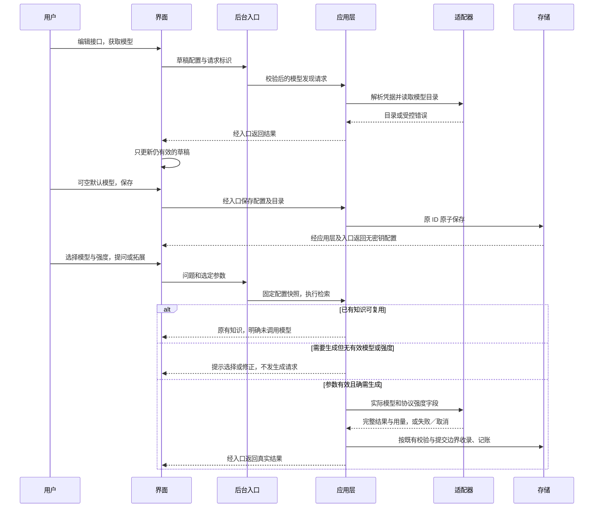

# 个人知识库 Agent：技术设计

> 当前代码为 `test0.03`；test0.01 实现和证据保留为历史基线。修订 3 的 API 编辑与模型选择已在第 7 节实施；真实供应商兼容性未验收。
>
> 简单说：接口与模型交互已经接通并在模拟环境验证，实际供应商仍需实测。


方案修订：3（新增 API／模型交互已授权实施）；更新日期：2026-10-20。技术栈、A 频率方案、本地路径与 Windows 基准已经选择；test0.03 已完成本机隔离验证，完整 v1 的真实接口、OCR 和安装交付仍有待验收。

本页与 [产品方案](产品方案.md)、[实施与验收](实施与验收.md) 共同构成当前完整方案。

## test0.01 实际实现

Electron 主进程负责可信窗口、文件选择、白名单 IPC 和 Python 生命周期；沙箱界面通过 preload 调用限定能力。后台使用 UTF-8 JSON 行协议，解析在线程中执行；数据库写入在后台事件循环串行完成。生成请求在提交前接受取消，知识与同问题复用标识在同一事务写入。启动时标记上次中断的调用，并清理应用所属孤立资料副本及遗留会话。

简单说：界面不直接读写数据库或执行系统命令；后台没完成的结果不会变成正式知识，重启保留已提交的数据。

后台目前使用中文双字与英文词匹配，尚无向量索引。MD／TXT 保留原文文本，DOCX 保留正文块和表格顺序，PDF 逐页提取文字，缺字页提示 OCR 未接入。模型内容先以 JSON 接收完整流，再检查标题、正文和引用 ID；界面显示接收进度与最终文本，不将原始 JSON 或来源 HTML 当作可执行内容。

简单说：引用能看到实际摘录和位置；复杂排版与答案内容质量仍需核对，关键词检索也可能漏掉同义表达。

当前模型适配提供 Responses、Chat Completions 和 Anthropic Messages；真实供应商服务未调用。Windows 凭据管理器保存 Key，普通 SQLite 配置只保留标识；每次调用独立记录结果、返回用量与用户输入价格快照。缓存、推理等复杂定价未做完整适配，费用只作基础估算。

简单说：可以填写自己的接口，价格以你输入的单价估算；不宣称任何型号已通过真实连接验收。

正常关闭先结束输入、取消任务并清理会话；2.5 秒未退出时仅终止本应用 Python 进程树。Windows 虚拟环境可能包含启动器与实际运行时两个进程，正常和挂起后的强制清理均已在隔离数据上验证。模型请求的等待上限为 180 秒，网络读超时为 120 秒。

使用与维护：双击启动入口或运行 `npm run dev`；数据目录由 Electron 用户目录决定，可在界面底部查看。运行前仍需项目开发依赖，当前未提供携带 Python 的独立安装包。完整结构和命令见 [使用说明](../../../README.md)。

简单说：现在是可运行的开发版，复制源码到没有开发环境的电脑还不能直接运行。

以下章节描述完整 v1 目标。向量模型切换、分层总结、OCR 和完整安装交付等尚未实现的部分继续按计划保留。

## 1. 目的与范围

使用适合 Windows 桌面交互、文档解析和模型接入的技术组合，实现可维护的个人知识库，先打通本地文件到带引用回答的完整链路。

简单说：界面用成熟的桌面网页技术，处理文档用 Python，知识放在本地数据库里。

技术设计覆盖界面、后台通信、数据与文件、检索、解析、API 和打包；暂不设计云服务、账号系统、同步或多 Agent 自主协作。

## 2. 已选技术与待验证候选

| 职责 | 已选方向／候选 | 决策状态 |
|---|---|---|
| 桌面外壳 | Electron | 用户已选择 |
| 界面 | React＋TypeScript | 用户已选择 |
| 后台 | Python | 用户已选择 |
| 数据库 | SQLite | 用户已选择 |
| 前端构建 | Vite／electron-vite 候选 | 工程验证后锁定 |
| 结构化结果校验 | Pydantic 候选 | 兼容性验证后锁定 |
| 模型 HTTP 通信 | httpx 等支持流式与取消的客户端候选 | 适配验证后锁定 |
| 中文关键词检索 | SQLite 全文索引＋中文分词或等效方案 | 不能假设默认分词可用；样例验证后锁定 |
| 向量索引 | sqlite-vec 候选 | Windows 二进制、打包和模型维度验证后锁定 |
| 凭据 | Python keyring 对接 Windows 凭据能力的候选 | 打包和读取验证后锁定 |
| Python 打包 | PyInstaller 等候选 | 干净 Windows 环境验证后锁定 |

设计表保留候选状态；本次开发环境的精确版本、锁文件、安装位置和合成样例运行结果已记录在 [开发环境](开发环境.md)。基础解析、SQLite 扩展和 CPU OCR 已通过本机环境检查，尚未进行代表性文件、真实 API 或产品打包验证；依赖／模型的完整分发许可审计仍待进行。

## 3. 进程边界与生命周期

Electron 主进程负责窗口、可信文件入口和 Python 后台生命周期；React 通过受限的 preload 接口调用；Python 持有数据库、解析任务和模型请求。界面不直接获得任意系统命令或数据库写权限。

简单说：界面负责显示和操作，后台负责处理与保存，避免解析大文件时窗口卡住。

拟采用随应用启动的本地 Python 子进程，通过标准输入／输出上的结构化消息通信，不要求用户启动 HTTP 服务。所有业务日志走独立日志或标准错误流，不污染消息通道。

消息至少包含请求标识、操作、有效载荷；事件包含状态、阶段、进度或文本片段；响应关联原请求并标明成功、失败、取消或已保存。模型输出和文档文本不作为系统命令执行。

解析／OCR 等耗时任务进入有并发上限的工作队列，与异步模型调用协调；SQLite 写入由后台集中管理，避免解析进程同时写同一连接。具体线程／子进程方案在性能与打包验证后锁定。

取消请求传播到任务和模型连接，晚到结果按请求状态丢弃。进入保存事务前取消不得生成正式知识；若事务已经提交，应明确显示已保存并允许用户管理，不假称撤销。关闭窗口时先取消和清理，限定等待时间后结束所属后台，不能留下孤立解析进程。

后台崩溃要让界面结束等待、显示失败并允许恢复；重试必须使用幂等标识避免重复保存。首版仅允许一个写入后台实例，重复启动聚焦已有窗口，降低跨实例锁冲突。

## 4. 文档解析与引用

统一解析产物包括文件指纹、格式、解析器版本、层级结构、文本块、表格／代码类型、可获得的位置和告警；检索与引用使用同一版本的文本块标识。

简单说：换解析库不会改变上层问答入口，回答也能找到它实际引用的原文。

| 格式 | 候选 | 计划验证点 |
|---|---|---|
| MD、TXT | UTF-8／常见编码检测，Markdown 结构解析候选如 markdown-it-py | 中文编码、标题、代码块、相对图片与链接边界 |
| DOCX | python-docx | 段落、标题、表格顺序与定位；不承诺排版页码 |
| 文字 PDF | pdfplumber | 中文、页码、多栏阅读顺序、表格与空文本页 |
| 多格式统一入口 | MarkItDown | 结构与来源位置能否满足引用要求，不因统一转换而丢失位置 |
| 扫描 PDF 的文字识别 | 优先验证 RapidOCR＋ONNX Runtime；PaddleOCR 为其他候选 | Windows CPU、中英文识别、位置、模型资源、体积与打包 |
| 复杂 PDF 的结构处理 | Docling 为增强候选，也可评估 PaddleOCR 的结构处理能力 | 双栏阅读顺序、表格、来源映射、附加模型和资源成本 |
| 旧 DOC | 例如 LibreOffice 转换流程候选 | 转换依赖、无头执行、失败反馈、来源映射和部署许可 |

其他候选参考入口：[MarkItDown](https://github.com/microsoft/markitdown)、[python-docx](https://github.com/python-openxml/python-docx)、[pdfplumber](https://github.com/jsvine/pdfplumber)、[sqlite-vec](https://github.com/asg017/sqlite-vec)。其中 python-docx、pdfplumber 和 sqlite-vec 已试装并记录版本，MarkItDown 未安装；完整分发许可审计仍待进行。OCR 项目已有下述首轮官方资料调研。

### OCR 开源调研结论

用户要求先查找网上开源项目再决定 OCR。2026-10-20 已通过 GitHub API 读取下列官方仓库说明、安装说明或模型授权说明；下表是资料证据。本次另行授权的环境准备已对 RapidOCR 3.10.0＋ONNX Runtime 1.31.0 做合成中英文图片的本机 CPU 检查，结果见开发环境页，不能据此确认真实文件质量或最终选型。

简单说，先确认别人已经提供什么能力，再在本应用里试装、试识别，最后定库；不自行从零开发 OCR 算法。

| 项目与已读取来源 | 官方资料确认的能力／许可 | 对本项目的判断 |
|---|---|---|
| [RapidOCR README](https://github.com/RapidAI/RapidOCR/blob/main/README.md)、[配置](https://github.com/RapidAI/RapidOCR/blob/main/python/rapidocr/config.yaml)、[模型许可](https://github.com/RapidAI/RapidOCR/blob/main/python/MODEL_LICENSES.md) | Windows、默认中英文、离线部署、ONNX Runtime CPU 路径；代码 Apache-2.0；许可说明覆盖的 PaddleOCR 派生模型为 Apache-2.0，其他资产需逐项核查 | 推荐优先验证基本 OCR；尚未最终定库或承诺速度 |
| [PaddleOCR README](https://github.com/PaddlePaddle/PaddleOCR/blob/main/README.md)、[安装说明](https://github.com/PaddlePaddle/PaddleOCR/blob/main/docs/version3.x/installation.en.md) | Windows／CPU、多语言及结构处理能力；仓库标注 Apache-2.0；功能组和推理引擎需按需安装 | 可选识别／结构增强路线，不默认安装全部组件 |
| [Docling README](https://github.com/docling-project/docling/blob/main/README.md)、[RapidOCR 集成示例](https://github.com/docling-project/docling/blob/main/docs/examples/rapidocr_with_custom_models.py) | Windows、扫描 PDF、版面、阅读顺序和表格处理；已有 RapidOCR 自定义模型示例；代码 MIT，模型许可分别核查 | 推荐作为复杂版面增强候选，不能凭集成示例认定组合已在本应用通过 |
| [OCRmyPDF README](https://github.com/ocrmypdf/OCRmyPDF/blob/main/README.md) | 为 PDF 增加可搜索文字层，使用 Tesseract 等外部程序；代码 MPL-2.0 | 当前不优先，第一版主要需要提取内容问答，不必先生成新 PDF |

RapidOCR 会使用转换后的 PaddleOCR 模型，两者不能当成完全独立的识别算法。OCR 读出文字，版面解析恢复顺序和结构；基础 OCR 成功不等于复杂表格和公式无损。

优先验证方案是文字页直接提取、扫描页转图后由 RapidOCR 在 CPU 上识别并关联 PDF 页码和坐标；若双栏和表格样例显示结构恢复不足，再评估引入 Docling。PDF 页面渲染器也需验证和锁定，不把 OCR 引擎本身当作完整 PDF 处理器。

资源首次使用准备、完成后离线识别是推荐部署方式；安装包内附资源是可选方式。首发是否支持 OCR、最终库组合、资源交付和旧 DOC 仍待确定。本次已记录候选发布版本及三项模型的来源／哈希和约 30.3MiB 总大小；真实文件准确度、每页耗时、峰值内存与打包稳定性尚未测量，适用分发许可仍需逐项核查。

识别 PDF 时检查逐页文本覆盖，不能把扫描页提取为空就当解析成功。未具备 OCR 时明确说明扫描页未识别，部分解析保留告警；用于回答的依据不能包含未读到的页面。

相同内容指纹且解析版本相同可复用缓存，文件内容变化产生新版本。PDF 页码可直接定位；DOCX 使用标题和段落；Markdown 使用结构和可用行号。表格、公式和图片解析能力分别说明，不承诺所有格式无损。

## 5. 检索、回答与受控 Agent

采用显式流程编排，让程序决定检索范围、保存条件和推荐数量，让模型负责理解、解释、归纳和提出关联。第一版不依赖复杂多 Agent 框架。

简单说：模型可以帮助思考，但不能自行决定覆盖笔记、删除文件或绕过你的资料范围。

检索先做关键词召回，可用时加入语义召回，再合并去重并按相关性排序。相关性阈值和中文分词效果需要样例标定；低分召回不等于证明库里没有该知识。已有内容足够时直接查看原文；需要解释或新学习内容时才调用生成接口。

普通提问与全文总结采用不同策略：前者检索相关片段，后者先覆盖全文分块再汇总。多文件比较保留各来源；输入超长时分批处理并说明未覆盖部分，不能静默截断后声称完整。

回答结构建议包含正文、引用标识、依据类型、可复用知识候选及不确定性。程序校验引用确实来自本次可用块，校验成功后再提交新知识。文档中的指令视为资料内容，不获得工具或操作权限。

三条关联推荐由程序按库存配比挑选，模型可提供概念和理由；先返回轻量拓展卡片，点击才生成全文。卡片展示不计作有效知识使用。

## 6. 本地数据与文件

SQLite 保存知识、资料元数据、引用、任务和用量记录；原文件副本放应用数据目录中的受管理资料目录，向量为可重建派生数据。暂不需要单独部署数据库服务。

简单说：核心资料在本机，索引坏了可以重建，不能把原知识当作可随意丢掉的缓存。

| 数据对象 | 核心内容 |
|---|---|
| 知识条目 | 稳定标识、标题、正文、来源性质、生成／编辑时间、自动分区、手动覆盖 |
| 知识关系 | 两端知识、前置／相似／对比／应用关系与理由 |
| 资料及版本 | 文件名、格式、内容指纹、受管理副本路径、解析状态和版本 |
| 文本块 | 资料版本、顺序、层级、文本和来源位置 |
| 引用 | 知识或回答到文本块的关联，以及需要保留的引用摘录 |
| 使用事件 | 知识、时间、事件类型、当日时区和本地日期、幂等标识 |
| 模型配置 | 提供方、协议、接口地址、模型、用途、凭据引用，不含明文密钥 |
| 调用记录 | 请求／尝试标识、用途、模型、状态、时长、返回用量、价格快照和估算 |
| 索引元数据 | 向量模型标识、维度、内容指纹、状态和索引版本 |
| 后台任务 | 请求标识、阶段、状态、错误类型、取消与提交状态 |

知识收录以事务提交，重复事件和重试不得重复创建。个人编辑不被自动刷新覆盖，语义相似但非相同的内容不能直接合并。引用保存必要摘录，临时原文件清理后仍有可读依据，全文回看不可用时明确说明。

用户主动保存资料时复制入应用管理目录；读取文件失败、空间不足或数据库提交失败时，不显示入库成功，并清理未提交副本。删除资料清理对应索引，保留知识需同步标记来源原文已移除；删除知识清理相关关系与索引，不删除用户原始文件。

数据库使用版本化迁移。首版不新增云备份功能；迁移和异常写入恢复方式须在实现时明确，不能以索引可重建为由丢失知识正文。变更向量模型、维度或切块策略时重建派生索引，不能混用不兼容向量。

## 7. API、凭据和用量

### 7.1 修订 3：配置、列表与调用参数（已实施）

目标是在现有协议和运行边界内接通编辑、模型发现、默认值和请求级覆盖；只整理本次触及的功能链路，按[项目规范](../工程规范/项目编码与分层规范.md)组织新代码，不进行全量架构迁移。

简单说：界面负责选择，后台负责校验和请求；把这次功能真正接通，不顺带重写整个应用。

变更前定位：`ProviderForm` 没有编辑入口和模型菜单，提问不传模型；后台保存支持同 ID 更新及保留 Key，但校验要求模型非空；三个协议编码固定使用默认模型，存储也只有单模型。现在相关实现分别位于 `features/providers/`、跨进程契约、`knowledge_agent/application`、`domain` 与 `infrastructure`，新增按配置关联的模型目录表。

简单说：要同时改表单、保存数据和真正发请求的代码，否则界面选了也不会生效。

| 边界 | 实施设计 |
|---|---|
| React | 在现有 `features/providers/` 中增加编辑、模型目录、选择组件和交互 hook；纯展示组件只接收数据和回调。受限 API 客户端负责新增操作的请求／结果校验 |
| Electron／契约 | 保留现有请求 ID、JSON Lines、取消和生命周期；白名单新增 `providers.models`。契约明确保存字段、模型列表结果以及 `question`／`providers.test` 的可选 `provider_id`、`model`、`reasoning_effort`，旧参数调用仍能使用默认值 |
| Python 入口／装配 | 保留 `worker.py` 入口，由 `application/knowledge_service.py` 组合新增用例；沿用 `knowledge_agent` 包内的 `entrypoints/application/domain/infrastructure` 分工，由 `bootstrap` 装配，不在新业务流程中直接操作 SQL 或导入 HTTP 实现 |
| 配置存储 | 增量增加按配置 ID、模型 ID 唯一的模型目录表；现有 `providers.model` 保留为默认值，空字符串表示未设置，不改既有配置 ID。旧非空模型幂等加入目录；保存目录和默认值为同一事务；默认模型不能被移除而仍留为默认 |
| 迁移恢复 | 在原数据位置进行版本化、幂等增量迁移；迁移前创建应用管理的 SQLite 一致性备份，失败回滚并明确阻止写入，不新建空库绕过失败。隔离数据验证原知识、原配置、凭据引用与旧尝试记录不变 |
| 凭据 | 新增必须有 Key；编辑的空 Key 只在后台解析旧凭据；新 Key 仅为瞬时输入。保存失败补偿凭据替换，不把真实 Key 或认证头返回列表、写日志或普通配置 |
| 模型发现 | 校验当前草稿地址／协议／凭据后，Responses 和 Chat Completions 使用基础地址加 `/models`、Bearer 认证；Anthropic 使用同一路径及其 API Key／版本头，按实际分页契约获取。仅 GET 列表，限时、限页、限响应体，不跟随认证重定向；服务不支持时给出可手动添加的错误 |
| 列表状态 | 发现结果只返回模型 ID；去重并保留手动条目。未完整取回时明确提示，失败不覆盖旧目录。请求与草稿版本绑定，切换编辑对象、地址、协议、Key、取消编辑、卸载后拒绝晚到响应 |
| 生成解析 | 在接收请求时固定配置快照；显式模型优先于接口默认值，无值时在网络请求前报错。显式模型必须属于该配置目录；后台同样校验强度，不信任界面状态。普通提问、拓展和测试连接共用解析规则 |
| 状态与复用 | 当前应用会话按接口保留临时模型选择，切换模型重置强度；配置删除或目录变化时清理失效选择并提示。发送中锁定控件；编辑／删除配置不会修改已经提交请求的快照；已有知识复用行为保留并显示未调用 |
| 记账 | 按解析后的实际模型记录尝试与知识来源。默认模型变化清空旧价格，除非重新填写；临时模型不同于默认模型时价格为未知。强度不伪装为 temperature，缺失用量仍未知，不增加自动重试 |

模型目录最多 1000 项、每个 ID 最长 160 字符；单页响应最多 1MB、最多 10 页、总等待上限 30 秒。达到分页上限显示部分结果，合并超限则保留草稿。数据库 `user_version` 从 1 增量到 2，恢复点为数据目录内 `before-model-catalog-v2.sqlite3`；升级失败应先关闭应用、保留完整数据目录及恢复点，再排查重试。

以上接口、存储与状态调整已实现；增量表及旧配置回填通过隔离迁移测试验证。主要回归风险是旧凭据丢失、默认值漂移、请求中配置变化、过期列表覆盖、迁移失败和模型切换导致错误计价；通过事务、快照、响应版本检查及隔离回归验证控制。

简单说：保存失败不能弄丢旧接口；新选择不能串到旧请求里，升级也不能动坏原来的知识。

推理强度按下表编码，默认始终省略参数。列表通常只有模型 ID，因此“协议可表达”与“具体模型已支持”分开标识；兼容协议的未验证模型可尝试基础档位，失败明确显示、不自动换档重发。附加档位仅在能力有明确依据时提供。

简单说：默认最兼容；选择更高强度是在请求模型多思考，不保证每个模型都接受，也不靠改温度冒充。

| 协议 | 初始强度行为 |
|---|---|
| Responses | 默认省略；低／中／高映射到 `reasoning.effort` 的 `low/medium/high`；`minimal/none/xhigh` 等只在明确支持时提供 |
| Chat Completions | 默认省略；低／中／高映射到 `reasoning_effort` 的 `low/medium/high`；兼容端不接受则明确报错 |
| Anthropic Messages | 初始保留“由模型决定”；未适配并验证具体模型的 thinking／effort 契约前禁用其他档位，不直接套用 OpenAI 字段 |



验证计划覆盖同 ID 编辑／取消／空 Key、凭据补偿、模型获取三种认证及失败／分页／晚到结果、空默认值、请求覆盖、未知模型／强度拒绝、实际负载和记账、迁移恢复、已有知识保护。使用模拟服务、临时数据库和模拟凭据；实现后运行类型检查、相关 pytest、Ruff、构建及隔离桌面交互。真实接口兼容性与计费仍需另行验证。

简单说：先用隔离环境验证“选什么就发什么、失败不破坏旧数据”；模拟通过不等于真实供应商全部可用。

### 7.2 继续有效的通用规则

通过供应商适配器统一流式文本、结构化结果、错误与用量。用户已确定 GPT 优先，同时接入 DeepSeek、Claude、Grok 等主流模型。具体型号与实际官方／中转协议仍待核查；不假设模型名称决定协议，也不写死最新型号。生成模型和向量模型分别配置，连接测试只能证明对应测试能力，不代表所有模型与接口均兼容。

简单说：换模型不会让知识丢失，但可能需要重建索引；能聊天也不代表同时能生成向量。

凭据由操作系统保护，界面输入后通过限定消息交给后台，日志不记录密钥、认证头或完整私密正文。普通设置仅保存凭据引用。Markdown 与文件内容渲染应过滤主动脚本；界面禁用 Node 直接执行并使用上下文隔离。

流式显示与持久化分开，只有内容完整、校验通过才保存。请求取消可能已经产生供应商费用，统计不能因为本地取消就自动记零。每次重试是一条调用尝试，既保留明细又防止汇总重复计数。

用量缺失显示未知；本地估算单独标明依据；缓存和推理等特殊用量按接口真实语义解释。价格记录带生效时间和币种，不把不同币种直接相加；无单价时仅统计可用用量，不臆造费用。

## 8. 拟议目录与交付

test0.01 已采用以下职责分布；测试样例由 tests 下的代码在临时目录构造。

```text
apps/desktop/              Electron 主进程、preload、React 界面
services/knowledge-agent/  Python 后台、解析、检索、模型适配与数据访问
contracts/                进程消息和结构化结果的共享协议说明／定义
tests/                    合成文档、领域行为、协议与模拟接口测试
docs/确认页/              当前中文方案
task-specs/                开发执行与验证记录
```

用户运行数据放系统应用数据目录，不写进安装目录或项目仓库。安装包应带后台运行环境，核心文件提问不要求用户另装 Python；OCR 模型与转换工具是否随包、按需准备或延后，属于待确认兼容范围。

已确认首版以 Windows 11 x64、16GB 内存、无需独显为验收基准。该基准不是已验证最低要求；Windows 10、ARM64 和其他系统未纳入首版兼容承诺。实际 CPU、系统版本、内存占用、首次准备与缓存后耗时应在验证时记录。

## 9. 预期效果与验证边界

此方案期望让文件解析、流式回答和数据库写入互不阻塞，知识保存在本地，引用可追溯，失败与取消不会制造重复条目或残留后台。首个技术验证就应尝试打包，而不是界面全部完成后再处理部署。

简单说：先证明“装得上、读得了、答得出、能找出处、能保存、能关干净”，再完善所有功能。

开发环境已记录依赖版本、验证 Windows sqlite-vec 加载、准备校验后的 OCR 模型，并完成合成样例检查。test0.01 产品程序已实现并通过本机后台与桌面检查；完整分发许可证、真实文件质量、安装包大小与响应性能仍未验证。Electron 与 Python 会增加基础体积，OCR 也会增加资源成本；本次开发目录大小不能视作最终安装包指标。
