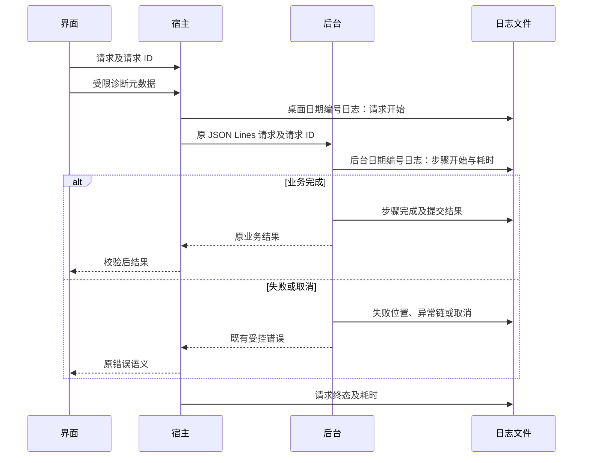
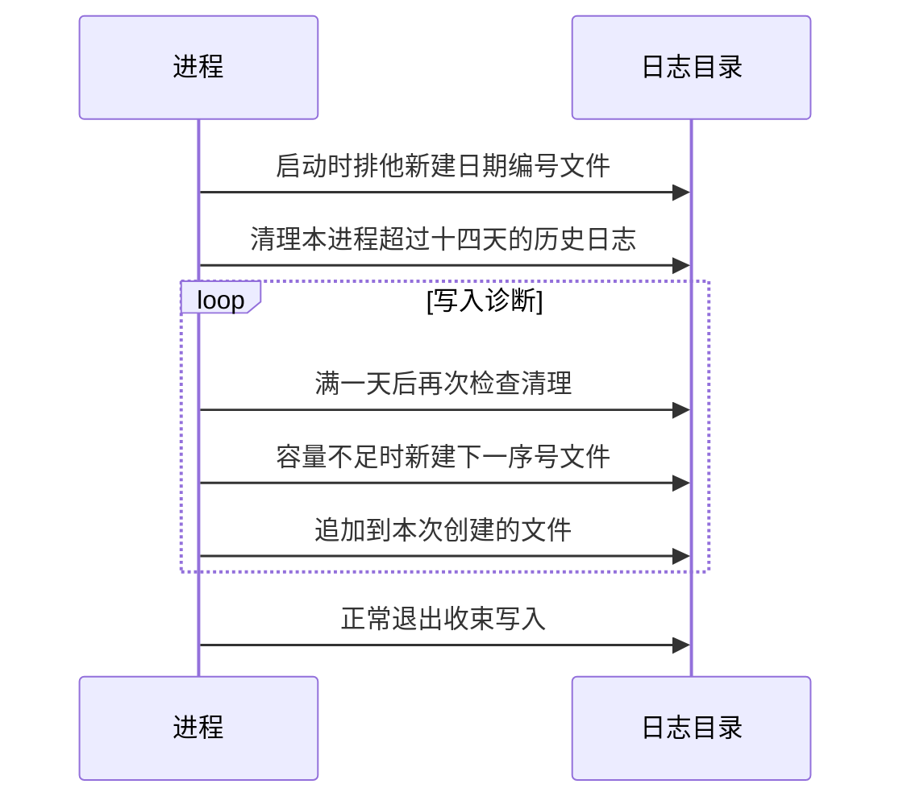

# 知序：日志与问题排查

当前修订：2。已按用户要求改为每次进程启动新建日期编号日志，并清理最后写入时间超过 14 天的文件；完整检查通过（215 项 Python 测试、19 项宿主测试及构建），隔离桌面回归通过，包括真实重启新建日志与旧日志内容不变。

## 目的与范围

对 React 界面、preload、Electron 宿主、Python 入口、业务流程和基础设施建立持久化诊断，按会话和请求串联执行阶段、耗时、失败位置和技术原因。

简单说：出问题后可以看清“这次操作经过了哪些步骤、停在哪里、底层出了哪类错误”，重启后也可以查看此前保留的记录。

已发现 Electron 直接排空后台 stderr，Python 异常兜底只返回通用错误提示，现有调用记录表只记录模型用量，不能替代运行诊断。日志写入独立文件；不把任意 stderr、网络错误体或业务正文直接保存为日志。

简单说：原来虽然有用量记录，但缺少排错所需的执行轨迹；现在补上专门的本地诊断。

## 实现方式

后台按显式关键用例和能力边界记录步骤开始、完成、失败、取消及耗时。每个步骤携带 `span_id` 和 `parent_span`；请求关联使用现有 `request_id`，宿主通过环境变量 `KB_LOG_SESSION` 把会话 ID 传给 Python。ContextVar 隔离并发上下文，并随 `asyncio.to_thread` 传入文档解析线程；退出步骤和请求时还原上下文。

简单说：多个任务同时运行时不会混成一条记录；可以按一次操作的编号把界面、后台和解析线程接起来看。

| 范围 | 主要记录 |
|---|---|
| 启动与退出 | 桌面启动、窗口加载、Python 依赖导入／装配、数据库初始化、后台就绪、关闭、强制终止、进程退出码 |
| 界面与桥接 | 请求开始／完成／失败、返回值校验失败、全局异常、React 渲染异常、未处理拒绝、IPC 来源拒绝、协议损坏、超时、晚到结果 |
| 检索与学习 | 问题锁等待、本地检索、证据数量、原知识复用、本地回退、拆解、独立审核、单点生成、待核对、依据不足、正式提交 |
| 全库重构 | 草案创建、当前条目／片段索引、摘要、分类、差异准备、预览、最终提交和备份步骤 |
| 模型与目录 | 尝试 ID、用途类别、协议、HTTP 状态、首片段、流完成、字符数、已知用量、模型发现分页、失败记账 |
| 文件与存储 | 路径校验步骤、复制、格式解析、块数、字符数、警告数量、副本回收、凭据访问步骤、SQLite 写入与失败位置 |

记录异常链的类别、源文件名、函数和行号，以及 errno／Windows／SQLite／HTTP 等技术码。不写局部变量、源码行、任意异常正文、异常 notes、完整私有路径。只有精确命中固定提示白名单的错误原因才保存文字；未命中时依靠异常链和代码位置定位。

简单说：尽量保留技术原因，同时防止错误信息夹带文档、密钥或供应商响应内容。日志中的步骤名称对应代码函数，可以直接定位源码。



## 保存位置与容量

| 项目 | 规则 |
|---|---|
| 保存目录 | 当前数据目录的 `logs` 子目录；界面底部展开可看到数据目录 |
| 桌面文件 | `2026-10-21-1-desktop.log`，包含宿主和经校验的界面诊断 |
| 后台文件 | `2026-10-21-1-worker.log`，包含步骤、业务阶段和后台生命周期 |
| 启动规则 | 本地日期＋当天序号＋进程类型；两类进程分别编号，从已有最大序号继续，跨天从 1 开始；后台重启也新建文件 |
| 容量 | 每文件 5 MiB，超限前新建下一序号文件；完整单条记录不拆分，单条超限可超过文件限额；不再按备份份数提前删除 |
| 保留与清理 | 启动及持续运行满一天后的首次写入触发；最后写入时间严格超过 14×24 小时才删除，等于 14 天仍保留 |
| 清理边界 | 两个进程各自清理自己的新旧命名普通日志，包括旧 `desktop.log`／`worker.log` 及数字备份；跳过链接、目录、无关文件和当前写入文件 |
| 格式 | UTF-8 JSON Lines，UTC 时间，默认启用详细步骤，不逐 token 记录模型正文 |
| 测试隔离 | 遵循 `KB_DATA_DIR`，不写正式用户数据 |
| 宿主拥塞 | 队列最多 1024 条；溢出记录丢弃数，界面诊断最多每分钟 600 条 |

正常关闭先收束后台，再等待宿主日志队列落盘。日志初始化或写入失败时输出固定提示，保留业务原结果或主异常，不把日志失败当作业务成功或失败。

简单说：每次启动都有新日志，同一天多次启动会顺着编号；超过两周的旧日志自动清理。14 天内文件总量取决于使用量，不再保证总计 60 MiB。磁盘满或旧文件删不掉时只输出固定提示，业务仍保留原结果。

## 本轮调整原因与预期效果

此前两个进程均对固定文件追加，容量达到上限后才轮转，因此重启不会生成独立日志；没有时间清理策略。现在每次初始化通过排他创建获得新文件，旧文件不被覆盖，容量分段使用相同日期编号规则。

简单说：原来多次启动混在同一份日志里，现在打开目录就能按日期和编号分开查看。清理只按最后写入时间判断，文件名日期不会误删仍在更新的日志。



## 排查步骤

1. 记下出问题的大致时间和操作，展开界面底部查看数据目录，进入 `logs`。
2. 先看对应日期的 `*-desktop.log` 对应操作的 `request.failed`、`request.timeout` 或 `renderer.diagnostic`。
3. 复制 `request_id`，在两份日志及其历史文件中搜索；用 `session_id` 区分重启前后。
4. 在对应日期的 `*-worker.log` 找 `step.failed`，查看 `step`、`errors`、`frames`、技术码及前面最后一个未完成步骤。Python 对应原源码函数与行号；TS 构建后的栈位置可能对应 `out` 中的合并文件。
5. HTTP 故障同时看 `model.http_response`／`catalog.http_response`；取消和退出看 `step.cancelled`、`worker.exit` 与 `worker.terminate`。

### 红色提示专项

界面出现红色错误提示时，提示末尾会附上 `日志请求 ID：...`。复制这个编号，在相应日期的 `*-desktop.log` 和 `*-worker.log` 中检索同一请求；前者能看到界面反馈和宿主请求终态，后者能看到后台最后完成的步骤及结构化错误原因。

例如“知识点知识要点无效，未采用模型目录”发生在模型响应已返回、摘要本地校验阶段。后台会记录 `library.validate_summary`，并给出字段、校验规则、实际类型、实际长度和长度上限（例如 `field=知识要点`、`rule=required_text`、`actual_type=list`、`limit=1600`），不会保存模型正文。捕获后的本地结果回退也会记录 `topic.plan_fallback` 及其错误链，便于区分模型返回格式问题和网络、协议或存储故障。

PowerShell 示例（替换第一行的实际数据目录）：

```powershell
$kbLogDir = '实际数据目录\logs'
Get-ChildItem -LiteralPath $kbLogDir -Filter '*-worker.log' -File |
    Sort-Object LastWriteTime -Descending | Select-Object -First 1 | Get-Content -Tail 40
Get-ChildItem -LiteralPath $kbLogDir -File | Select-String -SimpleMatch '这里替换成 request_id'
```

这些步骤只读取日志，不需要打开数据库或提供密钥。分享前仍应查看日志内容；会话标识、时间与操作轨迹也属于个人使用信息。

简单说：先按时间找到操作编号，再按编号一路追到出错函数；通常提供相关日志片段就能进一步排查。

## 预期效果与边界

覆盖已实现功能的关键边界和已捕获降级错误，保留现有 JSON Lines 操作、业务结果、数据库结构、凭据服务名及用户数据位置；增加一个只接收白名单元数据的界面诊断 IPC，不开放任意日志／文件／shell 能力。

简单说：这次增加诊断，不顺带实现待定产品功能或迁移数据。

日志不是录屏或全文审计。没有真实接口验收、断电落盘保证、系统级原生崩溃转储或大库性能结论；突然终止可能丢失最后一批异步宿主日志。原始后台 stderr 只统计字节数；启动日志初始化以前的运行时故障仍可能只有固定提示。超过保留期的历史日志会被删除；正在写入的文件会保留到关闭后再参与后续清理；第三方日志不自动全文采集。

简单说：日志会明显改善定位，但不能保证所有历史和所有极端故障都有完整记录。
