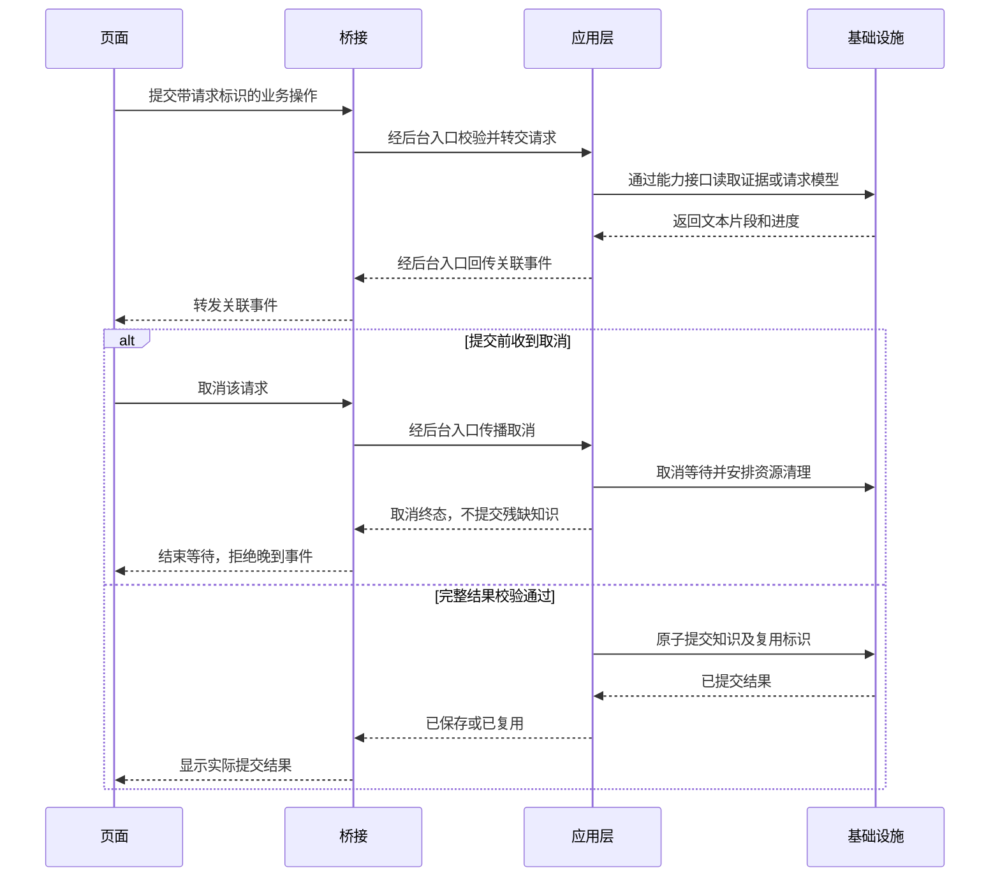

# 知序：项目编码与分层规范

| 项目 | 内容 |
|---|---|
| 文档状态 | 第 2 版，用户已选择推荐架构并要求后续开发遵守；作为项目有效规范 |
| 适用项目 | KnowledgeBase／知序，自 test0.02 起作为开发基线；现有业务实现以 test0.01 为基础 |
| 编制日期 | 2026-10-20 |
| 当前交付 | 正式纳入规范、根目录 AGENTS.md、版本迭代与 Git 发布；只更新源码中的版本标识 |
| 后续实施 | 新代码必须遵守；存量代码按明确的重构任务逐步迁移，不能将规范采纳误报为迁移完成 |

## 1. 目的、范围与预期效果

本规范保留用户提供的 C++/Qt 文档中适用的编码质量原则，采用“进程职责边界＋Python 后台四层＋前端功能模块”组织 Electron、React／TypeScript、Python 和 SQLite 项目，不沿用原来的 Application／Control／Interface 全项目三层模型。

简单说：保留原规范对代码质量和职责边界的要求，换成这个项目真正用得上的写法。

适用范围是自有源码、进程协议、构建配置、维护脚本、测试和相关文档。后续重构以保持 test0.01 已有功能、数据含义、界面布局和启动方式为默认目标；新功能、技术栈替换、依赖升级和数据库结构升级须明确列入范围。

简单说：先把代码整理清楚；规范本身不增加 OCR、向量检索、安装包或其他尚未交付的功能。

预期效果是界面改动、业务规则调整、模型接口或存储适配可以分别定位；函数执行过程、异步任务状态和资源释放能够顺着代码查清，已有用户知识不因重构丢失。

简单说：以后改哪里更明确，出错更容易查，整理代码不会顺带改变用户数据和操作习惯。

### 1.1 来源、适配和优先级

| 来源 | 本项目的处理 |
|---|---|
| `D:\code\temp\cpp-coding-standard.md` | 继承规则级别、职责命名、100 字符行宽目标、80 行函数上限、中文步骤注释、明确所有权、类型安全及风险验证原则 |
| `D:\code\temp\工程分层pri规范.md` | 参考职责清晰、依赖受控、构建归属明确的原则；原三层模型和 qmake 文件要求由本项目架构规则替代 |
| 用户提供的 AGENTS.md 指令 | 先搜索后读取，追踪必要链路；避免重复检查；交付时说明影响、证据和未验证部分 |
| 当前 README、配置、源码和测试 | 用于识别实际语言、运行方式与已有行为；不把现有实现中的偏离自动视为规范例外 |

两份外部原文保持原样。本文件是经用户选择后落地的项目规范，不宣称原文已经改为适用于所有语言。语言和架构适配差异见下表；其他冲突须明确说明，不能静默选择。

| 原文要求 | 本项目适配 |
|---|---|
| Application → Control → Interface | 按进程划职责；Python 内部分入口、应用、领域、基础设施；React 按功能组织 |
| C++ 文件全小写、下划线分词 | 普通源码沿用下划线命名；React 组件文件采用 `PascalCase.tsx`；框架入口保留约定名称 |
| C++ 函数、成员小驼峰及 `m_` 前缀 | TypeScript 使用小驼峰；Python 使用下划线；不引入 `m_` 前缀 |
| 统一 4 空格缩进 | Python、PowerShell 4 空格；TypeScript、TSX、CSS、JSON 2 空格，与现有前端风格衔接 |
| C++ 函数左花括号另起一行 | TypeScript 函数和控制语句左花括号同行；Python 使用缩进块 |
| 只允许 `//` 注释 | TS／JS 使用 `//`，Python／PowerShell 使用 `#`；JSX 标记内和 CSS 使用各自合法的注释语法 |
| `.h`／`.cpp` 四行文件头 | 自有脚本与源码使用“文件／层／作用／说明”文件头，采用对应语言的合法注释 |
| Qt 对象、信号槽与线程约束 | 映射为 React 订阅、Electron IPC、Python asyncio／线程及子进程生命周期约束 |
| `.pro` 汇总配置、每层一份 `.pri` | 保留现有 npm／electron-vite／Python 入口；用目录、明确导入与构建入口表达归属，不创建伪 `.pri` |
| 头文件保护、指针、RAII、`override` 等 | C++ 语法要求不适用；保留显式依赖、资源关闭、空值校验和接口约束的原则 |
| clang-format 基线 | 不用于 TS／Python；前端格式化配置可选 Prettier，Python 使用已有 Ruff，具体落地随重构确定 |

当前显式用户要求优先；已批准的项目行为约定不得被格式规则意外改变。在明确列出的适配项上以本文件为准；原文的其他适用要求继续保留。例外必须记录适用范围、技术原因、风险和验证方式。根目录 [AGENTS.md](../../../AGENTS.md) 是后续开发的规范入口。

### 1.2 规则级别

| 级别 | 含义 |
|---|---|
| 必须／禁止 | 强制要求；偏离须有明确技术依据和评审结论 |
| 建议 | 默认遵守；有可说明的收益时允许例外 |
| 可选 | 按需要使用，同一模块保持一致 |

下文明确的命名表、目录职责和禁止事项属于必须遵守的约定；“建议／可选”另行标出。历史代码是否符合本规范，需在后续相关改动中逐项核查，不能因本文件生成就宣布合规。

## 2. 项目现状与规范目标

### 2.1 已查明的工程事实

| 项目 | 当前情况 |
|---|---|
| 技术栈 | Electron + React／TypeScript + Python + SQLite；未发现 Qt／qmake／C++ 工程文件 |
| 前端配置 | TypeScript `strict: true`、ES2022；npm 脚本统一启动、检查和构建 |
| 工程版本声明 | Node `>=24.18.0 <25`，npm 11，React 19，Electron 44，TypeScript 7；精确依赖见 `package.json` 与锁文件 |
| 桌面入口 | `apps/desktop/main/index.ts` 创建窗口、注册 IPC 并管理后台 |
| 桌面桥接 | `apps/desktop/preload/index.ts` 暴露受限 API；`main/worker.ts` 管理 Python 子进程和请求关联 |
| 界面 | `renderer/src/main.tsx` 中的 `App` 集中了多个页面、异步交互和 JSX |
| 后台 | `worker.py` 处理 JSON 行协议；`service.py` 编排业务，并直接访问 `store.db`；其余包括 `store.py`、`providers.py`、`parsers.py` |
| 共享契约 | `contracts/desktop.ts` 定义前端类型；当前泛型 `request<T>` 不等同于运行时响应校验 |
| 验证入口 | pytest、TypeScript 检查、Electron 构建、桌面脚本及 Ruff |

以上是本次针对规范编制的静态检查结论，不是全量代码审计或本轮运行验证。Python 版本以开发环境和依赖记录为准，不能仅由类型注解推断最低支持版本。

### 2.2 已选架构与实施状态

用户已选择进程职责边界、后台轻量四层和前端功能模块方案。保留现有技术栈、工程根目录和启动入口；不增加独立服务部署或架构框架。

简单说：界面按功能整理，Electron 管桌面，Python 分开业务规则、操作流程和技术实现。

规范已采纳，代码尚未按新架构整体迁移。示意目录和模块名表达目标，不是已完成状态或逐文件修改清单。后续具体重构需根据调用、状态与生命周期链路明确范围和验证。

## 3. 分层和依赖方向

### 3.1 进程职责边界

| 部分 | 职责 | 禁止事项 |
|---|---|---|
| React 界面 | 页面、交互状态、结果展示，通过受限 API 调用后台 | 不访问 SQLite、系统凭据或供应商 HTTP；不决定正式知识收录规则 |
| Electron 桌面宿主 | 窗口、文件选择、IPC 安全、Python 生命周期 | 不承担知识业务，不因处于中间位置而成为业务控制层 |
| Python 业务后台 | 知识、资料、检索、问答、收录、调用记录 | 不依赖 React、DOM 或 BrowserWindow |

三者是运行边界，不是三个上下级业务层。Electron 不是独立业务服务；Python 后台也不开放额外网络服务来替代现有本地协议。

### 3.2 Python 后台四层

| 层 | 职责 | 项目例子与边界 |
|---|---|---|
| 入口层 `entrypoints` | 解析消息、验证协议结构、调用应用用例、转换事件和错误 | JSON Lines 分发；不直接执行 SQL 或编排完整问答 |
| 应用层 `application` | 协调一次业务操作，管理取消、事务需求和多资源操作 | 提问、保留资料、保存供应商配置、收录、调用记账 |
| 领域层 `domain` | 业务数据与规则，无外部 I/O | 分区规则、去重判定、收录条件、引用有效性；不导入 SQLite／HTTP／进程适配器 |
| 基础设施层 `infrastructure` | 实现具体技术访问 | SQLite 仓库、HTTP 协议、解析器、文件快照、系统凭据；不决定业务流程 |

应用层通过业务所需的窄接口访问存储、模型和解析能力。接口通常放在 `application/ports.py`，或按真实职责拆分；通用领域数据放领域层，基础设施实现这些接口，启动装配点注入具体实现。

简单说：应用层说明“我要保存知识或调用模型”，底层说明“如何使用 SQLite 或某种协议完成它”；业务不绑定具体技术。

源码依赖按下面规则检查，不能把执行顺序误当成导入顺序：

```text
entrypoints → application → domain
infrastructure → application 中的接口／domain
bootstrap → 入口、应用和具体基础设施，负责装配
```

领域层只依赖标准库和稳定的领域类型；应用层不导入具体基础设施模块。基础设施允许依赖应用层定义的接口和领域类型，不允许反向调用业务用例。入口不导入具体适配器；装配例外集中在 `bootstrap.py`。不是每个函数都需要接口，不为简单规则建立成套抽象类。

事务规则由应用层明确，SQL 和实际原子写入由基础设施实现。领域层负责判定业务合法性；仓库仍保留数据库约束和存储安全校验，不能因分层删除必要防线。

### 3.3 前端按功能组织

- `app/` 负责挂载、导航和整体布局；`features/` 按知识、探索、资料、供应商、用量组织组件、hook 和局部类型。
- 页面和 hook 可以调用统一受限 API；纯展示组件通过参数和回调与外界交互。
- hook 管理提交中、取消交互、订阅与过期结果等界面流程，不重复实现后台知识收录或去重规则。
- `shared/` 只放实际复用的展示组件、API 客户端、样式等；不得积累无边界的万能业务服务。
- 功能模块不深层导入另一功能内部文件；确需协作时通过明确公开入口、上层组合或真正共享模块实现。
- 不在 React 内机械复制后台四层；不强制建立空目录或每组件一套 API／service／repository。

### 3.4 契约、调用与模块边界

- 根目录 `contracts/` 只描述跨进程操作、数据、事件和错误，不导入运行时实现，也不堆放通用业务函数。
- Python 内部领域模型不必都成为跨进程 DTO；入口完成必要的映射，避免界面结构反向控制领域结构。
- 明确导入直接使用的符号；禁止通配导入、循环依赖和靠模块副作用建立隐式状态。
- 模块按职责命名，例如 `frequency_rules.py`、`request_registry.ts`；不为短函数或每个类型强行建类、建文件。

```text
React 功能页面／hook → 受限 API → preload → Electron IPC 与 Python 桥接
    → Python 入口 → 应用用例 → 领域规则与能力接口 → 基础设施实现

事件和结果沿请求关联返回；协议传输不改变源码依赖规则。
```

## 4. 目录与构建规范

以下是建议的逐步重构目标；未列出的现有文档、资源、锁文件继续按既有职责保留。不要求一次建齐示意文件。

```text
KnowledgeBase/
  package.json
  electron.vite.config.ts
  tsconfig.json
  contracts/
    desktop.ts
    protocol.md
  apps/desktop/
    main/
      index.ts
      window_manager.ts
      ipc_gateway.ts
      worker_bridge.ts
    preload/
      index.ts
    renderer/src/
      main.tsx
      app/
        App.tsx
      features/
        knowledge/
        exploration/
        sources/
        providers/
        usage/
      shared/
        api/
        components/
        styles/
  services/knowledge-agent/
    worker.py
    knowledge_agent/
      __init__.py
      entrypoints/
      application/
      domain/
      infrastructure/
      bootstrap.py
  tests/
  scripts/
  docs/确认页/
  task-specs/
```

`main.tsx` 最终只负责挂载；`worker.py` 可保留兼容启动入口，后台运行逻辑迁入合法 Python 包。`knowledge-agent` 是已有外层目录，不作为 Python 导入名；内部包使用 `knowledge_agent`。所需子包标识和导入路径须在迁移时一起核对。

构建规则如下：

1. `package.json` 管理工程脚本和依赖声明；`electron.vite.config.ts` 管理 main／preload／renderer 入口与打包；业务不得写入配置文件。
2. Python 入口负责装配和退出；模块清单通过显式导入、包结构和测试维护，不使用文件通配扫描自动注册业务。
3. 新增或搬移文件时检查 import、TypeScript 纳入范围、Vite 资源路径、Python 工作目录、启动脚本和测试入口；不把所有目录加入全局搜索路径掩盖错误依赖。
4. 对外保留根目录启动方式；新增依赖必须有用途、版本锁定和环境说明。未经确认不全量升级依赖。
5. 当前没有项目级前端格式化配置；新增配置和批量格式化属于后续实施项，本轮没有安装或启用。

简单说：用现有构建系统把文件归属表达清楚，不照搬 qmake，也不让移动文件破坏双击启动和后台导入。

## 5. 命名、排版和函数规模

### 5.1 命名

| 对象 | 规则 | 示例 |
|---|---|---|
| 普通 TS／JS／Python 文件 | 全小写，下划线分词 | `worker_bridge.ts`、`knowledge_service.py` |
| React 组件文件及组件 | 大驼峰，与主要组件同名 | `KnowledgeCard.tsx`、`KnowledgeCard` |
| React hook | `use` + 大驼峰；文件使用下划线 | `useQuestion`、`use_question.ts` |
| 框架入口与配置 | 保留工具要求的名字 | `index.ts`、`main.tsx`、`electron.vite.config.ts` |
| TS 函数、变量、参数、成员 | 小驼峰，不加 `m_` | `loadKnowledge`、`requestId` |
| Python 函数、变量、参数、成员 | 下划线；内部成员按需单下划线 | `load_knowledge`、`request_id` |
| 类、类型、接口 | 大驼峰 | `WorkerBridge`、`KnowledgeService` |
| 模块级业务常量 | 全大写，下划线；名称含必要单位 | `REQUEST_TIMEOUT_MS`、`MAX_FILE_BYTES` |
| CSS class／自定义变量 | 小写，连字符分词 | `knowledge-card`、`--text-muted` |
| 协议／持久化字段 | 保留既有约定；当前多为下划线 | `source_id`、`input_tokens` |

同一概念不得混用多种名称；时长、金额、大小必须能从名称或契约识别单位。接口边界的字段映射集中处理，不在每个组件重复转换。

禁止为统一内部命名顺手修改现有协议字段、操作名、数据库列和配置键。边界名称调整需提供兼容或迁移方案。

### 5.2 排版和导入

- 必须使用空格，不混用 Tab；缩进按第 1.1 节语言表执行。
- 单行以 100 字符为目标；长 URL、不可拆标识符等可说明例外，不靠一行塞入多个分支规避规模要求。
- TypeScript 默认单引号、不写非必要分号，与现有工程衔接；所有控制分支使用大括号，禁止压缩 `if`、`try/catch` 和多个状态更新到一行。
- Python 保持可由 Ruff 检查的语法与导入；捕获异常必须表达处理目的，不使用裸 `except`。
- TS 导入按平台／第三方、共享契约、项目模块分组；纯类型使用 `import type`。Python 按标准库、第三方、本项目分组。
- 避免多层三元表达式和嵌套 JSX；提取有业务含义的组件或函数，不把拆分变成无意义的一层转发。
- JSON 不加注释；HTML 只使用合法 HTML 注释；不把源码注释语法强套到配置和标记语言。

### 5.3 函数和组件

- 函数实现不得超过 80 行有效代码，排除空行和纯注释；TSX 的 JSX 也属于实现，不因“是界面”排除在外。
- 规模按正常展开格式检查；禁止把多条语句合并为一行规避上限。
- 确实无法拆分时记录技术原因、替代方案和评审结论；第三方和生成代码不纳入自有代码改写。
- 参数建议不超过 5 个；相关参数组合为有明确字段的对象／数据类，不滥用无类型字典。
- 一个函数完成一个可描述的职责；校验、业务决策、I/O、状态提交和清理按边界组织。
- React 组件按页面或完整交互单元拆分，跨页面业务流程放入 hook／控制模块；单纯展示组件不发 SQL、HTTP 或 IPC。
- 只有数据的结构优先使用 TS 类型／接口、Python 数据类或有类型结构；有不变量和资源生命周期时再引入类。

## 6. 注释规范

### 6.1 语法和位置

- 自有代码注释默认中文，协议字段、API 名和必要术语保留英文。
- TS／JS 使用 `//`；Python／PowerShell 使用 `#`，写在被说明代码块正上方，缩进一致。
- TS／JS 不使用块注释、JSDoc 标签或行尾解释；Python 不用三引号字符串充当普通注释。真正的多行数据字符串不属于注释。
- JSX 标记内部必须使用合法的 `{/* ... */}`；CSS 使用 `/* ... */`。这是语言适配例外，不据此放开 TS 逻辑中的块注释。
- 工具强制要求的指令、shebang、编码声明和许可证原文保留合法位置；例如 `noqa`、三斜线引用必须紧贴工具要求的位置，并说明限制范围。
- 删除失效解释和注释掉的旧实现；不编造库约束、线程安全或业务原因。

### 6.2 文件头

新增和重构触及的自有 TS、TSX、JS、Python、PowerShell 源码必须有四行文件头；工具要求的 shebang 等可在其前。迁移旧文件时同步更新文件名和职责。第三方、生成文件、严格 JSON 不强加文件头。

```typescript
// 文件：worker_bridge.ts
// 层：Electron 桌面宿主／进程桥接
// 作用：管理 Python 子进程和关联中的协议请求。
// 说明：不决定知识收录；退出时处理挂起请求并释放本模块资源。
```

```python
# 文件：knowledge_service.py
# 层：Python application／业务流程
# 作用：协调检索、生成校验和知识收录。
# 说明：不依赖界面；通过存储接口完成原子写入。
```

### 6.3 函数、字段和测试说明

- 对外接口及没有独立声明的函数，在定义正上方用一至三行说明职责和关键约束；不填写机械的“函数／参数／返回”标签。
- 补充类型和名称无法表达的信息：空值、取值范围、单位、资源所有者、线程归属、取消与已提交结果的区别。
- 接口契约已写清时，具体实现只补充额外限制，不重复复制说明。
- 状态字段、常量、枚举含义不明显时，在声明上方解释；可变模块全局状态须说明所有者、必要性和清理方式。
- 测试函数上方必须说明被保护的业务契约和防止的回归，尤其是失败回滚、并发、兼容和边界场景。

### 6.4 函数体内步骤说明

必须解释主要阶段、每个实际分支、有独立逻辑的循环、失败退出和成功提交；异步回调、React effect、锁和清理函数同样适用。

一个说明可以覆盖连续的校验／清理／报错／返回，但必须把该路径的实际结果说清。嵌套分支有独立含义时另写说明，不能只在函数开头写一句“处理请求”覆盖整个函数。

例如取消分支应说明：停止等待、保留已提交数据、丢弃哪一类结果、是否释放临时副本。无需逐条翻译赋值语句，也不要求每条注释都同时谈线程、所有权和副作用。

空函数、无额外逻辑的一行转发、纯取值，以及仅初始化成员的构造函数可免体内步骤注释；函数短不是省略有实际含义分支的理由。

## 7. 类型、协议和错误契约

### 7.1 类型边界

- 保持 TypeScript 严格模式。外部消息先视为 `unknown`，验证后收窄；禁止以 `any`、强制断言或随意 `!` 掩盖未验证输入。
- Python 对新增／重构的公开函数、业务对象和协议边界补充参数、返回类型；使用有类型结构表达稳定字段。
- 不把 `request<T>` 的调用方泛型视为已验证响应类型。目标是操作到参数、结果的明确映射，并在实际信任边界做运行时校验。
- 空、缺失和未知必须区分。用量未知保持 `null`／明确未知状态，不能通过默认值显示为零。
- 默认不暴露可变内部状态；返回 DTO、快照或受约束视图，资源对象留在所属模块。

### 7.2 IPC 和后台协议

- 保留现有 UTF-8 JSON Lines 传输基线；操作名、字段名和结果语义兼容 test0.01。协议升级必须说明版本与不兼容处理。
- `contracts/` 集中记录请求、事件、结果和错误；Python 与 TS 采用同一组协议样例验证一致性，不假定 TS 声明会自动约束 Python。
- 请求必须关联唯一 ID、合法 operation 和对象参数；重复 ID、未知操作、缺字段、超大帧、非法 JSON 都有受控结果。
- Electron 校验请求来源和允许操作；Python 校验业务字段和范围。preload 不能暴露任意 IPC、文件系统或 shell 能力。
- `stdout` 只输出协议，诊断走脱敏通道；传输层负责限长、断线处理和 pending 清理，不负责知识业务。
- 结果只能结算一次；请求终结后不再更新该请求 UI，超时或重启后的旧事件不得串入新任务。
- 统一错误分类属于重构目标。若新增错误码，须保留已有消息兼容并同步两端及测试，不在本轮宣称已完成。

### 7.3 错误处理

- 每个可能失败的操作都有可观察结果；禁止失败后继续显示成功、空 `catch` 或吞掉数据库失败。
- 保留主错误和可定位上下文；清理失败不能覆盖主错误，敏感细节不能直接回传界面。
- 状态码、错误信息和日志职责分开；用户看得懂恢复方式，诊断通过请求 ID 和操作定位。
- 安全边界的兜底异常处理可保留，但须记录原因并继续遵守取消传播和脱敏要求。

## 8. 异步、取消和资源生命周期

### 8.1 事件循环和共享状态

- React／Electron 主事件循环不执行长时间同步解析、阻塞网络或同步外部进程等待。
- Python 解析与文件任务使用受控后台执行；并发和排队均有上限。`asyncio.to_thread` 的等待取消不等于线程已停止，清理须等实际工作结束或使用明确的所有权交接。
- SQLite 连接有明确的线程／事件循环所有者；不得将现有连接直接交给解析线程，不能靠关闭线程检查掩盖并发问题。
- 同业务键的并发去重、互斥和锁回收由应用层负责；不同请求的进度、错误和结果不能共用未关联的全局状态。
- effect 必须声明真实依赖并清理定时器和订阅；请求序号或取消标记保护过期结果，避免卸载／切页后更新错位状态。
- 无等待的 Promise／Task 必须有错误与回收路径，不能用 `void` 假装处理了拒绝。

### 8.2 取消与提交边界

取消是端到端状态变化，不能仅停止界面动画。提交前取消不生成正式知识；已完成数据库提交时，不把结果描述为“已撤销”，应准确报告提交结果或说明需重新查询确认。

简单说：取消能阻止还没保存的内容；保存已经完成时，界面必须如实说明。

下面是规范要求的逻辑顺序，不代表当前实现已逐项验证，也不要求照抄事件名称：



每个请求在结果、失败、取消、超时和后台退出时都须释放关联表、定时器和订阅。取消、超时与已经提交的竞态必须有行为测试，不能只测试普通成功路径。

### 8.3 启动、关闭与清理

- 子进程、HTTP 客户端、数据库、解析任务、文件快照、定时器和订阅都有唯一明确的所有者。
- 退出先拒绝新任务，取消／收束任务，再关闭资源；有限等待后只终止本应用创建的后台进程树，禁止按进程名称全局杀 Python。
- 清理函数应能重复执行；启动失败、异常退出和正常退出均结算挂起请求，不能留下永不结束的 Promise。
- 仅清理经校验属于应用管理目录的文件；用户输入路径不能直接成为递归删除目标。
- 当前启动等待 15 秒、请求等待 180 秒、关闭宽限 2.5 秒是已读桥接代码的现值；重构时集中命名并保持语义，调整需有依据及回归验证。

## 9. 数据、文档和模型适配

### 9.1 SQLite 与资料副本

- SQL 集中在存储接口，使用参数绑定；业务层不得散落 `store.db.execute(...)`。
- 知识、引用和生成复用标识的原子性须按实际数据模型明确；失败不得只写一半或破坏用户手工编辑。
- 文件系统与数据库不是天然同一事务。保留／删除资料必须设计顺序、失败补偿和重启恢复，不仅靠 `with db` 声称文件也会回滚。
- 仅删除应用管理的快照；删除资料不删除用户原件，已有知识及引用摘录按既有契约保留。
- 用户数据在系统应用数据目录；测试通过 `KB_DATA_DIR` 使用临时目录，不写安装目录、仓库或正式用户数据。
- 结构性重构默认不改表结构。确需迁移时，单列版本、备份、失败恢复和数据兼容验收，不自动建空库绕过升级。

### 9.2 解析和引用

- 解析器只输出文本块、来源位置和警告；不选择供应商、不入库知识、不控制界面。
- 外部文件先校验本地路径、格式与资源限制；对副本处理，不改写原件。
- 解析不完整、空扫描页、不支持格式和超限应显式报告；不能将片段处理冒充全文处理。
- 引用包含稳定来源标识、位置和摘录；ID 校验通过不等于内容已被事实核验。
- 当前文件格式、大小、页数、附件数和上下文限制保持 README 基线；OCR、DOC 和语义索引仍为未交付项。

### 9.3 模型、凭据和用量

- 供应商适配按实际协议区分，模型 ID 和基础地址可配置，不从品牌名推断协议。
- 协议编码、流式拆包和供应商错误归一化属于基础设施层；生成目的、收录决策和记账策略属于应用层，纯业务校验归领域层。供应商适配返回文本、结束状态与用量，不直接写调用记录表。
- 完整结果经过结构和引用检查后才可收录；流式片段仅用于展示，截断／失败／取消不得作为正式知识。
- API Key 通过限定入口交给凭据适配器，并存于系统凭据管理器；普通配置只保存引用和是否已配置的状态。
- 每次真实尝试单独记账，保留调用时价格；缺失 token／费用显示未知，取消不推断免费，不同币种不相加。
- 自动重试可能增加费用，不能作为结构重构的隐含改动；须定义次数、错误范围和去重策略后才能启用。

## 10. 安全与配置

- 保持 Electron 上下文隔离、禁用 renderer Node 直连、启用既有沙箱与导航限制；不为省事降低安全配置。
- 文档内容、模型输出和错误体均视为不可信数据；不得作为命令执行或未经安全处理插入 HTML。
- 外部调用仅使用当前范围授权的证据；“仅本次文件”不得混入知识库内容。
- 日志可记录脱敏的请求 ID、操作、阶段、耗时和错误类别；禁止记录密钥、认证头和完整私密正文。
- 多处使用的限额与超时集中定义，注明单位和作用域；不同层可分别校验，但同一业务限制不能无意漂移。
- 开发环境、测试目录和生产数据目录分离；不提交 `.venv`、`node_modules`、用户数据、秘密文件和生成产物。

## 11. 测试、验证和交付

### 11.1 按影响选择验证

| 修改范围 | 必须验证的重点 |
|---|---|
| 仅文档 | 当前状态标注、路径与链接、来源适配、影响范围；无需为文档改动运行整套产品测试 |
| TS／React 拆分 | 类型检查、构建、受影响交互；状态、effect、订阅和过期结果保持正确 |
| Python 业务拆分 | 相关 pytest、Ruff；原接口、输出、错误、数据与取消行为不变 |
| 协议／进程桥接 | 两端协议样例、非法输入、超时、重复 ID、后台退出、关闭清理和桌面联通 |
| 存储／文件生命周期 | 隔离数据上的原子性、失败补偿、重启恢复、手工编辑保护和原件安全 |
| 跨层整体重构 | 类型检查、后台测试、构建、Ruff及构建后的桌面回归；补足实际受影响的风险场景 |

现有命令从项目根目录执行：

```powershell
npm run typecheck
npm test
npm run build
npm run test:ui
.venv\Scripts\python.exe -m ruff check services/knowledge-agent tests
```

桌面测试依赖先构建。上述命令是验证入口，不表示本轮已经运行；后续若新增包路径、脚本或测试目录，须同步命令覆盖范围。

### 11.2 验证准则

- 先检查受影响函数、直接调用者、输入输出和状态；涉及异步、生命周期或共享配置时追踪相关完整链路，不以“在另一个文件”为由跳过。
- 测试保护业务契约与回归，不能只验证内部函数被调用或文件被移动；格式和纯转发等低风险改动不机械新增测试。
- 使用临时数据、合成文档和模拟服务，默认不请求付费接口，不读取正式凭据。
- 新增类型检查、格式化工具或自动边界检查时说明覆盖范围；当前没有运行的工具不得写为“检查已通过”。
- 已通过的检查仅在新改动、新失败或未解决风险影响它时重跑；不扩大无关验证消耗。
- 交付说明必须区分：实际修改、静态检查、自动测试、真实接口验证和未覆盖部分。

## 12. 后续重构边界与验收

### 12.1 建议顺序

1. 保存可恢复的代码基线，并在隔离数据上建立现有行为证据；不是把旧报告直接当作本轮通过。
2. 明确协议和参数／结果边界，整理常量与错误映射，保持 wire 字段和操作名兼容。
3. 拆分 React 页面、展示组件和业务 hook，保持布局、交互及测试可识别的语义。
4. 拆分 Electron 窗口装配、IPC 校验和 Python 桥接，追踪所有监听器与退出路径。
5. 将 Python 整理为合法包，分离入口、应用、领域和基础设施，提取纯业务规则，逐步移除业务层直接 SQL；更新导入、启动和测试链路。
6. 按触及模块完善文件头、接口和步骤注释，再完成跨进程整体回归及文档对齐。

这是规范建议的阶段划分。每批具体文件、对外接口与兼容措施在执行前依据代码进一步确定，不将示意树直接当成全量修改授权。

### 12.2 完成标准

- 已实施范围满足职责和依赖规则，没有靠全局搜索路径、循环导入或类型断言掩盖边界问题。
- 触及的自有函数满足规模和注释要求；历史未触及区域的差距如实列出。
- 现有启动方式、协议、数据与已支持行为保持兼容，或者有明确批准的变更和迁移。
- 取消、超时、窗口关闭和后台异常不会制造假成功、残缺知识或孤立后台。
- 验证记录包含实际命令、结果和局限；模拟通过不等于真实供应商、文档质量或干净机器安装已验收。

### 12.3 使用和维护

本规范已作为新代码与重构评审基线，相关变更继续维护这一份当前完整文档；原产品方案、未完成项和历史验证记录保留各自职责。

简单说：以后按这一份检查代码，规则变了就更新这一份，不并行维护多份互相冲突的标准。

主要风险是拆分时遗漏隐式状态、导入或退出回调，以及把格式统一混同为行为正确。应通过小批迁移、临时数据验证和可恢复代码基线控制风险；未经验证不执行真实数据迁移。

本次采纳规范并更新版本标识，未进行架构迁移、依赖升级或数据库迁移。验证结果记录在任务验收记录，不能把规范生效视为存量代码已经全部符合要求。

## 13. 版本与发布维护

- 本轮版本为 `test0.02`，npm 版本为符合 SemVer 的 `0.0.1-test.0.2`；迭代内容是规范纳入与版本同步，已有业务能力不增加。
- 发布时同步 `VERSION`、npm 包与锁文件、界面／桥接／后台公开版本和测试报告版本；历史证据不批量改成新版本。
- 版本显示与持久化标识分开。凭据服务名、应用数据路径、协议操作和数据库结构不得因为版本递增而改名；当前凭据服务名 `KnowledgeBase.test0.01` 保持不变。
- 只修改发布版本字面量、且不改逻辑或资源行为的历史函数，本次不要求顺带补齐整函数注释或拆分；这是明确的窄范围例外。涉及逻辑的新增／重构继续完整遵守规范。
- 提交前检查实际文件清单，排除用户数据与秘密；正常推送指定分支和本次标签，不强制推送、不覆盖已有标签。

简单说：版本号统一更新，原有数据和密钥继续可用；发布记录如实说明这次只落地了规范。
